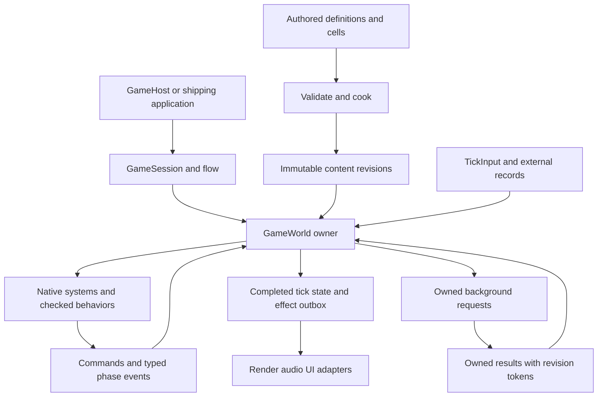
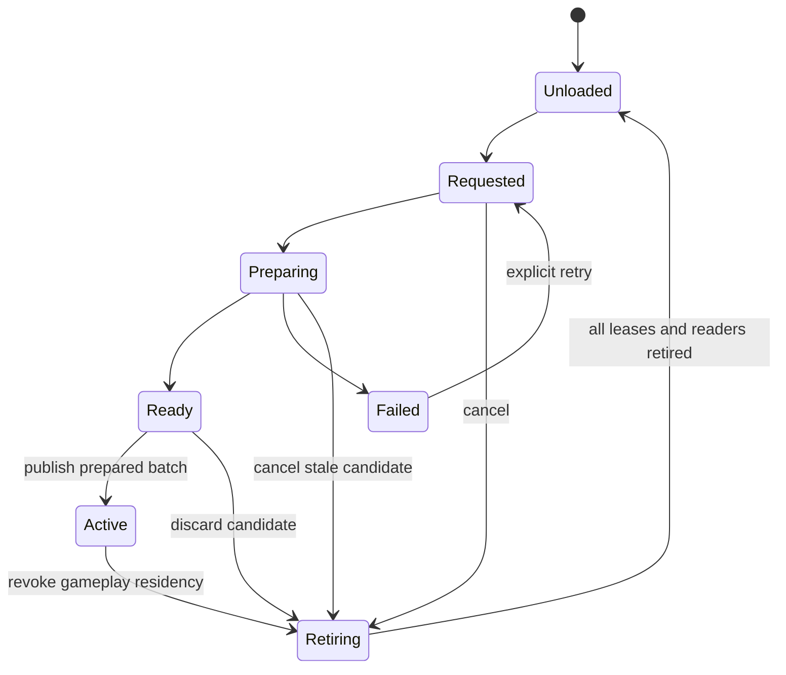
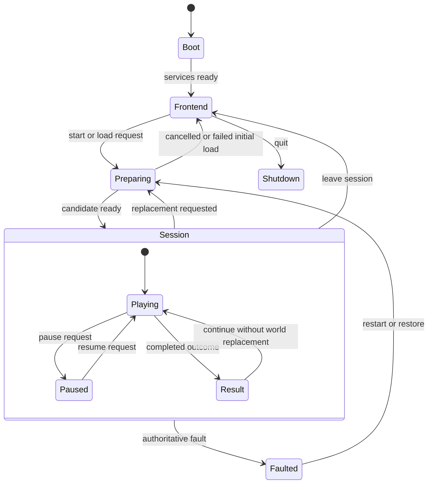

# Gameplay foundation architecture

Status: proposed extension of Ludus's implemented gameplay world baseline.
Baseline inspected at `ab49fe8` on October 11, 2026; scripting and resource
integration notes reconciled with `92f5726` before publication. This document specifies
architecture and acceptance criteria; it does not implement new runtime systems.
The [Gems review](gameplay-foundations-gems-review.md) records the initial design
and the refinements incorporated after consulting the local reading index.

## Recommendation

Use a game-owned, data-oriented world with immutable static cells, checked dynamic
entity identities, typed state stores, ordinary native systems, and an explicit
fixed-tick pipeline. Add a small session state machine above the world. Behaviors,
streaming, and background work enter through checked commands and publication
boundaries. Rendering, audio, and tools consume completed state and copied effects.

The central invariant is: **each mutable fact has one owner, each operation has a
declared visibility boundary, and every retained reference has a checked lifetime.**
This provides a small implementation for a room-based game and a growth path for
large worlds and agent populations. Optimize the workload's storage and algorithms
behind these contracts. A single universal object hierarchy or universal ECS
backend would impose costs on workloads that do not need it.

The target is native and browser gameplay, with headless simulation using the same
rules. Assume an action/adventure foundation with potentially many agents and
streamed regions. Physics, networking, rollback, modding, and offline world
simulation remain selected game features. Their requirements must be declared
rather than inferred from the presence of a fixed timestep.

## Existing facilities and scope

| Facility inspected | Baseline capability and subsequent integration | Consequence |
| --- | --- | --- |
| [GameplayWorld](../../modules/gameplay/world/README.md) | World/slot/generation identities, pending destruction, typed sparse pools, structural-phase checks | Extend these identities and storage contracts; keep the SDK module small. |
| [World demo](../../apps/world_demo/README.md) | Game-owned fixed ticks, static collision, candidate levels, commands, render extraction | Preserve this reference path as the serial correctness oracle. |
| [FoundationThreading](../../modules/foundation/threading/README.md) | Bounded sealed DAG, reusable submission, serial/native execution, lifetime fence | Use for measured batch computations. It currently admits one graph per JobSystem until Wait; it is not an asynchronous I/O runtime. |
| [GameApi](../../modules/runtime/game_api/include/ludus/runtime/game_api/api.h) and GameHost | Native gameplay authoring, explicit instance/checkpoint/candidate/edit lifecycle | Session extensions stay inside the module-owned instance; do not expand the ABI with live engine objects. |
| [Scripting architecture](scripting.md) | Native/Luau provider and focused visual authoring now have implemented S0–S5 slices; S6–S7 qualification remains in progress; C# is optional future work | Integrate the implemented shared behavior contracts and retain their platform, trust, and qualification limits. |
| [Content](content-resources.md) and [resource management](resource-management.md) | Native audio acquisition/catalog and Stage 1 audio integration boundary; shared coordinator and general streaming remain proposed | Build cell loading on shared acquisition and resident-version contracts; world cooking, cell residency, and navigation streaming require new slices. |
| [Networking](networking.md) | Protocol core; sessions, replication and prediction proposed | Reserve explicit command/state codecs without claiming multiplayer readiness. |

The existing [entity](entity-world.md), [tick](frame-update.md), and
[level](level-data.md) contracts remain the baseline. The larger-world facilities
here are opt-in extensions. This proposal does not change version 1 level files,
existing tick phases, browser worker support, or the public GameApi.

## Ownership and dependencies

`GameSession` owns the flow state, active/candidate worlds, clocks, input routing,
streaming coordinator, checkpoint operation, and presentation adapters.
`GameWorld` owns its registry, typed stores, static-cell membership, domain state,
RNG streams, timers, event buffers, commands, and runtime-to-persistent mappings.
CPU jobs own or borrow frozen inputs through an explicit fence. Content owners
retain immutable revisions. Render/audio owners retain their backend resources.
Tools read inspection snapshots and submit validated edits to the owner.

The existing GameApi Update still represents one host frame. A game adapter pumps
the session, executes its zero-or-more fixed ticks and returns completed
presentation values inside that callback. Tick policy does not require a new ABI
entrypoint. A headless runner invokes the same tick/domain functions without
presentation services.

Keep five dependency boundaries:

| Boundary | Permitted responsibility |
| --- | --- |
| Foundation | Types, containers, memory, math, time, jobs, logging and profiling; no gameplay vocabulary. |
| GameplayWorld | Identity and storage primitives; no script VM, renderer, platform, game flow, or universal game component roster. |
| Game-owned gameplay | Component types, definitions, systems, phase sequence, domain operations, persistence rules and agent policies. |
| Runtime composition | Session, provider selection, content/streaming coordination and adapters; depends on selected services. |
| Tools | Validation, cooking, debugging and authoring; Qt/VM compiler/backend headers remain private. |

Begin with game-owned `simulation/`, `world/`, `agents/`, `flow/`, `behaviors/`, and
`presentation/` directories in a reference game. Extract reusable modules only
when another consumer shares their semantics. A future `GameplaySimulation` or
`WorldStreaming` module is a candidate boundary, not a prerequisite for gameplay.
Use narrow status/identity headers, light typed views and implementation files;
avoid an umbrella gameplay header and reflection-driven automatic scheduling.

## Static world elements

Static content is immutable data indexed for its consumers. Terrain, walls,
foliage, render instances, static colliders, navigation tiles and visibility
proxies do not each require a dynamic entity. A cell contains typed arrays and
indices, plus bounds, dependencies, content digest and schema version.

| Data | Default layout and owner |
| --- | --- |
| Render instances | Spatially clustered instance records; renderer builds backend batches from immutable descriptions. |
| Static collision | Cooked primitives/mesh data and an immutable broadphase acceleration structure selected by the physics adapter. |
| Navigation | Independently referenced tiles and explicit cross-cell links. |
| Interaction locations | Small authored records for spawn points, reservations and triggers that have no mutable behavior yet. |
| Lighting/audio/visibility | Subsystem-specific immutable data sharing cell/content identity. |

Use a flat world catalog plus optional spatial cells. One entire room is one cell
in the first implementation. Authoring groups, transform relationships, spatial
indices and CPU dependencies are separate structures. An editor hierarchy is
not the runtime storage layout. Repeated recipes may be flattened at cook time;
start with bounded flat templates before adding nested override inheritance.

A static hit returns a checked cell/revision/element token and copied hit data.
It is valid only while that revision is resident. A durable interaction stores a
persistent authored ID and resolves it again. No callback retains an element
pointer after a cell or revision can retire.

An element needing mutable state becomes an entity or a typed mutable overlay.
A door normally starts as an entity; a destructible rock can start static and
promote on demand. Promotion prepares a complete recipe, reserves its capacity,
and atomically publishes both the dynamic instance and static suppression at
Commit. Failure leaves the static element intact. Save its tombstone/damage state
under the same persistent identity; reload cannot recreate the original rock
beside its dynamic replacement. Generated debris can use transient identities.

Use separate static and dynamic query structures, with one game-facing spatial
query facade returning tagged checked hits. Begin with scans for tiny worlds;
choose a grid for similarly sized moving agents or a BVH for heterogeneous static
bounds only after measuring query distributions. Cross-cell overlap must have one
logical owner even if several indices contain the same proxy.

## Dynamic object model and storage

An entity is identity plus capabilities and state. Keep the existing `EntityId`
fields: nonzero `uint64 World`, `uint32 Slot`, `uint32 Generation`. Validate full
identity in release builds. Exhausted generations retire their slots; identity
counters never wrap. Runtime entity IDs are distinct from persistent object IDs,
asset IDs, network IDs, request IDs and behavior instance IDs.

The current registry issuer is private to its linked runtime image. A retained
token crossing GameHost reload or a host-service boundary also carries the host's
session/module generation; an image-local World value alone cannot reject a
completion from an older loaded module. Keep raw entity handles inside the game
module's ABI boundary. A shared identity issuer requires a separate extension
only if independently linked modules must exchange live entity references.

`GameObject` may be an authoring/debugging facade around an entity and its recipe.
It owns no second copy of position, health or lifecycle. Runtime systems operate
on typed state. Composition describes capability; recipe kind only selects
construction. There is no mandatory per-object virtual Update or base class.

| State | Representation |
| --- | --- |
| Shared configuration | Typed definition ID into a pinned immutable revision: movement tuning, abilities, visual references. |
| Frequently changing state | Plain typed components: transforms, velocity, health, team, action state and revision counters. |
| Large or rare state | Checked handles into world-owned side stores; inventory, variable paths and behavior state are not owning pointers inside movable pool values. |
| Presentation history | Previous/current values and visual proxies owned under extraction lifetime rules. |
| Persistent identity | Explicit optional mapping for authored and persistent spawned objects. |

Start with current sparse pools and iterate the smallest relevant dense pool,
checking other capabilities through typed lookup. Components stay trivially
copyable/destructible. A game-owned compile-time store roster handles removal,
invariants, inspection and checkpoint participation; adding a store must update
that roster. Release a registry slot only after every store and side-store owner
has removed the entity. Side-store destruction uses explicit native cleanup.

The current ComponentPool reserves dense values and owners against the entire
registry limit, even for a rare component. For capacity N and component size S,
budget approximately N × (S + sizeof(EntityId) + sizeof(uint32)) per pool, plus
registry/container overhead. Across M pools this is O(MN) reserved memory.
Sparse sets are a simplicity baseline, not a guarantee of good large-world memory
usage. Inspect peak reservations before choosing global capacity.

For a homogeneous hot population, introduce a specialized dense `AgentTable`
with aligned columns or fixed bundles behind the same entity identity. Each field
has exactly one authoritative store; an entity-to-row mapping updates only at
structural boundaries. Do not maintain mutable duplicate Transform components.
Add occupancy-sized/paged sparse maps and separate dense capacities when measured
memory warrants a storage extension. Consider an established archetype ECS only
when measured multi-component joins and composition tooling justify the cost.

For infrequent expensive work, collect a compact work list with checked owner and
revision tokens instead of scanning every component again. Split hot/cold fields
according to actual kernel access; use AoS for fields consumed together and SoA
for independent column passes. Reorder persistent storage only at a legal
structural boundary. Measure gather/scatter and mapping cost as part of the whole
pipeline. Occasional random access can be the right tradeoff for clearer rules.
Thanks to Noel Llopis, *High-Performance Programming with Data-Oriented Design*,
Game Engine Gems 2, chapter 15, especially pp. 255-260, for the transformation and
conditional-work approach. [Review and departures](gameplay-foundations-gems-review.md#storage-and-data-transformation).

Epic's MassEntity provides a contemporary example of batched, data-only fragments
and deferred composition changes. It supports evaluating chunk storage for a hot
population; it does not establish that Ludus should replace its small sparse
baseline. [MassEntity overview](https://dev.epicgames.com/documentation/en-us/unreal-engine/overview-of-mass-entity-in-unreal-engine).

Borrowed pointers/views expire at their documented phase boundary, structural
mutation, store movement or replacement. Retain handles across suspension or
jobs. Pending destruction immediately removes gameplay activity; values remain
until Commit for already captured facts. Duplicate destruction is idempotent.
Spawn recording returns a request token; a complete entity publishes at Commit
and first simulates next tick. Same-tick hitscan is an explicit native query.

Transform parenting is optional and explicit. Validate acyclic parent links,
propagate in stable topological order, and define detach-on-unload behavior.
Physics-driven objects normally own world transforms; parented visual attachments
derive theirs. Choose coordinate precision for the actual world extent. Add
cell-local coordinates or origin rebasing only with physics/navigation/rendering
conversion tests and a recorded rebase boundary.

## Simulation and publication

Use the existing explicit call sequence. An ordinary function call reveals the
system running, its reads/writes, and the next breakpoint. Give each system a
short descriptor listing read stores, write stores, output buffers, phase and
execution mode. Start with compile-time/manual validation; a scheduler may later
check descriptors without discovering gameplay order from reflection.

| Boundary or phase | Work and visibility |
| --- | --- |
| Session boundary | Publish prepared whole-world replacements and ready cell batches between ticks; process pause/flow/reload policy. |
| BeginTick | Snapshot admitted external results and due wakes; clear consumed scratch; capture previous transforms after accepted discontinuities. |
| Intent | Capture sensing inputs; evaluate due agents and checked behaviors; resolve phase command batches; write movement/ability intent. |
| Motion and collision | Native movement, physics and contact production; no VM calls inside physics callbacks. |
| Gameplay consequences | Resolve damage, interaction, objective and behavior batches in specified order; stage effects and structural commands. |
| Commit | Preflight complete structural batch and required outbox capacity; publish with reserved non-failing operations. |
| EndTick | Publish successful tick index, canonical state/hash, trace and presentation effects. |
| Presentation | Extract/interpolate completed state, consume effects once, render/audio/UI through their owners. |

The 60 Hz reference policy remains selectable. Native interactive solo play can
use the existing bounded catch-up and counted debt discard. A dedicated server,
lockstep game or replay runs an explicit authoritative clock policy and cannot
silently discard required ticks. Browser callbacks return promptly and poll work.
Pause resets debt; step advances exactly one normal tick. UI/loading deadlines
use their own clocks; gameplay deadlines use checked tick arithmetic.

A failed authoritative phase stops the session in Faulted. The partial world is
inspectable, but its tick/effects are unpublished. Retain the last completed
presentation snapshot. Restart or restore before resuming. There is no implicit
whole-tick rollback. Invocation-local staging and candidate-world transactions
are narrower guarantees and must not be described as global rollback.

Presentation adapters consume copied values and immutable asset leases. Collision,
damage, ability timing and objectives do not depend on animation frame or GPU
visibility. Animation events that influence gameplay require an explicit native
timeline and phase contract. A skipped render frame cannot drop a required
simulation event or repeat an already delivered sound.

## Real time agent simulation

Separate sensing, decision, action execution, locomotion and representation.
Agents are data processed in batches; waiting actions retain explicit state and
wake conditions. Workers perform computations, never wait for an agent cooldown.

| Stage | Contract |
| --- | --- |
| Sensing | Read a declared phase snapshot/spatial index; bounded candidates, stable nearest/tie policy, validated perception results. |
| Decision | Evaluate due/dirty agents; choose one action using a small FSM first, optional utility selector for competing goals. |
| Action | Record phase, target, wake tick, revision and request token; bounded steps return Running, Succeeded, Failed or Cancelled. |
| Locomotion | Every active full-simulation tick consumes last valid intent and performs steering/motion under the physics contract. |
| Representation | Independent visual/audio detail; culled rendering does not imply suspended authoritative behavior. |

Urgent validity/death/cancellation checks run every full-simulation tick. Schedule
expensive decisions with a positive period and stable per-agent offset, and wake
on relevant signals. A dirty bit may coalesce "recompute perception"; it cannot
coalesce damage or required counted events. Keep indexed wake lists when sleeping
populations become large. Coalesce repeated path requests by destination revision.

Perception produces evidence, not privileged knowledge of the entire world. A
bounded knowledge record identifies the subject, last sensed position/tick,
sense provenance, confidence and expiry. Behavior reads this record and validates
live targets before effects. Use authored acquisition/loss thresholds and memory
decay so boundary flicker does not restart an action every tick. A sound stimulus
can persist after its emitter is destroyed. Sense fusion is a gameplay rule;
confidence scores are not automatically calibrated probabilities, and correlated
evidence must not be naively counted twice. Thanks to Steve Rabin and Michael
Delp, *Designing a Realistic and Unified Agent-Sensing Model*, Game Programming
Gems 7, 3.2, pp. 226-228. [Review](gameplay-foundations-gems-review.md#agent-work-and-believable-detail).

Share expensive environmental results only with an explicit cache key: query
parameters, spatial/nav revision, relevant team/capability and freshness tick.
Group movement can share a coarse corridor while agents retain their own local
avoidance and validity checks. A squad coordinator owns role assignments when
the game needs coordination. Avoid per-agent scans for facts already maintained
by contact, objective or spatial owners. Thanks to Steve Rabin, *Strategies for
Optimizing AI*, Game Programming Gems 2, 3.1, pp. 251-257, for event-driven work,
shared queries and incremental bookkeeping. [Review](gameplay-foundations-gems-review.md#agent-work-and-believable-detail).

Begin with Full and Dormant policies. Add Reduced and Abstract simulation only
for a game's actual population requirement. Full agents run motion/contact every
tick; Reduced can run decisions less often while retaining required motion.
Dormant agents have explicit wake conditions. Abstract agents use a declared
coarse model and persistent records rather than stale physical bodies. Promotion
materializes valid full state, rebases transform history and prevents duplicate
rewards/spawns. Never integrate a long sleep using one enormous physics delta.

Abstract simulation requires explicit `CompressAction` and `ExpandAction` policies,
not just a slower update rate. A coarse task stores its start tick, planned finish,
inputs, committed progress and completion token. On promotion revoke its scheduled
coarse completion before reconstructing detailed progress; on demotion settle
declared partial effects and replace detailed work with one coarse continuation.
Keep counts, inventory, unique-object ownership, deaths and objective outcomes
conserved. Decorative positions may be reconstructed by a seeded authored rule.
Interacting tasks that share a reservation/resource transition as one bounded
consistency group. If conversion is undefined or too costly, retain Full or
Dormant simulation. Cap detail-propagation and promotion work; delay optional
promotion or hold entry until required state is ready. Thanks to Cyril Brom,
Tomáš Poch and Ondřej Šerý, *AI Level of Detail for Really Large Worlds*, Game
Programming Gems 8, 3.1, especially pp. 220-230.
[Review and departures](gameplay-foundations-gems-review.md#agent-work-and-believable-detail).

Select simulation relevance from authoritative gameplay sources, with hysteresis
and explicit always-active classes. Do not derive server combat behavior from a
client camera. Change tiers at a tick boundary and record the policy/changes needed
for replay. Wall-clock CPU timing reports cost; it does not select which agents
receive an authoritative update. Fixed work units per tick support incremental
search. Unexpected load reduces optional presentation or invokes an explicit
overload policy instead of silently omitting gameplay.

Epic separates representation, simulation and replication LOD, and exposes
signals that wake StateTree work. Those are useful contemporary reference
boundaries; the exact cadence and promotion semantics above are Ludus policies.
[MassGameplay overview](https://dev.epicgames.com/documentation/en-us/unreal-engine/overview-of-mass-gameplay-in-unreal-engine).

For contested interactions, gather proposals from the same declared view, then
reduce by authored priority and stable entity/persistent key. Native reservation
operations own capacity, expiry and cancellation for seats, cover or interaction
slots. This avoids a storage-order advantage and prevents two agents claiming
the same slot. Path requests carry world/cell/nav revision and action revision;
stale completions release their storage without changing intent.

Small named FSMs are the default behavior representation. Introduce hierarchy
when several states genuinely share transitions; behavior trees/utility/GOAP are
optional selectors feeding the same action API. A state-machine authoring tool
does not justify a new general VM. [Epic StateTree](https://dev.epicgames.com/documentation/en-us/unreal-engine/overview-of-state-tree-in-unreal-engine)
is a useful comparison for hierarchy and on-demand selection.

## Calls commands events and asynchronous results

| Mechanism | Use | Timing and failure |
| --- | --- | --- |
| Direct typed call | Query or bounded domain operation within its owning phase | Immediate explicit result; preserves combined invariants. |
| Command | Request mutation across an ownership/phase boundary | Own payload, checked target, request token, declared application phase and outcome. |
| Event | Fact already resolved, consumed by known domain subscribers | Typed immutable record with tick/phase/producer sequence; fixed captured batch. |
| Signal | Coalescible invalidation/wake notification | Explicitly lossy/coalescible by meaning; no counted gameplay payload. |
| Completion | Result from external or background work | Owned data, status, request/revision identity and admitted application tick. |
| Presentation request | Sound, particle or visual/UI transient | Publish only from completed ticks; separate delivery cursor and overflow policy. |

Use typed per-domain buffers and explicit consumer calls. A bounded addressed
mailbox is useful for agents/behaviors; an engine-global string event bus would
hide dependencies and timing. Registration is data owned by a scope. Escaped
subscription tokens are generation checked and detach on entity/cell/program
retirement. Callbacks cannot retain component pointers or obsolete code pointers.

At dispatch, capture eligible subscription tokens. Removal invalidates a token
immediately, suppressing an undelivered callback in that batch; addition becomes
eligible at the next capture. Registration changes cannot invalidate the borrowed
dispatch list. A listener joining late gets an explicit current-state snapshot
when its protocol needs one. It cannot rely on having observed every past event.

Every queued protocol declares source, destination, payload schema, capacity,
ordering, capture point, delivery point and cancellation policy. Events emitted
during dispatch enter a separate later-phase buffer or next tick. No recursive
drain-until-empty loop. Same-tick contacts are consumed in Gameplay; Commit spawn
outcomes are consumed at next BeginTick. An event about destruction copies useful
facts; consuming it does not require resurrecting removed state.

External callbacks do only bounded capture/ownership transfer and return. They
enqueue typed records for the owning service; they never invoke gameplay, VM
handlers or FSM transitions on an I/O thread. Thanks to Mark Jawad, *Deferred
Function Call Invocation System*, Game Programming Gems 7, 1.8, pp. 81-85, for
separating notification from later processing and owning deferred arguments.
Ludus uses typed handlers/records instead of ABI-specific assembly invocation.
[Review](gameplay-foundations-gems-review.md#messages-callbacks-and-owner-boundaries).

Serial producer sequence is explicit. Parallel producers record preassigned
system/operation ordinals and stable source/target identities, then merge by the
protocol's total semantic key. Range IDs identify output storage, not gameplay
priority: repartitioning work or changing worker count must not change outcomes.
Worker arrival and atomic append order cannot determine damage or reservation
priority. Use creation/persistent keys when runtime slots or dense order are
incidental. Define subscriber rank when its order changes outcomes; preserve this
rank across native/Luau/optional managed providers.

Authoritative queue exhaustion rejects admission or faults according to the
protocol. Pre-reserve eventual completion capacity per admitted request.
Presentation can drop selected cosmetic effects with a counter. Required flow
transitions live in session state and cannot vanish in a cosmetic queue.
Timer due batches sort by deadline/sequence; revalidate cancellation at delivery.
World replacement invalidates old requests before reclaiming acknowledged work.

Addressed messaging does not imply an independently scheduled actor for every
entity. Keep phase-local reads synchronous against the declared view, and batch
messages by domain. Cross-owner requests carry a correlation token and resume at
a declared boundary; the simulation never blocks on a promise for another object.
Thanks to Robert Jay Gould, *Creating a Multi-Threaded Actor-Based Architecture
Using Intel® Threading Building Blocks*, Game Programming Gems 8, 4.13,
pp. 473-484, for exposing query and message-order tradeoffs.
[Review and departures](gameplay-foundations-gems-review.md#messages-callbacks-and-owner-boundaries).

## World loading and streaming

Share validation/cooking and runtime interpretation. Editable sources carry stable
IDs and typed recipes; runtime packages carry fixed-width schemas, digests, bounds,
dependencies and typed arrays. Validate offsets, sizes, arithmetic, capabilities,
required references and supported schema before creating a candidate. Never treat
serialized runtime handles or arbitrary C++ memory images as valid content.

Cook coherent dependency groups and derived spatial/behavior data offline, with
an inspectable manifest mapping source IDs to packed sections. Package sections
use explicit byte order, fixed-width offsets/counts, alignment and schema/digest
checks. Decode into runtime values or use validated byte views; do not cast
untrusted bytes to live C++ objects. Resolve external references symbolically.
Measure bytes read, validation, decode and activation separately. Thanks to Jason
Hughes, *Pointer Patching Assets*, Game Engine Gems 2, chapter 20, pp. 347-351,
for moving preparation/dependency work offline. Native object/vtable memory images
and raw pointer patching are outside this portable default.
[Review](gameplay-foundations-gems-review.md#streaming-and-cooked-data).

Whole-world loading keeps the existing prepare/validate/publish/retire transaction.
Failures preserve the active world and input/flow state. Cell streaming extends
this pattern with independently prepared cell batches in the same world identity.
It does not create a new world for each nearby cell or invalidate unrelated entities.

The streaming owner tracks desired residency separately from observed lifecycle.
Requests have world, cell, content revision and request generation. A late result
cannot reactivate a cancelled/replaced request. Distinguish Loaded from Active:
resident render data alone is not sufficient to activate gameplay. Required
collision, navigation, spawn recipes and assets must be ready for the activation
unit. Optional visual detail may arrive later.

Use streaming sources for players, predicted travel corridors, teleports and
explicit mission pins. Add load/unload hysteresis and stable priorities. Bound
I/O in flight, decode scratch, upload queues, resident bytes, preparation work,
activation counts and retiring revisions. Prioritize required gameplay cells
over distant detail. A teleport preloads and validates its destination before
moving the player. Missing collision blocks entry or enters a loading state; it
does not permit walking into an unfinished world.

Rank speculative work by time until needed and dependency criticality. A useful
initial metric is `Slack = EarliestUseTime - EstimatedRemainingLoadTime`, where
the estimate includes source read, decode, resource preparation and activation.
Calibrate its conservative margin with measured tail latency. Within urgency
classes use stable cell/request keys. Actual I/O timing still remains external
input. Reprioritize outstanding work when travel direction, speed or a mission
pin changes; deduplicate shared artifacts and requests. Track residency reasons
such as player, mission, dependency, simulation and retirement so removing one
source cannot evict data another owner needs. Estimate gameplay arrival from
possible authoritative movement; camera direction only ranks optional visuals.
Thanks to Kevin Kaichuan He, *Introduction to 3D Streaming Technology in Massively
Multiplayer Online Games*, Game Programming Gems 8, 5.4, especially pp. 525-536.
The deadline metric and lease policy are Ludus adaptations.
[Review](gameplay-foundations-gems-review.md#streaming-and-cooked-data).

Epic's World Partition demonstrates spatial streaming sources, distinct loaded
and activated targets, and destination preloading. Ludus should adapt these
concepts to its own content/owner boundaries. [World Partition](https://dev.epicgames.com/documentation/unreal-engine/world-partition-in-unreal-engine).

Preparation may allocate and run incrementally/asynchronously. Publication must
be bounded and allocation free after preflight. Start with activation between
ticks while rendering/loading UI remains responsive. A large cell that cannot
publish within budget must be partitioned into separately valid activation units;
partially visible entity bundles are not an acceptable time-slicing strategy.

Cross-cell references are logical IDs with an explicit policy: RequiredResident,
OptionalResident, or PersistentRecord. Required references pin a bounded dependency
group; cycles collapse into one activation group at cook time and its total cost
is checked. Optional lookups return Unloaded rather than a dangling pointer.
Persistent lookups address saved simulation records without implicitly loading
the target cell. Rebinding after residency changes uses validated mappings.

References that only need a persistent record must not join a residency group.
Report a dependency group's complete activation/memory cost at cook time so an
innocent quest reference cannot pin most of the map. A cell instance also has its
own checked residency generation; unload/reload rejects old static-hit tokens
even when content bytes and the containing world identity remain identical.

A mobile agent belongs to the world; cell residency is its current spatial
membership, not its permanent allocation owner. On unloading its region, migrate
it, pin the required region, or serialize/deactivate it by an explicit policy.
Persistent mission actors cannot disappear merely because their birth cell
unloads. Despawned cell instances get fresh runtime generations on rematerialization.

Deactivation removes gameplay query participation at a publication boundary,
checkpoints persistent deltas, revokes callbacks/requests, and schedules entity
removal. Backing bytes remain until jobs, presentation snapshots, audio playback
and GPU work release their leases/fences. Cancellation does not prove completion.
Shutdown drains owned services; callbacks never retain a destroyed session pointer.

I/O and browser fetch readiness are nondeterministic. Record admitted activation
and completion boundaries for same-build replay. Lockstep requires agreed barriers
or preloaded content. Rollback requires cell revisions/state retained for its
history window; it is a separate memory/physics feature. A local loading timeout
uses real time but never secretly changes simulation deadlines.

## Scripting integration

Preserve the [existing scripting design](scripting.md). Bulk entity iteration,
locomotion, collision, navigation and reductions remain native. Small encounter,
interaction, ability and objective behaviors use native authoring or a selected
validated provider. Unselected runtimes add no dependency to a C++/data game.

Behavior instances bind to checked entities and immutable program revisions.
They own explicit schema state, continuation records, subscriptions and request
tokens. Invocation receives the declared phase view and stages its state/RNG,
native operation commands and effects. Validate/reserve before publication.
Apply accepted nonstructural batches at the declared phase point; structural
effects use Commit. Native domain operations enforce atomic rules such as
consume-key-and-unlock. A queued operation's admission is not its application.

Waits use tick deadlines or addressed events/results. Keep transient VM stacks
separate from durable continuations; no borrowed view crosses a yield. Native
cleanup revokes reservations/requests/subscriptions even if script cleanup fails.
Reload stages program/state migrations and retires old execution generations;
cell unload cannot free code while a callback still executes.

Keep language exceptions inside approved provider boundaries; engine signatures
remain `noexcept` and status based. The Luau longjmp/trampoline feasibility and
debugger gates in the scripting proposal still apply. Add world/cell/execution
revision tokens through generated facades rather than exposing engine pointers.

## Interactions objectives and trigger authoring

Keep objective state in one typed domain owner. Encounters, quests and object
interactions reference it through checked operations; they do not each maintain
a second authoritative copy. A simple condition/action document can be a focused
front end to the existing behavior/operation schemas, without adding another VM.

Each trigger has an owning scope, stable ID, immutable conditions/actions and
declared runtime state. Conditions distinguish live state, a fact in the current
batch, and a latched historical fact such as VisitedArea. InsideArea uses current
occupancy; it cannot stay true indefinitely because an enter event was latched.
Counters retain every counted event and cannot be represented by a dirty bit.
Named flags/counters resolve to schema IDs during validation, with explicit types
and bounds, rather than creating string-keyed state during a tick.

Update event latches/counters before evaluating the pure condition expression.
Only those pure reads may short-circuit; short-circuiting must not drop a state
update carried by the right-hand branch. Evaluate on relevant events/dirty inputs
or a specified polling cadence for conditions lacking notifications. A spatial
trigger subscribes to relevant cells/entities rather than inspecting every object.
Compile bounded Boolean expressions into inspectable descriptors or the selected
behavior provider; arbitrary control flow remains authored text.

Define one-shot, edge-triggered and repeating modes explicitly. A trigger that
issues a deferred authoritative action enters Pending with its command token;
only its documented application outcome marks it Fired or eligible to retry.
Recurring actions use tick deadlines and reset rules. Side effects are native
domain commands with reserved capacity, not arbitrary setters or callbacks.
Persistent trigger state survives residency changes when its objective requires
it. Unload cancels cell-scoped triggers and leaves persistent objectives intact.

Thanks to Steve Rabin, *An Extensible Trigger System for AI Agents, Objects, and
Quests*, Game Programming Gems 3, 3.5, pp. 285-293, for scoped conditions,
responses, event/poll combinations and rearm semantics. Explicit live-versus-latch
meaning, staged outcomes and generated schemas refine the historical design.
[Review](gameplay-foundations-gems-review.md#flow-and-trigger-semantics).

## Session flow and hierarchical state machines

The game owns one small session controller. Game modes, menus, world preparation,
pause, win/loss and fault recovery have explicit transitions. World state records
the outcome; the session observes it at a completed boundary and chooses the next
flow action. A rendering callback cannot become the owner of game progression.

This diagram describes the game flow template; it is not a new engine-global FSM.
During replacement preparation retain the previous session snapshot and its
return state. A failed candidate resumes the retained session according to the
declared transition policy. For a seamless cell load, Playing continues and the
streaming operation is not a session transition.

Use typed transition requests, a table of guards/targets, and bounded entry/exit
actions. At each flow boundary capture the request batch, select at most one
transition by explicit priority then sequence, exit leaf-to-common-ancestor and
enter ancestor-to-leaf. Self transition has an explicit no-op or restart meaning.
Requests raised by entry/exit are eligible at the next boundary. Guards read
state and cannot perform resource loading or gameplay mutations.

Preflight the transition plan and reserve any owned request/notification slots
before exiting the old state. A preparation failure leaves that state active.
After preflight, cleanup and plan publication cannot allocate or fail under the
validated invariants. Long-operation failure is a typed result handled from its
waiting state. An unexpected invariant failure enters Faulted rather than
pretending an already executed exit can be rolled back. A Shutdown request has
explicit precedence and can be issued from every flow state.

Represent the resulting flow policy as one small snapshot: simulation mode,
input route, presentation scene/overlay, and audio policy. Core adapters apply it
at the owner boundary. Optional tools/UI observe `FlowChanged` afterward, with
an initial snapshot and scoped subscription tokens. Notification callbacks may
request a future transition, but cannot execute it recursively. This removes
scattered pause/menu flags without a global state singleton or per-object polling.
Thanks to Ron Barbosa, *The Game State Observer Pattern*, Game Engine Gems 1,
chapter 26, pp. 415-431, and Charles Farris, *Function Pointer-Based, Embedded
Finite-State Machines*, Game Programming Gems 3, 3.3, pp. 256-267, for explicit
state propagation and deferred begin/end hooks.
[Review and departures](gameplay-foundations-gems-review.md#flow-and-trigger-semantics).

Long operations expose a request token/progress/result and return immediately;
they do not block inside Enter. State exit cancels its owned scope once. There is
no recursive transition loop, arbitrary parallel state regions or universal state
event interpreter in the first implementation. Keep UI focus/overlay state and
streaming request lifecycle separate from the session FSM so their combinations
do not multiply session states. Network multiplayer pause is a selected local/UI
policy rather than a global authoritative pause.

Reuse named transition/action concepts for agents and visual authoring where
useful, but session and agent machines retain their distinct ownership and time
semantics. Start with ordinary C++ enums/tables and debugger-visible records.

## Minimal integration surface and a complete interaction

These are proposed game-owned responsibilities, not declarations of existing SDK
APIs. Keep each interface typed and implement it with ordinary functions first.

| Responsibility | Required contract |
| --- | --- |
| Spawn/Destroy/ChangeBundle | Owned recipe/target; reserved command token; complete preflight; Commit outcome; full store-roster cleanup. |
| Query/DomainOperation | Declared phase view/capabilities; checked references; explicit result; combined invariants such as spend-and-unlock. |
| Publish/Subscribe | Typed event and scope; stable capture/delivery; bounded payload; checked subscription generation. |
| StartAction/CancelAction/Wake | Explicit state/revision; bounded step; native cleanup; tick/event/result wake token. |
| RequestCell/ReleaseResidency | Desired state plus reason; generation/revision; progress/result; safe publication and leased retirement. |
| RequestFlowTransition | Typed request/guard/priority; preflight plan; at most one transition per boundary. |
| Extract/Inspect/Checkpoint | Completed boundary; copied values and retained revisions; no mutable borrowing across ownership. |

For example, a locked door guards entry to cell B. Its definition names B and an
unlock rule; its entity owns Locked/Open state, collision capability and a
persistent object ID. Cell B's static terrain needs no door-like object wrapper.

1. Approach starts a destination residency request. Streaming prepares B and its
   required dependencies without mutating the active world.
2. At a session boundary, a validated batch activates B. If it fails, the door
   remains closed and the loading/interaction owner reports the reason.
3. Motion in tick N generates a copied interaction fact. Gameplay dispatches a
   captured batch; the encounter behavior proposes UnlockWithKey.
4. The native door operation checks live identity, key ownership, door revision
   and destination readiness together. Failure consumes no key. Applied success
   consumes the key and opens the door once, then reports the command outcome.
5. A named later Gameplay subpass consumes DoorOpened. The objective updates
   once; the trigger leaves Pending only through its declared outcome. A sound
   request carries a copied anchor and an immutable asset reference.
6. Commit applies any structural changes; EndTick publishes state and effects.
   The next Motion tick sees the opened door. A navigation request against the
   old door/nav revision is rejected when it completes.
7. Presentation plays the sound once even if rendering skips a frame. The flow
   owner observes any completed victory outcome at its next boundary. A save
   stores door/objective deltas under persistent IDs.

Debugging this interaction follows one causal chain: residency request →
interaction fact → command token → native result → objective/effect → completed
tick. The inspector exposes the key guard or residency dependency that prevented
progress. Designer edits change the definition/condition; native rule changes
change one domain operation. Neither requires tracing an engine-wide event bus.

## Persistence networking and replay

Define an explicit persistent object ID for each authored or retained spawned
object, plus versioned definition references. Authored IDs are stable under cell
repartitioning; moving an object does not change its identity. Persistent spawns
use an authority-owned namespace/counter whose next value is checkpointed and
checked for exhaustion. Restore/reload never reuses an identity for a different
object. Restoring an older checkpoint preserves existing IDs and uses a fresh
spawn namespace or a retained monotonic issuer for new branches of play.
A save contains a content manifest, schema versions, world/session domain state,
object deltas/tombstones, RNG streams,
timers and supported durable behavior continuations. Persist remaining durations
or a defined saved tick epoch. Never serialize component addresses, runtime world
IDs, live requests, backend objects, locks or provider stacks.

Checkpoint from a completed boundary into owned bytes. Validate/migrate/load a
candidate before replacing the active world. Save writing publishes a complete
file atomically with conflict/digest checks; background writing does not borrow
mutable world data. Missing required content fails explicitly; optional content
uses an authored fallback. The existing GameApi checkpoint envelope bounds the
native reload path; large campaign saves need a separately versioned format and
limits rather than quietly expanding that ABI contract.

Networking maps session-scoped network identity onto runtime entities and
replicates selected state/commands through the networking design. Local events
are not automatically RPCs. Relevance, simulation detail and visual detail have
different policies. Validate remote commands at the native domain boundary.

Same-build replay records configuration/build/content revisions, initial state
and seed, per-tick input, admitted external results, residency/tier changes and
canonical checkpoints/hashes. Normalize runtime identities through persistent
keys or recorded creation sequences. Stable queue order plus fixed ticks does
not establish cross-platform bit-exact physics. Replay and rollback have distinct
acceptance and storage requirements.

## Debugging performance and acceptance

The minimal debugger is pause, single tick, serial execution, entity inspection,
phase timings and a bounded causal trace. Inspector output joins persistent ID,
runtime ID, cell residency, recipe/revision, components, action state, next wake,
requests and owner. It reports why an operation was rejected and why an agent is
idle. Debug edits enter the same checked prepare/apply path as gameplay operations.

Trace tick, phase, producer/consumer, command/event/request token, target,
definition revision, flow transition and publication outcome. Bound retention;
drop diagnostic records with counts without breaking gameplay. Expose queue and
pool occupancy, allocations, stale-result rejection, cell bytes by lifecycle,
activation cost, pending retirement bytes, per-tier agent work and search units.
Inspect completed snapshots from tools, not concurrently mutable stores.

Optimize in this order: eliminate needless work, improve algorithms/spatial
queries, batch and improve layout, reduce meaningful update frequency, then
parallelize measured independent ranges. Keep native kernels executable serially.
Jobs use frozen inputs/exclusive output, a lifetime fence, stable reductions and
explicit failure policy. The current serial JobSystem Submit runs synchronously;
it cannot hide a long computation from the browser event loop. Browser workloads
must be bounded/incremental until a separately validated worker path exists.

| Decision | Measure before extending |
| --- | --- |
| Sparse pools versus dense bundles/archetypes | Memory reservation, occupied bytes, join cost, structural churn, code size and edit/debug cost. |
| Spatial grid/BVH | Candidate counts, query cost, rebuild/update cost and worst density. |
| Timer scan/heap/wheel | Sleeper count, wake distribution, cancellation frequency and worst due batch. |
| Serial versus jobs | Whole tick p50/p95/p99/worst, dispatch/fence cost, critical path and worker utilization. |
| Agent cadence/detail | Behavioral correctness, work per tier, response latency and promotion bursts. |
| Cell layout | Resident/preparing/retiring peak bytes, I/O/decode/upload latency and activation spikes. |

Use named target machines and optimized builds. A 60 Hz game has about 16.67 ms
for its simulation period; assign its actual gameplay/physics/other CPU budgets
before making capacity claims. Initial fixtures should include a small encounter,
a dense-agent scene, mass destruction, event bursts, fast traversal and teleport
with failed I/O. Counts are workload inputs, not promised engine capacities.
Reserve hot buffers during preparation; successful steady ticks allocate zero
within the defined workload. Include staging plus old revisions in peak memory.

An initial scale experiment can use 100, 1,000 and 10,000 active agents; a separate
10,000-sleeper case; 100,000 static instances; and a 1,000-operation burst. Run
each independently before combining them with traversal/streaming. Sweep density,
component occupancy, wake distribution and decision period rather than measuring
one favorable scene. Add worker-count/partition sweeps that preserve per-tick
canonical outcomes. These synthetic inputs locate growth limits and do not define
the first game's minimum requirements or establish AAA-scale readiness.

| Stage | Deliverable and exit criteria |
| --- | --- |
| G0 | Preserve existing world demo; document store roster, phase descriptors and completed-state inspection. |
| G1 | Typed addressed messages, cancellation scopes and minimal session FSM; prove ordering, queue bounds, pause/step and failed replacement behavior. |
| G2 | Native agent actions, reservations, cadence and indexed wakeup; run the same scenario at varied presentation rates and serial execution. |
| G3 | Two streamable cells with dependency validation, persistent references and safe unload; test teleport, late completion, migration and retained render/job leases. |
| G4 | Native/provider behavior integration using the existing scripting stages; prove command outcomes, fault containment, cancellation and generation retirement. |
| G5 | Measured storage/parallel/detail extension for a named game workload; publish before/after latency, peak memory and semantic equivalence. |

Keep each stage independently useful; streaming or a VM is not required for G1.
Acceptance covers stale/cross-world handles; omitted store cleanup; partial recipe
failure; promotion duplication; equal-time wake order; cancellation after capture;
recursive publication; multiple ticks without rendering; subscriber removal;
parallel merge order; simultaneous reservations; stalled navigation; tier
promotion; unload/save races; reference cycles; activation preflight failure;
late I/O after cancel/reload; retained resource leases; FSM entry failure; and
save/replay identity rebinding. Use fault injection and invariant/property tests
where they expose failures that example tests miss.

The post-review regressions also cover counted facts under Boolean short-circuit,
latched versus live trigger state, rearm after rejected application, late observer
registration, removal during dispatch, duplicate coarse completions, conserved
inventory across detail changes, changed travel priority and dependency-group
memory explosions. These are required before enabling their respective extensions.

Implementation must follow AGENTS.md: C++23, Ludus fixed-width aliases, explicit
fallible allocation/statuses, exception-free engine code and infrastructure
`noexcept`, explicit includes, small public headers, dependency direction, and
reference comments near informed code. Run warning-clean native tests, ASan/UBSan,
pinned format/tidy, header/build-budget/SDK gates and relevant browser acceptance.
This documentation change requires document/link/diff checks and does not prove
runtime feasibility or benchmark results.

## References

Existing Ludus design documents above establish implementation contracts. Modern
primary references are linked at the affected sections. Architecture policies,
budgets, storage choices and delivery stages here are Ludus engineering judgments.
The [Gems review](gameplay-foundations-gems-review.md) records selected passages
from eleven chapters, exact authors/titles/pages, adopted ideas, rejected machinery
and the changes from the initial proposal. It supplements the existing
[world review](game-world-gems-review.md) and [scripting review](scripting-gems-review.md).
Those earlier reviews inform the preserved baseline; they are not presented as
fresh readings here. Source ideas must also receive concise attribution comments
when the affected code is implemented.
