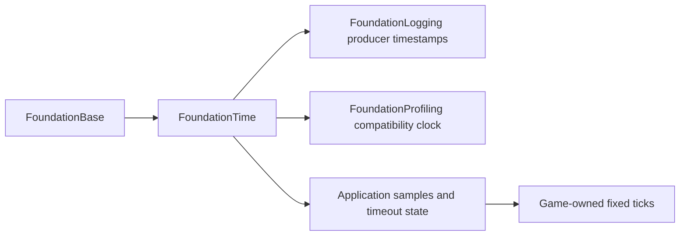

# High-resolution time

Status: FoundationTime implementation slice, frame integration, the integer
simulation driver, native frame pacing, runtime timing telemetry and the editor
Timing view implemented; the scheduling queue below is proposed. Reviewed
October 4, 2026; frame integration October 15, 2026; integer simulation driver
and native frame pacing October 16, 2026; inspection October 17, 2026. See
[ADR 0017](../decisions/0017-foundation-time.md).

## Goals and independent baseline

Time should be precise at long uptime, inexpensive to read, and easy to inspect.
The implementation should have ordinary value ownership, explicit failure and
small public headers. The initial design, written before reviewing the catalog,
selected a shared monotonic source, distinct integer timestamps and durations,
checked arithmetic, owner-local elapsed-time state and explicit frame samples.
The article review below strengthened frame sampling and future scheduling
contracts without changing that baseline's backend or dependency direction.

Keep these domains separate:

| Domain | Representation and owner | Meaning |
| --- | --- | --- |
| CPU measurement and real-time timeout | FoundationTime `Timestamp`/`Duration` | A monotonic interval within this process/domain. |
| Simulation | Game-owned `uint64` completed tick and tick rate | Authoritative gameplay, pause, single step and replay. |
| Frame/presentation | Application-owned `FrameClock` and copied `FrameSample` | Once-per-frame accepted delta and discarded stall time. |
| UTC | Logging's private system-clock anchor | Human-readable labels; never deadline arithmetic. |
| Audio | Device/sample position | Audio scheduling follows the device timeline. |
| GPU | RHI query and explicit CPU/GPU calibration | CPU clock reads cannot substitute for GPU elapsed time. |
| Network | Protocol-owned synchronized/estimated clock | Never compare another machine's CPU timestamp directly. |

## One clock and small value types

`Ludus::FoundationTime` depends only on FoundationBase. Base does not depend on
Time. Logging links Time privately; Profiling uses it for its existing timestamp
entry point. Installed SDK metadata registers FoundationTime. `core.h` remains
unchanged: a consumer explicitly includes Time when naming its vocabulary.

Arrows show dependency availability, not execution order. The public `time.hpp`
and `timers.hpp` contain only aliases, plain values, declarations and small
non-template accessors. Platform headers and `<chrono>` stay in `.cpp` files.
Everything is `noexcept`; failures return `TimeStatus`. There is no allocator,
registry, service initialization/shutdown, virtual dispatch, clock override,
calibration thread, engine lock or shared mutable timer state.

Native `NowTicks()` uses `std::chrono::steady_clock` converted to integer
nanoseconds, preserving the existing profiling/logging epoch. The
[C++ steady-clock contract](https://eel.is/c++draft/time.clock.steady) requires a
steady, non-decreasing source. The pinned Linux standard library delegates to
the OS monotonic clock. Retain this proven backend until a representative profile
shows that clock reads materially limit performance. Windows/macOS-specific
backends are future supported-platform work, not validated by this Linux PR.
Microsoft recommends [QPC rather than direct TSC reads](https://learn.microsoft.com/en-us/windows/win32/sysinfo/acquiring-high-resolution-time-stamps)
and documents cross-thread tick uncertainty, frequency stability and integer
conversion hazards. Do not add raw TSC, frequency polling, core affinity or a
global atomic clamp to this architecture without measured evidence and a complete
migration/ordering contract. A clock timestamp is not a synchronization primitive;
use sequence numbers and actual happens-before edges for causal event order.

Browser `NowTicks()` preserves `emscripten_get_now()` from the pinned 4.0.23 SDK.
Its main-thread implementation uses `performance.now()`; integer conversion
cannot recover precision removed by browser privacy settings. Verified against
`src/lib/libcore.js` in the local SDK and the
[Emscripten API](https://emscripten.org/docs/api_reference/emscripten.h.html#c.emscripten_get_now).
Nanoseconds are the storage unit, not a claim of nanosecond resolution or read
latency. This slice targets the current main-thread browser engine. AudioWorklet,
separate worker origins, pthread synchronization and GPU/audio clocks require
separate contracts before expanding support.

`Timestamp` and `Duration` each hold one `uint64 Nanoseconds`, with no implicit
conversion between them. `TryElapsed(start, end, out)` subtracts integers before
`ToSeconds(interval)` converts the small result to `float64`. No API converts an
absolute timestamp to floating seconds. `TryAdd` and `TryElapsed` use
FoundationBase's opt-in checked integer helpers. `TryAdd` rejects overflow;
reversed samples return `ClockRegression`. Failed operations leave outputs unchanged;
zero is an ordinary timestamp/interval, never a sentinel. Unsigned intervals do
not model negative offsets. UTC anchoring uses its own signed private delta.

The representation can hold about 584 years of nanoseconds, but this is not a
backend-uptime guarantee: native signed durations may have a smaller range. Do
not persist clock epochs across sessions, infer UTC from them or treat wrap as a
normal recovery policy. There is no timestamp ABI change to existing trace or
breadcrumb records: `profiling::NowTicks()` remains a compatibility wrapper and
its denominator remains one.

## Elapsed-time state and failure behavior

Each helper is an allocation-free owner-local value; synchronization, if shared,
is the caller's responsibility. Supply the same explicit `Timestamp` to all
helpers in one update. Tests can use synthetic samples without a global mock,
OS sleep or a virtual time-source hierarchy.

| Helper | Contract |
| --- | --- |
| `Stopwatch` | `Start` begins a new interval; `Pause` accumulates active time; `Resume` excludes the paused gap; `Reset` stops it. Invalid transitions and reversed transition samples preserve state. `Read` preserves its output on failure. A paused read returns frozen time. |
| `Deadline` | Checked `Arm(now, delay)` preserves an existing deadline on overflow. Zero delay expires immediately, equality counts as due, expiration remains armed, and `Cancel` changes an explicit flag. It executes no callbacks. |
| `FrameClock` | First sample establishes a baseline and returns zero; accepted samples report `Elapsed` and `Discarded`; stalls advance the baseline even when clamped. Reset drops suspension/startup history. A backwards sample returns zero and retains the previous high-water mark. Equal readings are valid. |

Stopwatch reads are observational: they validate against the latest transition,
not the previous read. Callers must supply a monotonic sequence from one domain.
FrameClock tracks every accepted sample and therefore rejects recovery below its
high-water mark. Maximum accepted frame delta is supplied by the application;
zero deliberately freezes accepted time. Clamping is never applied to profiling
or real-time deadlines. Long loads, debugger stops and hidden browser intervals
must be visible in raw diagnostics even if simulation discards them.

## Frame and simulation integration

Read one timestamp at the presentation callback boundary. Pass the resulting
sample through presentation and the simulation driver. Sample profiling scopes
independently, since their purpose is to measure actual work inside that frame.
Reset frame and simulation debt on startup, pause/resume, visibility suspension
and session replacement. Lifecycle signals, rather than the backend's treatment
of OS sleep, define whether a suspended game catches up. On Linux,
[CLOCK_MONOTONIC excludes suspended time](https://man7.org/linux/man-pages/man3/clock_gettime.3.html);
other clocks may include it. Do not promise uniform suspend behavior from the
measurement API.

The frame integration keeps the [fixed-tick driver](frame-update.md) policy:
60 Hz by default, 250 ms clamp, four catch-up ticks and explicit discarded time.
The world reference application reads `time::Now()` once per callback and passes
that timestamp to its `TickDriver`, which owns the FrameClock. Every existing
debt reset (pause/resume, focus changes, queued browser input resets, hidden
frames, faults and session activation) also drops the frame baseline, so lifecycle resets cannot
diverge between the clock and the driver. The FrameClock is the only clamp; its
discarded excess joins the existing discard total. The driver additionally
reports accepted, clamped and lifecycle-excluded nanoseconds and a regression
count. It keeps the highest observed timestamp across resets, so a regressed
sample cannot become a baseline below it. The smoke application samples its own
100 ms FrameClock the same way; it is a presentation loop without fixed ticks.

The world reference integer fixed-step driver retains a rational phase rather
than rounding `1e9 / rate` to a nanosecond tick length. It accumulates
`elapsed_ns * rate` in checked `uint64` phase units; one tick consumes exactly
`1e9` phase units. It carries the remainder, bounds catch-up, and reports
discarded whole ticks separately from the initial frame clamp. A checked
`TickPolicy` (rate, frame clamp, catch-up budget) validates at configuration that
`MaximumFrameDelta * rate + 1e9 - 1`, the largest clamped frame plus the largest
carried remainder, fits `uint64`; a zero rate, a zero catch-up budget or that
overflow returns `InvalidConfiguration` and preserves the previous policy. At
60 Hz, 1 second produces exactly 60 ticks regardless of frame partitioning. The
world increments its completed tick only after a successful tick; a failed tick,
including tick exhaustion, faults the driver and stops the session. Interpolation
alpha is the remainder divided by `1e9`, bounded to [0, 1) after `float32`
rounding. Lifecycle resets drop the sub-tick remainder with the frame baseline.

Keep simulation time scaling explicit and rational, with an overflow policy and
replay metadata, if a game actually requires it. Do not build a timer hierarchy
or floating-point scale controls speculatively.

## Native frame pacing

Pacing decides when a native frame loop starts its next frame. It is a
presentation policy, separate from measurement (FoundationTime) and simulation
(the fixed-step driver). `Ludus::PlatformPacing`, a small Platform target like
`PlatformEntropy`, owns the policy value and the operating-system wait so a loop
and its tests need no window backend. Each application chooses its schedule;
FoundationTime gains no sleep, wait or callback. The RHI keeps swapchain queue
depth and GPU completion: Vulkan and WebGPU present with FIFO, Metal uses
`CAMetalLayer` display sync with two drawables, and each backend keeps two frames
in flight. The pacer queries no refresh rate, changes no queue depth and waits on
no fence.

`FramePacer` is an owner-local, allocation-free value with a validated
`PacingPolicy` (interval of 1 ns to 1 s, maximum lateness). It receives an
injected `PacingClock`, a pair of function pointers for reading the clock and
waiting, so unit tests replace both with synthetic time. Each `Pace()` call:

1. Anchors a schedule at the current reading when none exists (startup, `Reset()`
   or `Configure()`) and starts the frame at once.
2. Otherwise compares the reading with the absolute target. While early, it asks
   the clock to wait for the remaining interval and rereads the clock after every
   return, whether the wait completed, woke early or was interrupted by a signal.
   After eight early returns it starts the frame rather than looping further; a
   failed or unsupported wait starts the frame early. Neither case spins.
3. Advances the next target from the previous target, never from the wake time,
   so an oversleep shifts one frame and is not inherited by the next.
4. When a frame is already late, starts it at once. Up to the policy's maximum
   lateness it skips missed targets and keeps the phase; beyond it, it re-anchors
   the schedule at the frame's actual start. Missed targets never become a burst
   of back-to-back frames.

A reading below the previous reading, or a target more than two intervals away,
cannot come from a monotonic clock, so the pacer re-anchors instead of waiting.
With the one-second interval bound, no call requests more than two seconds of
waiting. Each result reports the target, the wake reading, lateness, skipped
targets, wait and early-wake counts, and an outcome (`Baseline`, `Waited`, `Late`,
`Rescheduled`, `WaitFailed`, `WaitLimit`, `ClockRegression`, `Overflow`,
`Disabled` or `InvalidClock`).

The native clock reads `time::Now()` and waits for the interval remaining until
the target, recomputed from a fresh reading before every wait, so the target
stays absolute in the FoundationTime domain and wake errors do not accumulate.
Linux sleeps with POSIX
[`nanosleep(2)`](https://man7.org/linux/man-pages/man2/nanosleep.2.html). macOS
waits on a one-shot `kevent64(2)` timer with `NOTE_CRITICAL`, which removes the
kernel's timer-coalescing leeway; it falls back to `nanosleep(2)` if the thread's
kqueue cannot be created. Both waits may return early with `EINTR`. The cost of a
relative wait is the gap between the reading and arming the timer, which the
measured wake lateness includes.

An absolute OS wait needs proof that the OS timer uses the same clock as the
hidden steady-clock backend. On macOS, libc++'s `steady_clock` was measured equal
to `CLOCK_MONOTONIC_RAW` and Mach continuous time, while `mach_wait_until` uses
Mach absolute time, which excludes system sleep and differed by about 29 hours on
the test host; it is rejected. A Mach-continuous absolute kevent timer matches the
domain but measured no better than the relative critical timer, so the clock
interface stays relative. macOS has no `clock_nanosleep`. Browser builds return a
wait that reports `Unsupported`: browsers keep pacing with presentation callbacks
(`emscripten_set_main_loop` at the display rate) and never block or busy-wait.

No spin phase exists. Before the zero-leeway wait, the windowed application on
the measured macOS host woke a nearly constant 1.0 ms after its target and the
windowless process woke later as the interval grew. Both matched the kernel's
leeway tiers. With `NOTE_CRITICAL` the median wake is about 0.03 ms late in both
modes; the remaining tail under heavy load is CPU scheduling, which a spin would
compete for rather than remove. The zero-leeway wait gives up the kernel's power
batching of one wake per frame; a loop that should save power while hidden or idle
lowers its rate, as the world reference does for hidden windows (below). See the [measurements](../development/high-resolution-time-evidence.md#native-frame-pacing)
and the [wake leeway trial](../development/high-resolution-time-evidence.md#wake-leeway-trial).
Adding a spin later requires a strict budget, a power policy and measurements
showing it removes lateness that the OS wait leaves.

Reset the pacer when the old phase should not carry over: startup, session
activation, resuming from suspension and a window becoming visible or hidden. Pausing the simulation does not affect
presentation pacing; frames keep their schedule while ticks stop. Without an
explicit reset, the lateness bound re-anchors after any long stall, so a missed
lifecycle signal costs one unpaced frame, never a catch-up burst.

The world reference loop owns a `LoopPacing` policy. Without a cap, the FIFO
swapchain paces presented frames, and frames that present nothing wait at 60 Hz.
Those frames include startup, pending pipelines and loading, which the native
loop previously polled at full speed. A presented frame drops the idle schedule.

While the window is not visible, every frame waits at 10 Hz instead, or at a
lower `--frame-rate` cap. Platform reports `WindowVisibility` from each window:
Cocoa reports `Minimized` for a miniaturized window and `Occluded` while AppKit's
occlusion state has no visible part; browser canvases mirror
`WindowState::Visible`; Wayland and headless report `Visible` because they do not
observe occlusion. The hidden rate also applies to presented frames, because an
occluded window's presents need not block. Each visibility change drops the
schedule, so the first frame after showing the window starts at once and never
waits out the hidden phase. Like a hidden browser page, a hidden native window
drops simulation time instead of ticking. The loop still pumps window events at
10 Hz, so it notices being shown within 100 ms. `--frame-rate N` caps every frame (1 to 1000) with a
four-interval lateness bound. Intervals are whole nanoseconds, so a 60 Hz cap is
16,666,667 ns, about 20 ns per second slower than exact; the simulation's
rational phase is unaffected. A cap that does not divide the display refresh rate
beats against FIFO's vblank quantization on a fixed-refresh display: a 50 Hz cap
on a 60 Hz display shows alternating one- and two-refresh frames. A
variable-refresh display may follow the cap instead. Matching caps to a display and frame
timing feedback (presentation timestamps, queue-depth control) remain RHI work;
see HR-01 below.

## Runtime timing telemetry

The editor and the game run in separate processes: the editor, a Python play
supervisor and the GameHost, linked by the versioned play-session protocol (see
[loading projects and editing games during play](project-live-reload.md)). Their
FoundationTime readings come from different processes and are not one domain, so
timing crosses that boundary only as intervals and counts the runtime computed
itself. The editor never subtracts its own clock readings from runtime readings,
and no absolute runtime timestamp appears in the protocol.

**Owner.** The GameHost play session owns the measurement. `HostSession::RunLoop`
paces each frame start with a `FramePacer` (60 Hz, 16,666,667 ns, with a
four-interval lateness bound), then reads `time::Now()` once and samples a
`FrameClock` with the frame-update 250 ms clamp. This replaces the loop's
earlier fixed 16 ms sleep after each frame, which added the frame's own work to
every interval. The static shipping loop, `RunStaticEntry`, uses the same
schedule without telemetry. The simulation is unchanged: the host still advances
one fixed tick per running frame and never catches up after pause or reload
(live-reload design 8), so the frame samples are diagnostics, not simulation
debt. A committed module reload is a session replacement and drops both the
pacing schedule and the frame-clock baseline. A rejected reload resumes the old
instance and schedule, so its stall appears as one long, rescheduled frame.

A private, owner-local `TimingTelemetry` value
(`modules/runtime/game_host/src/internal/timing_telemetry.h`) records each frame
start: its `FrameSample` and the `PaceResult` that preceded it. Recording is
constant time and allocation-free: it updates saturating totals and writes one
slot of a fixed 120-frame ring (two seconds at 60 Hz). Only measured frames
enter the window; a baseline or clock regression carries no interval and is
counted instead. Statistics are computed when the editor asks, not per frame.

| Field | Meaning |
| --- | --- |
| `frames`, `baselines`, `clock_regressions` | Frames recorded; frame-clock baselines (startup, reload); samples below the previous reading |
| `accepted_ns`, `discarded_ns` | Totals of `FrameSample::Elapsed` and of time beyond the 250 ms clamp |
| `simulation_ticks` | Ticks advanced while recording; equal to the Status `sim_ticks` |
| `pacing_interval_ns` | The pacer's interval, from which the editor shows the target rate |
| `pace_waited`, `pace_late`, `pace_rescheduled`, `pace_wait_failed`, `pace_other` | `PaceOutcome` counts; `WaitFailed` and `WaitLimit` share one count, `Baseline` and fault outcomes another |
| `skipped_targets`, `early_wakes`, `last_outcome` | Sums of `SkippedTargets` and `EarlyWakeCount`; the latest outcome's enumerator name |
| `window_frames`, `window_interval_{min,mean,max}_ns` | Measured frames in the window and their raw interval (accepted plus discarded) |
| `window_lateness_{mean,max}_ns` | Pacing lateness (wake minus target) of the same frames |

**Wire record.** The existing `Status` command result carries the report as a
one-record `timing` array, within the codec's closed flat-record vocabulary and
32-field limit. The supervisor forwards host results unchanged. Every value is
an unsigned integer at most 2^53 - 1, the largest integer the editor's Qt JSON
reader, which uses binary64 numbers, represents exactly; totals saturate there
instead of wrapping or silently losing precision. Both readers reject missing or
unknown fields, out-of-range or non-integer values, an unknown outcome name, more
window frames than the window or than recorded frames, and unordered window
statistics. No command was added and the protocol version is unchanged: older
editors ignore the field.

**Editor Timing view.** A Timing dock, tabbed with the Live Inspector, shows the
latest report for the running session: target rate, window frame interval and
wake lateness, outcome counts, skipped targets, accepted/discarded frame time,
simulation ticks and clock events. The editor controller owns the request and
the decoded snapshot; the panel only renders them. While visible, the panel asks
for one `Status` per second, with at most one timing request outstanding; a
hidden panel sends nothing. The derived values are unit conversions and the
target rate (one second divided by the runtime interval). A rejected record
leaves the panel's previous report and shows the reason.

The window mean is a labeled presentation metric. It never feeds simulation,
deadlines or pacing, and minimum and maximum are reported beside it so smoothing
cannot hide a hitch. Llopis's clock chapter suggests averaging for display, and
the [profiling literature review](profiling-literature-review.md) keeps diagnostic
smoothing separate from retained evidence.

Not covered: the world reference application is not an editor-hosted session.
Its `TickDriver` accepted/clamped/excluded totals and `--pacing-report` remain
its own inspection path. Browser play sessions, presentation timestamps, GPU
timing and a persistent timing history are separate work. This view is
for inspecting a session, not for benchmarking; see HR-02 below.

## Future scheduling and frame pacing

Most gameplay cooldowns remain checked tick deadlines on their owning component.
A future bounded typed queue follows [the established gameplay contract](frame-update.md#timers-and-decision-cadence):
owner-thread mutation; `(DueTick, Sequence)` ordering; snapshot due records at
BeginTick; validate target world/entity generation and cancellation at delivery;
minimum one-tick delay for scheduling during dispatch; no recursive queue drain.
Use generation-checked handles and bounded copied payloads. World replacement
clears the queue. Overflow and deadline/sequence exhaustion are explicit faults
for authoritative gameplay. Periodic deadlines advance from their previous due
time to avoid drift; specify skip/coalesce/bounded catch-up behavior when late.
The policy cannot silently depend on a measured CPU budget.

Start with a contiguous bounded scan at demonstrated small counts. Compare it
with an indexed min-heap only when queue-size and due-density measurements justify
it. Timing wheels require a documented granularity and horizon. No callback
registry, worker per timer, dynamic allocation on dispatch or thread sleep belongs
in FoundationTime. A real-time async timeout service would need a separate
ownership/cancellation/shutdown contract and would use CPU timestamps, not game
entity tick deadlines.

Frame pacing is implemented as described in [native frame pacing](#native-frame-pacing).
High-resolution measurement does not imply precise wakeups. Queue depth and GPU
completion remain graphics policies.

## Gems review and design changes

Selection used the local `references/game-dev-gems-toc.md`. Chapters were read in
full: scanned GPG3/GPG4 pages were rendered and OCRed; GEG1 text was extracted.
The clock chapter's diagrams were checked visually. No CD-ROM implementation was
available or copied. Historical performance statements are not current benchmarks.

| Article | Author and pages | Adaptation to the independent baseline |
| --- | --- | --- |
| GPG4 1.3, The Clock: Keeping Your Finger on the Pulse of the Game | Noel Llopis; printed 27-34, PDF 44-51 | Strengthened the one-sample-per-frame contract, independent pause state, synthetic time injection, and explicit stall accounting. |
| GPG3 1.1, Scheduling Game Events | Michael Harvey and Carl S. Marshall; printed 5-14, PDF 7-16 | Made real/simulation domains, periodic phase and equal-deadline ordering explicit in the future queue contract. |
| GEG1 25, A Basic Scheduler | John Bolton; printed 409-414, PDF 437-442 | Reinforced owner-thread execution, separating due-set discovery from delivery and removal, and measuring scan versus ordered structures. |

Llopis separates a physical source from manipulable timers and stabilizes all
frame observations after FrameStep. Ludus adopts those semantics through supplied
value samples instead of a virtual source/registered timer object graph. Integer
intervals retain long-uptime precision. The chapter's averaging is useful for a
labeled presentation metric, but is excluded from simulation debt, deadlines and
raw tracing because it redistributes hitches. Its frame cap becomes explicit
accepted/discarded output. Vsync queue management remains an RHI concern.

Harvey/Marshall distinguish real and virtual time, specify scheduled phases and
identify events through registrations. Ludus preserves fixed gameplay ticks and
adds stable tie/cancellation contracts rather than arbitrary subframe simulation
callbacks. Subdividing a coarse clock does not increase its physical accuracy.
CPU-budget-driven adaptive gameplay cadence would undermine replay and is
excluded; optional cosmetic work may have a separately documented budget.

Bolton's serial scheduler separates discovering due work, execution and cleanup.
Ludus uses that ownership principle for a future bounded typed queue, with
explicit overflow and generation checks. Its arbitrary task ordering and reset
of a recurring period from delivery time are unsuitable for deterministic ties
and drift-free periodic phase. Container choice remains a measured decision.

Relevant earlier profiling reviews remain in
[the profiling literature review](profiling-literature-review.md): absolute
single-precision timestamps lose interval precision, and diagnostic smoothing
must stay separate from retained timing evidence.

## Verification and implementation scope

This PR implements Time, checked arithmetic, stopwatch, deadline and frame
sampling; migrates logging/profiling producers; and adds native unit, installed
SDK and pinned web semantic/header coverage. Later stages migrated the frame
loops, replaced the world reference float64 debt with the rational fixed-step
driver, added native frame pacing, and reported runtime timing to the editor. The
future queue, scaling, GPU and network clocks remain unimplemented.

Boundary tests cover max-value overflow, output preservation, zero/equal/reversed
samples, one-nanosecond intervals at a large epoch, lifecycle failures, independent
pause state, deadline equality/cancellation and exact stall discard accounting.
A concurrent-read test records worker failures without calling Catch assertions
from workers. Native and web compatibility tests check the shared epoch/units.
The installed consumer exercises only public headers and exported symbols.

Use the pinned warning-clean builds, full unit/contract tests, ASan/UBSan,
format/tidy, browser semantics and installed-SDK verification. Measure release
clock-read cost against the prior direct steady-clock implementation and inspect
symbols for allocator/lock dependencies. These measurements describe this host;
they are not nanosecond-resolution or portable latency guarantees. See
[validation evidence](../development/high-resolution-time-evidence.md).

## Implementation before research

Recorded October 6, 2026. Implement and validate the initial architecture before
starting the conference/journal improvement pass below. The shared clock and
owner-local helpers already exist; the next work integrates those values into
application, simulation and presentation owners. Preserve the contracts above
and [ADR 0017](../decisions/0017-foundation-time.md) as the implementation baseline.

| Stage | Work before the improvement pass | Completion evidence |
| --- | --- | --- |
| FoundationTime slice | Retain the shared source, checked arithmetic, stopwatch, deadline and frame helpers; document changed public APIs beside their declarations. | Existing native/browser semantic tests and installed-SDK coverage; updated Doxygen coverage for any changed API. |
| Frame integration (implemented) | Migrate application loops to one explicit frame sample and wire lifecycle resets using the existing frame/simulation contract. | Integration tests for startup, pause/resume, visibility and session replacement, clock regression and accepted/discarded time; no duplicate clamp. See [validation evidence](../development/high-resolution-time-evidence.md#frame-integration). |
| Integer simulation driver (implemented) | Implement the rational phase accumulator described above, including checked configuration, catch-up bounds, interpolation and exhaustion. | Partition-independent tick/remainder accounting when no time is intentionally discarded, exact 60 Hz accounting over one second, explicit clamp/catch-up loss and failure tests. See [validation evidence](../development/high-resolution-time-evidence.md#integer-simulation-driver). |
| Pacing (implemented) | Implement the agreed [native pacing policy](#native-frame-pacing) under Platform/application ownership. | Reproducible target/wake/presentation measurements, interruption/lateness and lifecycle tests. See [validation evidence](../development/high-resolution-time-evidence.md#native-frame-pacing). |
| Inspection (implemented) | Define [runtime timing telemetry](#runtime-timing-telemetry) and the editor Timing view under their existing owners. | Runtime-reported intervals/status across the editor process boundary. See [validation evidence](../development/high-resolution-time-evidence.md#runtime-timing-telemetry). |

The bounded gameplay queue, time scaling and additional clock domains remain
conditional extensions. Establish their requirements and ownership before
including them in a delivery milestone. Reading a timer-queue paper does not
make a wheel necessary, and a PREEMPT_RT result does not establish a desktop
wake-up guarantee. Platform/API checks needed for the initial implementation
remain part of that work; this sequence defers the broader improvement study.

At the implementation gate, record the revision, supported backends, toolchain,
workloads, reproduction commands and measurements in the
[validation evidence](../development/high-resolution-time-evidence.md). Complete
the relevant warning-clean builds, unit/integration tests, sanitizers,
format/static analysis, browser semantics, SDK and documentation checks. These
results become the comparison baseline for research trials.

## Conference and journal research backlog

The following sources were screened through venue/session metadata, abstracts
and available introductory material when recommended. Full readings and talks
are **Queued**; none has a completed Ludus experiment or adoption record. This
list is continuing research context, not a claim that their designs have already
informed the implementation. Preserve the completed Gems review above separately.

### Initial readings

| ID / priority | Source | Ludus question and proposed experiment |
| --- | --- | --- |
| HR-01 / First | Alen Ladavac, **Advanced Graphics Techniques Tutorial: The Elusive Frame Timing: A Case Study for Smoothness Over Speed**, GDC 2018. [Session](https://www.gdcvault.com/play/1025407/Advanced-Graphics-Techniques-Tutorial-The). | Which presentation effects create uneven visible frame intervals? Compare the implemented pacing baseline with bounded alternatives using CPU timing, presentation intervals, queue depth where available and latency measurements. |
| HR-02 / First | Tomas Kalibera and Richard Jones, **Rigorous Benchmarking in Reasonable Time**, ACM ISMM 2013, pp. 63-74, DOI [10.1145/2464157.2464160](https://doi.org/10.1145/2464157.2464160). [Corrected author manuscript](https://kar.kent.ac.uk/33611/). | How much repetition is needed for a reliable clock-read or pacing comparison? Identify variation between builds, executions and iterations; report effect-size confidence intervals rather than a favorable median alone. |
| HR-03 / First | Daniel Bristot de Oliveira, Daniel Casini, Rômulo Silva de Oliveira and Tommaso Cucinotta, **Demystifying the Real-Time Linux Scheduling Latency**, ECRTS 2020, pp. 9:1-9:23, DOI [10.4230/LIPIcs.ECRTS.2020.9](https://drops.dagstuhl.de/entities/document/10.4230/LIPIcs.ECRTS.2020.9). | What causes wake-up lateness under load? Trace relevant delays and compare requested targets with actual execution. Separate measured desktop behavior from the paper's PREEMPT_RT assumptions and formal bounds. |
| HR-04 / Queue requirement | George Varghese and Anthony Lauck, **Hashed and Hierarchical Timing Wheels: Efficient Data Structures for Implementing a Timer Facility**, IEEE/ACM Transactions on Networking 5(6), 1997, pp. 824-834, DOI [10.1109/90.650142](https://doi.org/10.1109/90.650142). [Paper](https://www.cs.columbia.edu/~nahum/w6998/papers/ton97-timing-wheels.pdf). An earlier version appeared at ACM SOSP 1987. | At which queue sizes, due densities and cancellation rates would an ordered structure improve our bounded scan? Compare scan, indexed heap and, only with explicit granularity/horizon, a wheel while preserving deterministic delivery and capacity policies. |
| HR-05 / Virtualized workload | Timothy Broomhead, Laurence Cremean, Julien Ridoux and Darryl Veitch, **Virtualize Everything but Time**, USENIX OSDI 2010, pp. 451-464. [Paper and session](https://www.usenix.org/conference/osdi10/virtualize-everything-time). | How do virtualized environments affect clock access and interval measurements? Test supported VM workloads and distinguish timestamp access latency, monotonicity and timeout behavior from synchronized wall-clock or migration guarantees. |
| HR-06 / Benchmark companion | Todd Mytkowicz, Amer Diwan, Matthias Hauswirth and Peter F. Sweeney, **Producing Wrong Data Without Doing Anything Obviously Wrong!**, ACM ASPLOS 2009, pp. 265-276. [Publication](https://research.ibm.com/publications/producing-wrong-data-without-doing-anything-obviously-wrong). | Could setup or execution order bias a claimed improvement? Design controlled comparisons and evaluate setup randomization and repeated independent executions alongside HR-02. |

Search GDC for frame timing and presentation experience, ECRTS for scheduling
latency, ISMM/ASPLOS for measurement methodology, Transactions on Networking for
timer-queue structures, and OSDI for clock behavior in systems environments.
[Real-Time Systems](https://link.springer.com/journal/11241/aims-and-scope) is an
additional journal to screen for scheduling and timing analysis; no specific
article from it has been selected yet. Record the scope/date of each archive
search and add only papers relevant to a concrete Ludus question.

### Review and trial records

Use **Queued**, **Reading**, **Reviewed**, **Trial planned**, **Trial complete**,
**Adopted**, **Deferred** or **Rejected**. Update each source's status as work
advances. A metadata or abstract screen is not a full review; a proposed
experiment is not a measured gain.

For each completed review or trial, record:

1. Source ID, review date and exact sections/pages or talk timestamps consulted.
2. The relevant idea, assumptions, evidence and limitations, and the difference
   from the current Ludus contract; distinguish inspiration from adapted code.
3. A testable hypothesis, affected owner/module and bounded prototype.
4. Baseline revision, supported backend/toolchain, workload, seeds where relevant
   and reproduction commands; keep generated captures in ignored `out/`.
5. Before/after results: clock-read cost and uncertainty, wake-up lateness and
   frame interval distributions, CPU/power cost where measurable, allocations
   and queue bounds as relevant. Include overload, interruption, lifecycle,
   overflow/regression and determinism checks for the affected behavior.
6. Adopt/defer/reject decision and rationale, with links to evidence, the PR and
   any architecture/ADR changes. Credit consulted sources near affected code.

#### Trial: native pacing wake leeway (October 17, 2026)

Status: **Adopted** for macOS. The HR-02 and HR-06 sources remain **Queued**: the
trial applied the methodology stated in their rows, without a full reading.

1. Question (HR-03's, for desktop macOS): what makes native pacing wakes late,
   and can it be reduced without a spin? Consulted Apple's XNU sources (tag
   `xnu-12377.121.6`): `osfmk/kern/timer_call.c` (`timer_call_slop`,
   `timer_compute_leeway`), `osfmk/arm/arm_timer.c` (`tcoal_prio_params_init`) and
   `bsd/kern/kern_event.c` (`NOTE_CRITICAL` urgency). Ordinary user timers get
   `min(interval >> shift, max)` leeway: interval / 8 up to 1 ms for timeshare
   threads and interval / 4 up to 5 ms for the first latency-QoS tier. The
   user-critical tier has none.
2. Hypothesis: the measured 1.0 ms windowed and interval-proportional headless
   offsets are this leeway. Thread QoS or a clock-matched absolute wait might
   reduce it; zero leeway should remove it. Owner: `Ludus::PlatformPacing`.
3. Prototype: one world demo binary whose wait and QoS were selected by an
   experiment-only environment switch (not committed): `nanosleep` (baseline),
   `QOS_CLASS_USER_INTERACTIVE`, kevent absolute Mach-continuous timer with
   default leeway or `NOTE_CRITICAL`, and kevent relative timer with default
   leeway or `NOTE_CRITICAL`.
4. Baseline `16346bce` (develop), macOS 26.6, Apple M5, pinned Clang 18
   Development. Two fully randomized blocks (seeds 20261017 and 20261018), 288
   runs; see the [evidence](../development/high-resolution-time-evidence.md#wake-leeway-trial).
5. Results: zero leeway cut windowed median lateness from 1.0-1.5 ms to 0.03 ms
   (ratio 0.02-0.03, 95% CI upper bound 0.03) and frame-start p90 to within
   0.03 ms of the cap. Headless median fell by 29-59% under one-minute load
   averages of 10 to 157 on 10 cores. QoS (already user-interactive) and default-leeway
   kevent timers had no effect. Absolute and relative critical timers were
   indistinguishable. Process CPU time did not change measurably; power was not
   measured.
6. Decision: adopt a relative `NOTE_CRITICAL` kevent wait in macOS
   `GetSystemPacingClock()` (ADR 0003 entry), keeping the relative clock interface,
   absolute targets, no spin and the browser contract. Reject `mach_wait_until`
   (different clock domain). Defer QoS changes and Linux absolute waits until a
   launch context or Linux host shows lateness that they remove.

Retain exception-free APIs, allocation-free timer values, explicit failure and
separate CPU/simulation/presentation domains in every trial. Backend replacement,
raw TSC, smoothing, spinning or a more complex queue requires relevant
measurements and an explicit contract review before adoption.
