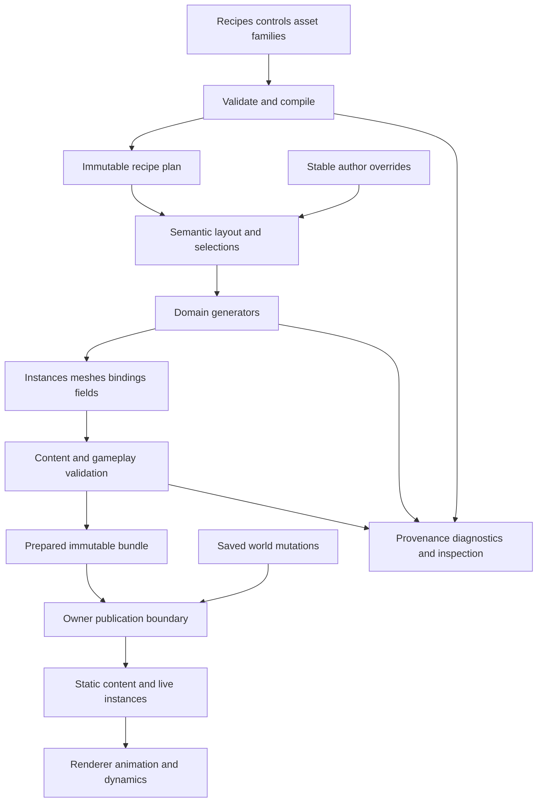

# Procedural content generation architecture

Status: proposed Ludus architecture, October 13, 2026. The initial draft used
`ab49fe8`; integration boundaries were reconciled with `a8e041d`.
The procedural modules and tools described here require implementation, except
the headless scatter kernel of [P0](#p0-room-scoped-scatter). The
[Gems and research review](procedural-content-generation-gems-review.md) records
consulted sources and the [research queue](procedural-content-generation-gems-review.md#conference-and-journal-research-plan)
maps further reading to owners, delivery slices and acceptance evidence.

## Recommendation

Build an **artist-directed, deterministic content compiler** with a small runtime
executor. A versioned recipe produces a semantic plan, domain generators turn that
plan into content, validators accept a complete candidate, and the owning world or
asset system publishes it. Keep terrain, architecture, vegetation, characters,
garments and vehicles in separate domain packages over one small core.

The common abstraction is a transformation of immutable typed data. A forest
scatter, building grammar and garment fitter share identity, execution and
diagnostics, while retaining their own representations and algorithms. Their
outputs become ordinary engine content. Production quality comes from coherent
art direction, validated asset families and explicit gameplay constraints as well
as generation algorithms.

Use current production techniques where they fit: hierarchical generation,
incremental cooking, compact instances, grammar-driven assemblies, compatible
parametric assets, bounded constraint solving and optional GPU detail. Choose the
simplest implementation that meets measured content and platform budgets. There
is no universally fastest generator across these domains.

| Concern | Default | Add complexity when |
| --- | --- | --- |
| Authoring | Versioned text recipe, focused inspector, painted controls | A graph editor makes actual recipes easier to edit |
| Execution | Native typed stages and a serial reference | Coarse CPU jobs improve representative workloads |
| Asset construction | Cook topology, fitting, UVs, collision and LOD offline | A product requires bounded runtime construction |
| World generation | Coarse semantic plans with local refinements | Regional solvers are needed for connected structures |
| Randomness | Existing Philox addressed sampling | Another numerical contract passes explicit qualification |
| Variation | Curated modules, correlated traits and style profiles | New topology adds demonstrable visual or gameplay value |
| Constraints | Construct valid content, then validate | Bounded search is necessary for a specific combinatorial problem |
| GPU | Visual fields, scatter and renderer-owned detail | End-to-end profiling repays dispatch and transfer costs |

## Fit with Ludus

Reuse [Content](content-resources.md), [FoundationMath](../modules/foundation/math.md),
[randomness](randomness.md), [FoundationMemory](memory-management.md),
[Threading](threading.md), [level loading](level-data.md) and
[world ownership](gameplay-foundations.md). Follow Ludus coordinates: right-handed,
+Y up, meters in the proposed content profiles, radians, and existing transform
composition. Import adapters explicitly convert foreign units and conventions.

The [resource coordinator](resource-management.md) supplies bounded native
coordination, immutable CPU mesh products, required dependency DAGs and explicit
replacement transactions. The [RHI](rhi-gdi.md) supplies indexed/instanced raster,
completion-scoped resources and bounded buffer compute/indirect drawing on
Vulkan, Metal and WebGPU; WebGL 2 needs an authored CPU/direct variant.
[Renderer systems](renderer-systems.md) own scene extraction, materials and
presentation. Reuse those consumers rather than introducing a PCG resource
manager or device wrapper.

The existing [terrain architecture](terrain.md) and
[terrain generation](terrain-generation.md) own ground representation, surface
queries, noise, hydrology, erosion and terrain cooking. This proposal owns the
cross-domain recipe/execution contract and its composition with other generators.
General streamed-world activation, skeleton/garment content and navigation
preparation still need their respective domain slices. Procedural recipes and
asset families need a versioned catalog-kind extension or a game-owned manifest;
the existing version 1 audio catalog cannot accept them unchanged.

FoundationThreading currently admits one graph per `JobSystem` until `Wait`.
Integrate generation into the application's admission policy or a deliberately
budgeted separate system; it cannot assume unrestricted concurrent submissions.
Browser builds use the existing serial executor and cannot block the browser
event loop. Reflection currently handles bounded scalar records; complex recipes
need their own codecs and editor models under the
[reflection contract](reflection-serialization.md).

## Architecture and ownership



Three layers keep responsibilities readable:

1. **Intent:** recipes, authored curves/masks, asset families, constraints, style
   profiles and persistent edits. Designers control meaning and composition.
2. **Construction:** pure stages producing semantic plans, assemblies, fields and
   cooked products. Jobs access immutable inputs and exclusive output ranges.
3. **Consumption:** content loading, world activation, rendering, animation,
   navigation and dynamics. Each existing subsystem retains its mutable state.

Generation never inserts an entity, registers a collider, submits RHI commands or
advances cloth while evaluating a stage. It returns data and explicit preparation
requests. An integration adapter resolves these requests with the corresponding
owner before publication.

| Owner | Owns |
| --- | --- |
| Recipe document | Mutable draft, source revision, stable stage IDs and undo |
| Compiler | Validation, type checking, dependency analysis and compiled plan |
| Generation coordinator | Request identities, admission, scratch, jobs, cache leases and cancellation |
| Domain package | Algorithms, typed intermediate data, asset compatibility and domain validators |
| Content cooker | Source acquisition, dependency closure, derived products and release manifest |
| World/session | Persistent objects, mutations, activation and dynamic promotion |
| Renderer/animation/dynamics | GPU resources, poses and live simulation state |

The coordinator owns a candidate until rejection or successful transfer. Every
retained view pins an immutable generation. Cancellation invalidates publication,
then drains work and releases its storage through the existing lifetime fence.

## Module boundaries

Initially implement one consumer with ordinary native functions. Extract the
common executor after environment scatter and modular assemblies demonstrate
the same contracts. The following target layout is proposed:

| Location and target | Responsibility and dependency boundary |
| --- | --- |
| `modules/content/procedural/core`, `Ludus::ProceduralCore` | Recipe IDs, stage plans, bounded views, execution, diagnostics and provenance; Foundation dependencies only |
| `modules/content/procedural/spatial`, `Ludus::ProceduralSpatial` | Reusable sampled fields, spatial indices, candidates and socket assembly; Core and Math |
| `modules/content/procedural/environment` | Terrain provider adapters, biome plans, ecology, scatter and regional road products; terrain keeps its own generation/cooking contract |
| `modules/content/procedural/architecture` | Parcels, building/interior plans and module assembly |
| `modules/content/procedural/character` | Body/rig families, appearance and wardrobe selection |
| `modules/content/procedural/garment` | Pattern assets, fitting and cooked garment bindings |
| `modules/content/procedural/vehicle` | Chassis families, sockets, assembly and physical descriptors |
| Shared procedural format | Header-only INTERFACE schema target depending only on FoundationBase; fixed-width field layouts, limits and versions shared by tools and runtime |
| Content/tool adapters | Catalog, file acquisition, importers, cache storage and cooking; use Content, the existing Resources coordinator and selected generators |
| Game integration | Plans to game-owned static cells and spawn definitions; depends on GameplayWorld and selected domains |
| Editor integration | Draft/preview/inspection in `apps/editor`; Qt remains private |

Garment fitting receives a body-surface descriptor shared by the character
content boundary; it does not import character simulation. Render/rig/collision
preparation adapters depend on the appropriate consumer modules. Foundation and
the core executor never depend on RHI, GameplayWorld, animation, dynamics or Qt.
Games choose the domain targets they link. Shared cooked formats belong to
neither a cooker nor a consumer. Reuse existing scene-format records where their
contract fits; procedural-specific schemas use an independent format target.
Serialize fields explicitly with fixed widths and byte order, never native struct
padding. A cooker does not link a renderer and runtime does not link a cooker.

Use public `include/` and private `src/internal/` directories, narrow headers,
Ludus aliases and fallible storage. Kernels return explicit statuses and are
`noexcept`. Keep parsers, heavy templates, external geometry libraries and file
operations behind implementation boundaries. Ordinary content errors use
structured diagnostics; logging failure cannot invalidate a successful result.

## Content contracts

| Record | Meaning |
| --- | --- |
| `RecipeSource` | Editable schema/version, persistent stages, parameters, constraints and dependencies |
| `CompiledRecipe` | Immutable typed operations, static dependencies, capacities and execution profiles |
| `GenerationRequest` | Exact recipe generation, root seed, scope, input leases, quality profile and request token |
| `SemanticPlan` | Roads, parcels, room adjacency, ecosystem strata, body traits or vehicle layout before geometry |
| `AssemblyPlan` | Stable part IDs, asset IDs, sockets, transforms, material choices and physical descriptors |
| `GeneratedBundle` | Validated products and their dependencies, bounds, identities and provenance |
| `OverrideSet` | Author locks, masks, replacements, additions, deletions and explicit rebases |
| `MutationSet` | World-owned harvested, damaged, moved or customized state relative to an exact base |

These are typed contracts, not a single universal variant that stores arbitrary
fields. Use contiguous arrays for homogeneous records; use structure-of-arrays
only for kernels that consume selected columns at scale. An editor projection may
expose searchable attributes without requiring string lookup in generation loops.

A product declares coordinate space, units, schema, bounds, element counts and
ownership. Fields additionally declare domain, lattice origin/spacing, sample
placement, interpolation, outside-domain policy and filter support. Density
fields declare which sign means solid. A density function is not automatically
a signed distance function; distance-based collision or sphere tracing needs a
separately qualified metric or conservative bound.

Mesh products carry indexed geometry, material slots, validated bounds and
source-part correspondence. Collision, navigation, rig, cloth and LOD products
have their own schemas and dependency versions. A mesh's existence does not prove
that its gameplay or deformation products are ready.

## Recipes and compiled execution

Start with explicit declarative stages in a versioned text asset. JSON codecs
reject duplicate IDs/keys, unknown fields/versions, invalid types, nonfinite
values, missing resources and out-of-range sizes. A read/validate/write round
trip preserves stable IDs and emits canonical ordering and explicit defaults.

This illustrative recipe shows the common structure; operator names and exact
domain schemas are proposed:

```json
{
  "schema": 1,
  "id": "environment/pine-clearing",
  "address_schema": 1,
  "style": "styles/alpine-forest",
  "inputs": {
    "surface": "terrain/north-region",
    "exclusions": "masks/clearing-and-paths",
    "family": "families/alpine-trees"
  },
  "stages": [
    {
      "id": 1001,
      "operator": "environment.scatter",
      "algorithm": 1,
      "inputs": ["surface", "exclusions"],
      "parameters": {"spacing_m": 4.0, "candidates_per_microcell": 2}
    },
    {
      "id": 1002,
      "operator": "environment.select-and-place",
      "algorithm": 1,
      "inputs": [1001, "family"],
      "parameters": {"minimum_scale": 0.85, "maximum_scale": 1.15}
    }
  ],
  "outputs": [1002]
}
```

The root seed and requested scope belong to the invocation and its saved base
manifest. They can be exposed as editable instance settings. Reordering stages,
renaming their display labels or adding a preview must preserve their IDs.

Compile the source into a sealed DAG with typed ports, topological order, input
liveness and checked amplification bounds. The compiler validates scope
compatibility and explicit conversions between regional, cell and object data.
Loops live inside named, bounded operators with iteration/search limits; graph
cycles are rejected. A reusable subrecipe has explicit inputs and outputs and
cannot read hidden globals. Its instance identity distinguishes repeated uses.

A native operator descriptor declares its persistent ID/version, input/output
schemas, supported execution profiles, locality, capacity estimator and kernel.
Use explicit registration at startup, with module lifetime leases when required.
Avoid static constructors, runtime class discovery and function addresses in
saved assets. Adding a kernel requires a descriptor, implementation, validator,
fixtures and attribution near code materially informed by a reference.

At execution, bind a typed input view, immutable parameters, preallocated output
builder, scratch view and bounded diagnostic sink. The kernel cannot discover
files, the active world, time or RNG through global services. Failure discards its
partial builder; caller-visible output remains unchanged. Parallel callbacks
write disjoint ranges, followed by stable compaction/merge. Data needed after a
graph ends must transfer into owned bundle storage, never retain scratch views.

## Determinism and persistent identity

A reproducible base manifest contains recipe source digest, stage algorithm and
schema versions, asset/dependency digests, root seed, address layout, scope,
numerical profile and selected product versions. A seed alone is insufficient.
The [randomness persistence contract](randomness.md#procedural-persistence)
already requires versioned regeneration and independent mutations.

Keep four identities separate: authored resource/stage identity, generated object
identity, transient execution request identity, and live engine entity identity.
Generated identity never contains a pointer, array position, worker ID, cache
path, camera position or runtime entity slot. Different mesh LODs retain the same
semantic object identity.

For generated children, persist a canonical tuple such as recipe-instance ID,
parent ID, emitting stage ID and semantic child key. Child keys are grammar
production/slot keys, floor-and-bay coordinates, or fixed scatter microcell and
candidate keys. Search attempts are not successful-object ordinals. A global
recipe revision belongs to provenance, rather than changing every object ID.
An explicit identity epoch marks a deliberate incompatible layout change.

Keep the tuple as authoritative identity. Compact digests/indices are accelerators:
check tuple equality on collision and reject an ambiguous duplicate. Hashing
coordinates into 64 bits does not prove injectivity over an arbitrary world.
Regeneration maps persistent tuples to runtime entities through the world owner.

Reuse the existing addressed RNG through a checked adapter. Its public address
has a `uint64` scope, `uint32` event and `uint16` dimension; it is not an unlimited
tuple. Pin a collision-checked scope manifest over the supported generation
domain, allocate stable numeric domains and semantic dimensions, and pack logical
attempt/occurrence fields with checked widths. An overflow or collision is an
explicit admission error; extending the supported space requires a versioned
address contract. Built-in bounded-sampling retries remain internal to that
sampler, separate from procedural search attempts.

Choose appearance, structure, materials, damage and population in separate
domains. Adding a window-color draw cannot shift room connectivity or equipment.
For weighted selection use qualified integer mapping, stable candidate ordering
and explicit weights. Correlated traits are sampled from shared latent style/body
parameters; independently randomizing every property creates incoherent content.

Guarantee exact random bits under the existing RNG contract, exact ordered
semantic choices for a qualified integer/quantized profile, and same-build CPU
regeneration for its pinned arithmetic profile. Floating-point geometry and GPU
results require declared tolerances and qualification. Portable authoritative
content uses shipped cooked bytes or a separately tested canonical quantized
generator. Do not infer cross-platform lockstep from a fixed seed or fixed tick.

## Incremental cooking and cache keys

Cache pure stage products by a cryptographic content digest over operator and
algorithm version, output schema, persistent stage/subrecipe identity, canonical
parameters, seed/address profile, scope, numerical/quality profile, input product
digests and declared dependency closure. Include external tool versions and
import settings where they affect bytes. Never hash native struct padding,
unordered traversal, machine paths or timestamps as content identity.

Track precise product dependencies. Changing tree color invalidates material
selection and presentation, while an exclusion-mask edit invalidates affected
scatter scopes. A road edit invalidates its bounded terrain influence, affected
placements, collision and navigation. Whole-source provenance can change without
invalidating unrelated pure products. A stage that discovers asset choices must
initially depend on the candidate-family manifest; after selection its downstream
products can depend on the exact selected assets. Hidden catalog or scene queries
make an operator ineligible for the pure cache.

The first implementation may hash entire input tiles. Spatial dirty regions and
per-tile digests are later improvements, with conservative influence expansion.
Keep a reverse dependency index for invalidation and record the reason for every
miss. Cache eviction follows byte budgets and leases; it cannot evict a bundle
still used by a job, world, renderer or preview.

Write cache products into private staging, verify lengths/digests/schema, and
publish a completion manifest last. A cache hit validates content, rather than
trusting filename existence. A corrupt entry is discarded and rebuilt. Packaged
content has a manifest rooted in ordinary Content identity and needs neither
authoring tools nor a developer cache. Sources and licenses remain under the
game's asset/version-control policy. Optional distributed cooking can use the
same keys and a sandboxed worker after local reproducibility is established.

## Author overrides and saved mutations

Author changes are durable input to generation. Offer lock selection, lock
transform, replace part, exclude region, delete generated object, add authored
object, edit spline and freeze a generated subtree as ordinary content. Each
override identifies its target, property, expected base revision and precedence.
Locks enter before affected constraints are solved; final overrides are validated
again. A locked building that blocks a required road produces a conflict.

Use a fixed precedence: generated base, validated author overrides, then live
world mutations. Tombstones suppress a stable generated identity across unload
and regeneration. Moving an object preserves its identity and transfers spatial
membership through the world owner. A static object promoted to a dynamic entity
has one owner and one collision representation; retirement of the old static
representation accompanies publication of the dynamic one.

Persist the exact base manifest plus overrides/mutations. When upgrading a
recipe or asset family, retain the old base, materialize it, or run an explicit
migration that maps identities and reports orphans/conflicts. Do not silently
apply an old deletion to a different new object. Changing a seed requires an
explicit rebase decision for locks and mutations. Undo restores source data and
regenerates affected products; it does not patch transient GPU buffers.

## Large worlds and locality

Use a hierarchy of **region plan, generation cell, content product**. A region
plan defines connected roads, drainage, settlements, landmarks and gameplay
routes. Cells refine it into local terrain, assemblies and placements. Render,
collision, navigation and generation grids may use different sizes with explicit
mappings. Region size and refinement depth are product settings, not an engine
promise of an unbounded connected world.

Every operator declares one locality contract:

| Locality | Required input |
| --- | --- |
| Object local | One asset/plan and its declared parameters |
| Finite neighborhood | A radius or bounded stencil around a requested scope |
| Parent planned | Immutable regional decisions and any finite local inputs |
| Regional/global | A bounded region or complete offline domain, with explicit boundary conditions |

Propagate influence bounds through the DAG, including resampling, displacement,
filtering and a bounded number of solver iterations. Reject runtime locality
claims with unknown/unbounded support. Hydrology, global road connectivity and
erosion cannot be made independent by inventing a small halo. Resolve them in a
regional/offline plan, declare boundary conditions and publish its revision.
Cross-region connections are canonical boundary records agreed before local
refinement. Moving upstream decisions invalidates dependent regions.

Use integer cell/lattice coordinates with mathematical floor division for negative
locations, checked arithmetic and declared extent. World origin rebasing affects
consumer transforms without changing generation coordinates or identity. Store
local floating-point offsets alongside integer origins for large worlds.

Each root object has one immutable home partition defined by the identity
schema. Neighbor queries can inspect padded data but publish only objects owned
by the requested partition. Bounds may cross cells; residency dependencies load
the owning object rather than spawning another copy. A movable override changes
spatial membership without choosing a new procedural identity. Shared edges,
road crossings and mesh boundary samples use canonical boundary coordinates and
ownership independent of load order.

For terrain boundaries, share sample values and derivative support; identical
vertex positions alone do not ensure matching normals or materials. Include
filter, AO and displacement support in the halo and dirty region. Validate LOD
joins and temporal transitions separately from same-resolution joins. See the
[terrain chapter review](procedural-content-generation-gems-review.md#terrain-boundaries-and-noise).

## Constraints and failure

Construct hard invariants before optimizing soft preferences. A building plan
must connect required rooms and exits; aesthetics can then choose among valid
facades. Constraint records name their subject, source, tolerance, severity and
validator. A result records failed constraints and why a candidate was rejected.

Prefer direct construction, catalog filtering and deterministic greedy selection.
Use a small local solver for socket matching or room/module alternatives. A
Wave Function Collapse or model-synthesis operator can fill bounded adjacency
problems, but local tile consistency does not prove global connectivity. Validate
the resulting gameplay graph separately. Merrell's
[Example-Based Model Synthesis](https://paulmerrell.org/wp-content/uploads/2021/06/model_synthesis.pdf)
informs this optional family of local arrangement tools.

Search orders use stable IDs, deterministic tie breaks and an addressed attempt
index. Bound expansions, productions, candidates, solver operations and retained
history. Deterministic operation limits define outcomes; wall-clock limits only
pause/cancel work and cannot select a different successful base. A resumable
operator stores explicit continuation state and is tested against uninterrupted
execution. Ordinary coarse kernels need no coroutine framework.

Failures distinguish invalid input, unsupported profile, exhausted capacity,
out of memory, unmet constraints, search exhaustion, dependency failure,
cancellation and stale request. Bounded fallback is an authored alternative that
must satisfy the same hard constraints. Otherwise preserve the active content
and return failure. Automatic retries cannot run forever or silently relax
requirements. Validate cheap semantic failures before generating expensive meshes.

## Environment terrain and ecology

### Terrain and natural structures

Consume the canonical surface and derived products defined by
[terrain systems](terrain.md) and its [generation pipeline](terrain-generation.md).
Those owners define height fields, separate cave/cliff meshes, layer ordering,
noise/filtering, hydrology, erosion, terrain queries and tile/LOD boundaries.
A sparse volumetric generator remains an optional domain for pervasive digging;
its density and meshing contracts do not replace ordinary terrain by default.

The procedural coordinator treats a terrain recipe as a typed provider with
immutable inputs, exact product revisions and declared influence support.
It supplies final surface, slope, moisture/drainage and exclusion products to
settlement and vegetation consumers. Terrain edits can alter final drainage;
downstream ecological decisions must depend on the final validated products,
not an earlier intermediate field. Regional dependencies retain the terrain
owner's boundary conditions and invalidation rules.

Road and settlement plans supply stable centerlines, junction ports, protected
footprints and grading constraints to authored terrain layers. Regenerating or
moving them recomputes their influence while preserving the unmodified base.
The road domain owns grade, cross slope, curvature, bridge/tunnel decisions and
traffic clearance; terrain owns how those validated controls change its surface.
The [road review](procedural-content-generation-gems-review.md#roads-and-reversible-terrain-editing)
explains that separation. Render/physical LOD and query residency remain in the
terrain contract, independently of placement scheduling and camera movement.

### Vegetation and scatter

Represent dense static vegetation as compact placements referencing reusable
species assets. Derive suitability from elevation/slope, moisture, light,
distance fields and authored masks. Generate large obstacles and trees before
small strata, with an explicit occupancy product consumed by later strata.
Same-stratum candidates resolve conflicts by stable priority. Include roots,
canopies, rocks, paths and required interaction clearance in conflict policy.

For order-independent local generation, start with a fixed bounded candidate set
per global microcell. Give each candidate an addressed position and a total
priority `(sampled priority, persistent identity)`. Reject candidates conflicting
with higher-priority candidates in the full required neighborhood, including
candidates those neighbors may themselves reject. This local thinning rule
guarantees pairwise exclusion with finite support; it can underfill and is not a
maximal blue-noise sampler. Bound the pairwise exclusion radius for variable
species sizes and use symmetric conflict tests. Acceptance and transforms must
match whether a cell is built alone or with neighbors.

For finite offline regions, Bridson's
[Fast Poisson Disk Sampling in Arbitrary Dimensions](https://www.cs.ubc.ca/~rbridson/docs/bridson-siggraph07-poissondisk.pdf)
is a separate quality candidate. Its evolving active list must not be run
independently per streamed cell and assumed to preserve boundaries. Measure
spacing, clustering and anisotropy for both choices on actual species mixtures.

Cook a curated library of branch/trunk/leaf variants first. Add a bounded
botanical grammar when structural variety matters, with explicit branch/leaf
counts, pruning and wind metadata. Population scatter and individual plant
geometry are separate recipes. Promotion handles trees that are harvested,
damaged or simulated; cosmetic grass needs no entity per blade.

The [Leadwerks chapter review](procedural-content-generation-gems-review.md#vegetation-placement-and-collision)
motivates compact regenerable placement, explicit cross-layer occupancy and
shared rendering/physics data. Interactive obstacles use a common CPU/cooked
placement product. GPU cosmetic detail may differ within declared visual
tolerances, but cannot move the visible trunk away from its collider. Collision
residency follows simulation/query demand, independently of camera visibility.

## Architecture buildings and interiors

Generate meaning before mesh detail: district/road network, parcel, building
envelope, floor layout, room/door adjacency, circulation and finally facade/detail.
Reserve landmarks and required gameplay connections in the semantic plan. A
facade grammar cannot certify an interior layout. Keep a module library with
units, dimensions, pivots, sockets, material slots, collision, LOD and clearance
metadata under a named style profile.

Use bounded split/repeat/select operations for envelopes and facades. Stable
production and slot IDs identify floors, bays, doors and windows. A production
declares its allowable dimensions and expansion ceiling. Modular spans close
exactly within a qualified tolerance; exceptional corners and residual spans
select authored adapters or fail validation. Pascal Müller, Peter Wonka, Simon
Haegler, Andreas Ulmer and Luc Van Gool's
[Procedural Modeling of Buildings](https://doi.org/10.1145/1179352.1141931)
informs hierarchical shape grammar; Ludus additionally owns gameplay topology.

Rooms use a typed adjacency graph with required entrances, traversable routes,
stairs, door clearances and activity slots. Prefer authored room clusters and
bounded packing; add local search when the game needs it. Furniture placement
consumes activity and clearance zones, rather than scattering props over floors.
Connectivity tests operate on the selected navigation/collision representation.
Wall/perimeter generators take protected footprints and movement/buildability
capabilities as distinct inputs, following the
[wall-building review](procedural-content-generation-gems-review.md#architecture-and-territory-boundaries).

Emit ordinary modular instances first. Merge geometry only where measured draw
cost repays loss of editing, culling and reuse. Collision uses qualified simple
shapes or cooked geometry; lighting and occlusion products depend on the final
material/geometry revisions. The original semantic plan remains inspectable
after meshes have been merged.

## Characters and population

Separate a character's persistent gameplay definition, body/rig compatibility
family, appearance recipe and live animation state. Population plans assign
roles and meaningful trait correlations before choosing appearance. Games own
names, occupations, capabilities and social/gameplay rules; the generation core
does not infer them from mesh properties.

Start with validated fixed-topology body/head archetypes, compatible modular
parts, authored blend shapes and material variations. A rig family pins hierarchy,
joint/socket semantics, skinning conventions and bind-pose revision. Body shape
parameters stay within a cooked admissible envelope. Extreme proportions select
another validated family instead of silently stretching one rig arbitrarily.

Cook or validate selected morph combinations for seams, bind poses, skin weights,
joint limits, bounds, collision proxies and representative motion poses. Body
shape changes invalidate affected garment fit and contact/socket calibration.
Produce a character definition plus bindings consumed by the
[skeletal animation architecture](skeletal-animation.md); generation never runs
animation control or chooses combat timing.

Use population-level diversity quotas and style distributions where requested,
with bounded assignment and explicit conflicts. They are regional planning
inputs; independent per-character draws cannot guarantee a group quota. Cache
shared rig/material/garment products and avoid a new unique mesh for every color.
Hair uses curated groom/mesh families and fit metadata first; detailed groom
growth is an optional offline generator.

## Clothing and garment construction

Clothing has three distinct tasks: wardrobe selection, garment construction and
runtime deformation. The first slice selects compatible authored garments by
body family, layer/slot, theme and size. It produces ordinary skinned parts and
visibility masks with stable garment identities. This is a useful production
feature before a pattern generator or cloth simulator exists.

For parametric garments, use authored pattern panels with stable seam IDs,
measurements, grain direction, ease and closure metadata. Parameter changes
preserve panel and seam correspondence within the template's supported envelope.
Validate closed seam pairing, orientation, allowances, panel intersections and
material limits before fitting. Triangulation, remeshing and UV generation are
offline stages with versioned correspondence; a topology change invalidates skin,
cloth and LOD bindings explicitly.

Fit to a qualified body family offline. Store body-dependent rest geometry or
bounded deformation coefficients, transferred skin weights, seam constraints,
collision proxies and fit bounds. A coarse simulation mesh drives a separate
render mesh through validated barycentric/cage bindings. Test fit at envelope
boundaries and representative poses; interpolation among fitted bodies is not a
proof against clipping. Epic's
[parametric outfit workflow](https://dev.epicgames.com/documentation/metahuman/create-a-metahuman-parametric-outfit-asset)
supports treating body/cloth correspondence as explicit content dependencies.

Layered garments declare clearance, coverage and exclusions. A body-hide mask
can prevent hidden surface rendering, but cannot establish cloth collision
correctness. An unsupported outfit returns a compatibility error or selects an
authored alternative. Preserve hero details through art review and replacement
assets rather than escalating solver complexity automatically.

Live cloth belongs to a dynamics owner after publication. The generated asset
supplies rest state, constraints, pins, material parameters and render bindings.
Begin with a qualified XPBD implementation for cosmetic cloth if the product
needs dynamics, with fixed substeps/operation budgets, reset and LOD transition
policies. [Macklin, Müller and Chentanez's XPBD paper](https://matthias-research.github.io/pages/publications/XPBD.pdf)
informs compliance semantics; collision, convergence and visual quality still
need testing. Distance reduces simulation detail without changing the wardrobe.
Gameplay-significant cloth requires a separate authority/replay contract.
The [cloth Gem](procedural-content-generation-gems-review.md#garments-and-live-cloth)
informs buffer separation and connectivity, rather than garment construction.

## Vehicles and mechanical assemblies

Generate a validated vehicle definition from a chassis family, rather than
arbitrarily attaching random parts. Families define supported wheel/axle layouts,
wheelbase/track ranges, clearance, body envelope, attachment sockets, suspension
travel, drivetrain capabilities and compatible visual modules. Aircraft, boats
and tracked vehicles use their own typed family constraints.

Use the shared socket assembly vocabulary: connector ID/type, local frame,
permitted transform range, compatibility and clearance. The vehicle package
adds physical and mechanical constraints. Validate wheels within travel range,
steering/door sweeps, axle alignment, body clearance and attachment transforms.
Materials, trim and wear vary independently of structural domains.

Emit one inspectable assembly plan and separate render, collision, rig/control
and physical products. Aggregate mass, center of mass and inertia from qualified
part descriptors in the common coordinate frame, including rotation and
parallel-axis translation. Reject nonfinite or invalid physical values. A
decorative mesh edit does not alter handling unless its physical descriptor
changes. Breakable parts retain semantic identity through dynamic promotion.

Cook meshes, collision and common variants. Runtime customization selects
compatible parts, evaluates bounded assembly constraints and prepares a candidate
vehicle before replacement. The dynamics system owns motion and contacts;
generation does not become a second vehicle-physics engine. Test the complete
selected definition against the game's vehicle controller and terrain profiles.

## Runtime activation streaming and cancellation

Requests carry session/world identity, request generation, recipe/input revisions,
target scope, mutation revision and execution profile. Completion does not grant
publication rights. The coordinator discards stale results after any relevant
identity or revision changes, even if their bytes are otherwise valid.

Use the states Requested, Admitted, Generating, Validating, Preparing, Ready,
Published and Retiring, with explicit Failed/Cancelled exits before publication.
External I/O completes through owned input records; it never blocks a CPU job.
Reserve active-plus-candidate peak memory and all required consumer capacity.
Pin dependencies through jobs and through each consumer's retirement fence.

Preparation must resolve required collision/navigation/rig/resource products
before activation. Publication runs on the world owner at a structural safe point.
Within an activation unit, prepare a no-fail commit or swap one prepared immutable
cell/asset handle. If consumer registration can still fail, stage it in an
inactive candidate and discard that candidate on failure. Do not claim a
transaction across arbitrary RHI, physics, audio and world calls. The previous
revision remains active until the replacement is fully prepared.

For live replacement, preflight conflicts with players, dynamic bodies and saved
mutations. Game policy can defer activation or relocate through a checked command.
Switch collision/navigation and semantic identity consistently; visual products
may lag only under a declared safe fallback. Never place a player into terrain
whose collider is awaiting generation.

Prioritize runtime work by gameplay dependency, travel horizon and residency
sources. Add hysteresis to loading/eviction, bound pending requests and coalesce
superseded edits. Cosmetic quality can drop under load. Required content either
stays resident, delays entry with game-owned behavior, or reports a fault. The
schedule changes availability, not the chosen procedural base.

## Performance and capacity

Reduce repeated work and output size first: share semantic plans, reuse mesh
modules, generate only required products, batch homogeneous candidates and avoid
entities/colliders for cosmetic instances. Precompute immutable selection and
compatibility tables. Coarse range jobs amortize scheduling; stable prefix sums
and compaction can construct dense outputs without contested append counters.

Use two passes when useful: count/validate amplification, reserve checked
capacity, then emit into exclusive ranges. Both passes see identical inputs and
addressed choices. Variable searches retain bounded choices/results between
passes or use a conservative ceiling rather than rerunning a different search.
Scratch allocation is per request/worker, accounted and reused. Promote only
owned results out of scratch.

Initial guardrails below are proposed admission defaults, not measured limits:

| Quantity | Initial policy |
| --- | --- |
| Source recipe | 1 MiB, 32 nesting levels |
| Expanded stage DAG | 128 stages, 256 dependency edges, 8 nested subrecipe levels |
| Unbounded repetition or recursion | Rejected |
| Instances, vertices, indices, candidate expansions | Explicit ceilings supplied by each content profile |
| Scratch, result bytes, staging bytes, diagnostics | Separate explicit byte/count budgets |
| Pending work and active candidates | Bounded by coordinator admission and peak-memory budget |
| Solver work | Deterministic operation/iteration budgets per operator |

Calculate peak memory from active content, all admitted candidates, retained
inputs/cache leases, scratch, merge buffers, preparation staging and GPU uploads.
Checked products/sums reject overflow before allocation. Raising a limit needs
measurements for the supported platforms. Quality profiles can reduce cosmetic
output but cannot relax hard constraints or alter authoritative identity.

An optional GPU backend handles sufficiently large visual arrays or fields and
keeps consecutive kernels/data on the GPU. CPU fallback uses the same semantic
inputs; parity is declared per product. Measure dispatch, uploads, readbacks,
compaction, synchronization, renderer consumption and contention with rendering.
Epic's [PCG GPU guidance](https://dev.epicgames.com/documentation/unreal-engine/using-pcg-with-gpu-processing-in-unreal-engine?lang=en-US)
supports minimizing transfer boundaries. Use the RHI's existing qualified buffer
compute and direct/indirect profiles; stages needing storage textures or other
unsupported capabilities retain a CPU/cooked path until those features ship.
GPU execution never implies free speedups on small graphs or integrated GPUs.

## Authoring debugging and external tools

The initial workflow is edit recipe, generate selected scope, inspect plan and
rejections, compare changes, accept or keep the current content. Offer focused
domain inspectors and bounded thumbnails/overlays before a general node canvas.
The optional canvas edits the same schema and displays compiled stages, scopes,
cache hits and transfer boundaries. Saving it never requires an opaque executable
graph or an additional language implementation.

Evaluate the P1 authoring slice with a task suite: preserve a landmark while
changing surrounding density, lock an accepted assembly, explain a rejection,
undo an edit and regenerate its scope. Record completion, intervention count,
explanation accuracy and edit-to-preview latency. The
[developer-survey review](procedural-content-generation-gems-review.md#developer-control-and-transparency)
motivates these Ludus-selected tasks; it does not establish their usability.

Every selected object can answer which recipe/stage/parent/asset created it,
which choices were made, which constraints passed and which overrides apply.
Diagnostics include resource ID, stage, scope, persistent object, source property,
status and relevant values. Trace buffers are bounded and disabled or sampled in
shipping; trace saturation records dropped entries without altering generation.

Provide serial stepping, intermediate views, lock-and-isolate stage inputs,
wireframe/bounds/socket views, constraint heatmaps and candidate rejection reasons.
A reproduction package records exact input digests, versions, seed, scope,
profile and overrides; it includes required input bytes or resolvable immutable
references. GPU faults can replay semantic inputs on CPU without claiming
identical floating-point output. Inspectors read snapshots and never advance RNG
or simulation. Compare outputs by persistent identity and product type.

Offline DCC adapters may use Houdini, Blender or garment tools through explicit
import/export manifests. Pin tool/settings versions; validate their output through
the same content gates. Houdini is optional authoring infrastructure. SideFX's
[PDG workflow](https://www.sidefx.com/docs/houdini/tops/intro.html) informs explicit
work items and dependency visibility; its mutable runtime is not an engine
dependency. External tools run outside exception-free engine translation units.

Learned or generative tools can propose masks, designs or asset candidates offline.
Once accepted, their concrete outputs become versioned inputs to the deterministic
compiler. Pin model/tool/input provenance and review topology, rig compatibility,
licenses and gameplay constraints. A model service is optional; model inference
does not define the shipped world's reproducibility contract.

## Implementation sequence and acceptance

Each slice must ship one useful consumer and its evidence before expanding the
framework. Existing modules retain their contracts.

| Slice | Deliverable | Acceptance gate |
| --- | --- | --- |
| P0 | Headless recipe codec, identity adapter, serial plan and compact environment scatter | Same fixtures under reordered work, bounded errors, stable property draws and exact save manifest |
| P1 | Shared executor, provenance, cache and author overrides demonstrated by scatter and modular assembly | Precise invalidation, lock/delete/rebase conflicts, corruption recovery and no publication on failure |
| P2 | Tiled terrain, occupancy, modular building/room plan and candidate world adapter | Seam/LOD matrix, cross-layer exclusions, required routes and active/candidate budget handling |
| P3 | Character/wardrobe families and chassis assembly | Rig/socket/clearance/physical validation and round-trip customization |
| P4 | Offline parametric garment pipeline and selected dynamics integration | Envelope/pose fit, seams, render/simulation correspondence and safe reset/LOD transitions |
| P5 | Regional planning/streaming, measured jobs and optional GPU stages | Residency-order independence, supported browser scheduling, end-to-end quality/cost comparisons |

P0/P1 establish headless correctness first. Presentation then consumes existing
mesh/instance renderer profiles and qualified RHI compute through explicit
adapters; skinning, cloth and other missing domain products retain their own
implementation gates. Editor graphs, regional solvers and runtime topology
construction are conditional extensions with their own product justification.

Qualification fixtures cover:

- Stable choices under worker-count changes, cell traversal order, instrumentation,
  cache hits/misses, pause/resume and irrelevant material edits.
- Neighbor generation alone/together, negative coordinates, rebase, every supported
  boundary/LOD case, and shading/collision consistency.
- Room/route connectivity, socket dimensions, garment seam/fit correspondence,
  vehicle clearances and cross-layer occupancy.
- Missing assets, malformed recipes, address collisions/overflow, capacity/OOM,
  solver exhaustion, cancellation, stale results and failed consumer preparation.
- Save/load after harvesting, movement, dynamic promotion, customization and
  recipe upgrades, including identity-migration conflicts.
- Browser serial responsiveness and native serial/parallel agreement within each
  declared numerical profile.

Benchmark sparse/dense forests, edited terrain with roads, repeated building
blocks and interiors, character/wardrobe populations and vehicle variants.
Report hardware/tool versions, content/output counts, cold/hot cook time, edit
latency, p50/p95/p99 work and publication cost, peak bytes, cache reuse,
constraint failures and visual/gameplay quality. Compare optimized kernels with
the serial reference at equal output quality. Establish platform budgets from
these workloads before accepting optimization claims.

Implementation must pass the repository's pinned warning-clean build, meaningful
unit/property tests, ASan/UBSan and format/tidy gates. Reference-inspired kernels
retain author/title/section attribution near the implementation, with links to
the relevant review. Follow the
[conference and journal research plan](procedural-content-generation-gems-review.md#conference-and-journal-research-plan)
when investigating an observed shortfall; preserve the serial baseline and the
owning domain contracts. Documentation uses the pinned local-index, strict wiki,
coverage/link/search and documentation-regression checks.

### P0: room-scoped scatter

P0 starts with a scatter of static placements in the rooms of `apps/world_demo`.
It is also milestone 1 of the [randomness architecture](randomness.md#milestone-1-procedural-placement),
which owns its domains, root seed and event rules. This section owns the recipe,
the placement identity, the thinning rule and the kernel. The recipe is read
from the level files the world demo already parses; a separate recipe codec,
provenance, caching and author overrides wait for P1. Layers are independent:
cross-layer occupancy, where trees claim space before smaller plants, waits for
P2, so in P0 only authored keep-out rectangles constrain every layer.

**Kernel.** `Ludus::ProceduralEnvironment` (`modules/content/procedural/environment`)
is headless and depends only on FoundationBase, FoundationContainers and
FoundationMath. It never depends on GameplayWorld, so it builds for native and
browser targets alike. It is the serial reference: one call generates one layer
over a requested range of cells into caller storage, without allocating. Job
scheduling belongs to the caller. Generating a range in pieces and merging them
in canonical order gives the same result as one call, which the tests verify with
the job system.

**Coordinates.** The kernel works in integer lattice units; the game maps them to
world space. The region and keep-outs are half-open integer rectangles. Cells are
`cellSize` units square, cell coordinates use floor division so negative
positions work, and each must fit in `int16`. Candidate positions, conflict tests
and acceptance are exact integer arithmetic, so native and web builds accept the
same placements. Rotation and scale are integers too; the game converts them to
floating point for presentation.

**Identity.** A placement is identified by the tuple (room, layer, cell X, cell Y,
candidate). Room is a nonzero ordinal from the game's room catalog, layer is the
recipe's authored layer ID, and candidate is the index of the candidate within its
cell. The tuple packs exactly into the 64-bit address scope:

| Bits | Field | Range |
| --- | --- | --- |
| 63-48 | Room | 1 to 65535 |
| 47-40 | Layer ID | 0 to 255 |
| 39-32 | Candidate | 0 to 255, below the layer's candidate count |
| 31-16 | Cell X | `int16`, stored as its two's-complement bits |
| 15-0 | Cell Y | `int16`, stored as its two's-complement bits |

The packing is injective within these ranges, so the scope is the identity rather
than a digest of it. Validation rejects a recipe that cannot be packed; nothing
is truncated or hashed. Candidate indices are fixed per cell, so a search attempt
never becomes an identity.

**Random layout.** The game derives three keys from the session's world seed and
its manifest domains, and the kernel samples them at event zero:

| Domain | Dimension | Meaning | Mapping |
| --- | --- | --- | --- |
| Placement | 0 | X offset within the cell | `TrySampleBounded` below `cellSize` |
| Placement | 1 | Y offset within the cell | `TrySampleBounded` below `cellSize` |
| Placement | 2 | Thinning priority | `SampleUInt32` |
| Variant | 0 | Variant index | `TrySampleBounded` below the variant count |
| Transform | 0 | Rotation in 1/65536 turns | high 16 bits of `SampleUInt32` |
| Transform | 1 | Scale | minimum plus `TrySampleBounded` below the range width |

Rotation and scale are drawn only for accepted candidates, and nothing in
acceptance reads them, so changing the transform ranges cannot move or remove a
placement. A new property uses an unused dimension or a new domain.

**Thinning.** Each cell holds a fixed number of candidates. A candidate is eligible
when its position lies inside the region and outside every keep-out. Two eligible
candidates conflict when the squared distance between them is less than the
square of the sum of their variants' exclusion radii. The test is symmetric. An
eligible candidate is accepted unless it conflicts with an eligible candidate of
higher priority, where priority compares the sampled word and then the packed
identity. The ordering is total, so ties cannot occur. Validation limits each
exclusion radius to the cell size, so a conflict reaches at most two cells in each
direction. Acceptance therefore depends only on nearby cells, so a cell gives the same
result whether it is generated alone or with its neighbours, in any order. The rule
can leave gaps; it is not a maximal Poisson-disk sampler.

**Output and failure.** Placements are written in canonical order: cell Y, then
cell X, then candidate, all ascending. Validation reports the first problem with
its index. Generation checks the room, layer, cell range and storage capacity
before writing anything. If a bounded draw exhausts its attempts, which needs
65,536 consecutive rejections, generation reports it, the reported count is
unchanged and the storage contents are unspecified.

**Acceptance.** The kernel tests cover the golden placement digest on native and
Emscripten, ordering independence across worker counts, chunk sizes, traversal
order and isolated cells, property isolation, and rejection of every invalid
recipe field. World integration, harvesting and the remaining isolation rows of
milestone 1 follow in the world demo.
