# Skeletal animation architecture

Status: proposed architecture for Ludus, October 11, 2026, against checkout
`ab49fe8`. Repository capability descriptions below refer to that historical
snapshot; implementation must reconcile them with the current module contracts.
This proposal defines runtime and content contracts; it does not add an
animation module, codec dependency, mesh renderer, or editor. The
[Gems review](skeletal-animation-gems-review.md) records the initial design,
consulted chapters, and revisions incorporated here.

## Recommendation

Build a native C++23 animation runtime around immutable assets, small explicit
instance state, and a linear pose evaluation plan. Keep control updates separate
from pose evaluation. Control advances states, playback, synchronization, events,
and root motion at the simulation tick. Pose evaluation samples, blends, and
modifies joints at the rate the consumer requires. This separation is the most
valuable optimization boundary: reducing visual work must not change gameplay.

Use Animation Compression Library (ACL) as the preferred production codec,
subject to the integration and quality gates below. Own the skeleton, playback,
blending, state-tree semantics, extension boundary, and debugging experience.
Start with scalar kernels and an uncompressed reference sampler. Add SIMD and
jobs where representative measurements justify them. Keep GPU skinning in the
renderer. A native pose pipeline should work headlessly before a character can
be drawn.

Use a small hierarchy of animation states and a short ordered list of layers.
Offer a visual editor for these declarative assets when authors need it. Keep
arbitrary gameplay scripting, reflection dispatch, and script VMs outside pose
evaluation. Do not create Luduscript for animation. Games may use the providers
in the [gameplay language proposal](scripting.md) to select actions and fill typed
inputs; joint loops and numerical solvers remain native.

This is a production-oriented design with a path to contemporary locomotion and
character quality. Its optimization claims require measurements on Ludus content;
neither a novel algorithm nor a large feature list establishes a universal best
animation system.

| Concern | Selected default | Extension condition |
| --- | --- | --- |
| Pose representation | Parent-relative translation, unit quaternion, and scale | Component-space operations at explicit conversion points |
| Compression | Private ACL adapter and cooked quality profiles | Another codec must beat the same quality and workload gates |
| Playback | Explicit clip players and marker synchronization | Distance matching and motion matching for demanding locomotion |
| Blending | Normalized base blend, ordered masked overrides and local additives | Component-space rotation layers for a demonstrated aim requirement |
| Transitions | Crossfade baseline; inertialization for suitable visual transitions | Keep crossfades where outgoing authored motion must remain active |
| Control | Bounded hierarchical states with typed predicates | Small parallel regions for independent actions |
| IK | Analytic two-bone and aim; bounded long-chain solver | Coupled full-body solving for a concrete interaction |
| Execution | Serial reference, reused buffers, then coarse character jobs | GPU pose evaluation for measured crowds |
| Authoring | Versioned text assets and focused inspectors | Visual state/layer authoring over the same schema |

## Fit with Ludus

FoundationMath already defines right-handed coordinates, +Y up, column vectors,
Hamilton quaternions in `(x, y, z, w)` order, and parent-before-local composition.
Its `TransformTRS` is authoring data; `Affine3` composition retains shear. Use
those conventions without an animation-specific matrix or quaternion convention.
See [FoundationMath](../../modules/foundation/math/README.md).

FoundationMemory supplies fallible `AllocationDomain` allocation, Containers
supplies owned storage, and FoundationThreading supplies bounded CPU job graphs
with a serial path. Content already has catalog and file facilities. These are
useful boundaries, not evidence of an animation cooker or streaming system.
The current public RHI supports bounded fullscreen drawing; general mesh buffers,
skinning, and character rendering need their own graphics feature slice.

The [world](game-world.md) and [tick](frame-update.md) contracts keep gameplay
ownership explicit. Do not put animation behavior into the entity registry or
make the world depend on a humanoid controller. The game's animation integration
owns entity-to-instance bindings and the phase sequence.

Proposed targets follow the established public/include and private/src layout:

| Target and location | Owns | Dependencies and exclusions |
| --- | --- | --- |
| `Ludus::Animation`, `modules/animation/` | Skeleton/clip views, poses, control, evaluation, blending, generic constraints | Base, Math, Containers, Memory; private Logging/Profiling and codec adaptation. No World, RHI, physics scene, scripting VM, or Qt |
| `Ludus::AnimationContent`, `modules/animation/content/` | Validated cooked packages, asset generations and runtime bindings | Animation and Content. File acquisition and import remain outside evaluation |
| Animation cook tool | Import normalization, retargeting, clip preparation, compression, program compilation | Offline tooling and private importer/codec dependencies; not part of the runtime SDK |
| Game integration | Typed inputs, movement authority, scene queries, game modifiers, action policy | World/physics/game APIs and Animation |
| Renderer integration | Mesh skin bindings, palette upload, skinning, GPU retirement | Graphics/RHI and immutable animation outputs |
| Optional editor panels | Clip preview, masks, states, layers, rig constraints | Editor-side clients of the cooker and runtime; Qt remains outside Animation |

Keep this to two runtime libraries initially. State trees, layers, and IK are
sections of Animation, not independent plugin frameworks. Extract a target only
when a real consumer needs that dependency boundary.

Public headers expose Ludus types, light views, handles, statuses, and
non-template operations. ACL/RTM types and templates stay in private translation
units. No heavy public headers, exceptions, public `internal/` includes, or
dependency backedges into FoundationBase. Every fallible API returns a status;
hot-path APIs are `noexcept`. Native and browser implementations use the pinned
toolchains, including a serial browser execution path.

## Ownership and frame flow

```mermaid
flowchart LR
    Author[Clips rigs masks states] --> Cook[Validate and cook]
    Cook --> Assets[Immutable asset generation]
    Input[Typed game inputs] --> Control[Fixed tick control update]
    Assets --> Control
    Control --> Motion[Root motion request]
    Motion --> Motor[Game movement and physics]
    Control --> Plan[Selected pose plan]
    Assets --> Plan
    Plan --> Sample[Sample and decompress]
    Sample --> Blend[Base overrides additives transitions]
    Blend --> FK[Local to component transforms]
    Motor --> Query[Owned scene query results]
    Query --> Solve[IK and ordered game modifiers]
    FK --> Solve
    Solve --> Output[Pose curves sockets and bounds]
    Output --> Render[Renderer palette and skinning]
```



An asset generation owns skeletons, clips, masks, rigs, and programs. These remain
immutable and pinned while jobs use them. Each `AnimationInstance` owns its state
path, clip cursors, action/layer weights, transition history, contact state, and
solver continuity state. One instance has one mutable owner per phase.

Workers receive copied inputs, immutable views, exclusive state/output ranges,
and preallocated scratch. They return results; they do not call back into a mutable
world, an importer, a script VM, RHI, or a physics scene. The owner accepts results
in stable instance order after the lifetime fence. Asset release, instance removal,
and game-code unload happen after all readers finish.

Keep two output uses explicit:

- **Simulation output:** tick-stamped root motion, control events, and any
  required gameplay joints/sockets. Evaluate required joints every tick even
  when the mesh is invisible. Gameplay decides whether a pose-dependent collision
  or attachment is part of authoritative simulation.
- **Presentation output:** a pose and curves sampled at a specified presentation
  time, visual IK, deformation metadata, and renderer bounds. Evaluation can run
  less often, but cannot advance simulation state or deliver gameplay events.

For the baseline, keep previous/current completed simulation poses and blend
local transforms for rendering, then run FK. This follows the world's delayed
interpolation convention. A higher-quality character can evaluate the same
snapshot of the selected plan at its render time and solve visual contacts there.
That second path is read-only with respect to control and simulation history.
Record the chosen presentation policy so preview, captures, and debugging agree.

Each evaluation domain owns its history. A presentation evaluation can update
its own contact/transition history once for that presentation sample; it cannot
overwrite simulation solver state. An extra inspector read must use a snapshot
or scratch copy rather than advance either domain again.

The initial tick integration runs input/action decisions, animation control,
root-motion/motor application, required simulation pose and scene-query phases,
then gameplay socket/event consumption. Preflight authoritative assets and output
capacity before applying motion. Tag motion/event delivery with tick and activation
identity. A late critical failure faults the tick/session under the game policy;
it does not roll back already applied motor or external effects. Never retry a
partially applied tick as though nothing happened. Cosmetic pose failure can retain
the last valid output independently.

## Skeletons poses and bindings

### Skeleton asset

Cook a flat, depth-first, parent-before-child skeleton. Store the parent index,
exclusive subtree end, stable joint ID, rest local transform, and optional debug
name per joint. A synthetic identity root makes multi-root imports explicit.
Bound joint counts and use checked index conversions; a compact index width must
not silently limit future rigs. Imported names are authoring identifiers, not
runtime string lookups.

Include a skeleton compatibility identity covering joint IDs/order, hierarchy,
rest transforms, units, and conventions. A matching bone count is insufficient.
Separate a stable authoring identity from the revision/content hash. A clip binding
maps tracks to joints once, validates defaults, and records both generations.

Do not equate rest pose, mesh bind pose, additive reference pose, and retarget pose.
They have separate roles. Each mesh skin binding owns its palette-to-skeleton map
and inverse bind transforms, including any mesh-to-skeleton conversion. Modular
meshes may share a skeleton and pose without sharing inverse bind data.

### Local pose and component pose

Use a dense logical pose in skeleton joint order. Local values are translation,
unit rotation, and scale; component values are `Affine3` transforms. Publish a
readable scalar access interface. The evaluator may use a private array-of-structures
of SIMD-width structure-of-arrays blocks for contiguous joint work. Do not impose
one CPU instruction width on asset formats or game-facing APIs.

For joint `j`, with column-vector conventions:

```text
component[root] = ToAffine3(local[root])
component[j]    = Compose(component[parent[j]], ToAffine3(local[j]))
```

Keep local transforms canonical. Component transforms are derived caches with a
validity set, not independently editable persistent state. A modifier changes
local values and invalidates the affected subtree; dependent component reads
rebuild those joints first. Never decompose an arbitrary sheared component matrix
back to TRS as an implicit convenience operation.

Validate finite values, nonzero normalizable rotations, and the chosen scale
domain while importing/loading. Normalize rotations at controlled boundaries and
after blending. Begin with strictly positive scales; reject negative, zero, and
near-singular scales with an asset diagnostic. Nonuniform positive scale can be
supported for sampling, blending, affine FK, and matrix skinning. Rigid IK and
component rotation layers require an explicitly validated compatible chain;
otherwise report unsupported scale and keep its FK pose.

Pose identity includes skeleton generation, joint validity, evaluation time,
LOD plan, and coordinate space. Uncomputed lanes are never interpreted as current
joint values. Tail SIMD lanes have identity padding and are excluded from results.

### Subskeletal animation and masks

A subskeleton is a joint selection in one skeleton, not a second independently
animated skeleton. Author masks by subtree, named joint group, and explicit joint
weights. Cook them into weights, nonzero ranges, and any track selection needed
by the program. Feather weights across spine/shoulder boundaries to avoid abrupt
upper-body changes. Mask values and layer weights are finite and bounded.

Keep three sets distinct: joints a layer may **write**, joints the evaluation must
**sample**, and joints component-space operations must **read**. A hand-only local
additive may write only the hand. FK for that hand still needs its ancestors from
the base pose. IK also needs its chain, target frame, and any dependent sockets.
Union these requirements and cook an ancestor-closed FK set for each LOD plan;
do not automatically give ancestors a nonzero blend weight.

Initialize an override sample's missing tracks from the skeleton rest pose.
Initialize an additive sample's missing tracks from additive identity. An override
then applies only its authored mask; it must not erase unrelated joints. At lower
LODs, explicit mesh and rig remaps define retained joints, skin weights, sockets,
and disabled constraints. There is no unchecked assumption that the first N
joints are a valid LOD.

Guillaume Blanc's ozz-animation demonstrates full and partial blending through
the same pose operations with per-joint weights. Ludus adopts that common-kernel
idea and adds explicit sampling/FK dependency sets.
[Partial animation blending](https://guillaumeblanc.github.io/ozz-animation/samples/partial_blend/).

## Import cooking and decompression

### Cook pipeline

Keep editable source clips and cooker intermediates separate from runtime blobs:

1. Normalize coordinate conventions, meters, skeleton IDs, local transforms, and
   quaternion continuity. Validate hierarchy, durations, sample rates, and tracks.
2. Apply an explicit retarget profile when needed. Bake the result into the target
   skeleton for the normal shipping path.
3. Prepare clip semantics: loop boundaries, motion-root extraction, additive
   reference conversion, contact/sync markers, curves, and event channels.
4. Resample the authored curves at a quality-profile rate and check the resampling
   error against the original interpolation. Detect constant/default subtracks.
5. Compress with the selected codec and runtime-matching error metric. Preserve
   root trajectories and event metadata independently of pose compression.
6. Reconstruct through the actual runtime adapter, validate quality, and publish
   an immutable versioned package with the program's bindings and debug map.

Clip format metadata records skeleton identity, duration semantics, codec/version,
loop policy, additive convention/reference, root-motion policy, quality profile,
and cooker provenance. Serialized fields have explicit widths and byte order.
Validate counts, offsets, alignment, sizes, and bounds before entering a trusted
decoder; do not reinterpret arbitrary package bytes as codec objects.

Retarget profiles explicitly map source/target joints or chains, their reference
poses and axes, translation/length policy, twist distribution, and motion-root
scale. Matching joint names does not establish compatible rest orientations or
proportions. Convert reference-relative motion through the declared bases, bake
target local tracks, then validate target-space contacts and sockets. Recompute
additive deltas against the target reference and regenerate motion/contact metadata;
retargeting already prepared deltas without that information is insufficient.
Runtime retargeting for avatars/VR is a later producer with the same explicit
profile and per-instance state. Modular body parts using the same compatible
skeleton normally share its pose rather than retarget it every frame.

Use a few author-facing profiles such as Hero, Standard, and Crowd, with optional
important-joint overrides. Values are project measurements, not universal error
thresholds. Show the tradeoff as bytes, decode time, and error at selected joints,
contacts, and sockets. Cache import/retarget/resampling intermediates separately
from final packing so a quality adjustment does not repeat unrelated expensive
steps. Thanks to Søren Hannibal's compression chapter for this pipeline refinement;
see the [chapter review](skeletal-animation-gems-review.md#compression-and-cooking).

### Codec decision

ACL's uniform-sampling design compacts constant/default subtracks and arranges
sample data for predictable access. Its decoder exposes all-track and single-track
operations and a custom writer. Use that writer to emit the runtime's pose layout
without exposing RTM values. Pin a tested release/commit and matching cooker;
do not silently track the moving upstream branch.
[Uniform sampling](https://raw.githubusercontent.com/nfrechette/acl/develop/docs/algorithm_uniformly_sampled.md),
[decompression](https://raw.githubusercontent.com/nfrechette/acl/develop/docs/decompressing_a_track_list.md).

The codec adapter exposes a small operation: validated clip view, bounded local
sample time, requested joint/track set, explicit default values, output, and
caller-owned decoder scratch. Keep cursors/contexts private to a player or job;
generation changes force rebinding. Two instances never share a mutable decoder
context. Seek, reverse playback, and a clip switch are first-class operations.

Sparse requests do not guarantee sparse decode cost. Measure all-track decode,
single-track loops, range/block decode, and mask-aware output using the pinned
codec. Skipping a writer store may still read/decode the track. Select a dense
decode crossover from representative masks; do not build a second bespoke codec
just to claim every masked joint is free.

Keep an uncompressed reference format for fixtures and diagnostics. ozz-animation
is a credible alternative complete runtime and a useful layout/job reference.
If delivery constraints favor using it wholesale, evaluate that alternative
against the same contracts. Avoid shipping both ACL and ozz clip decoders by
default, or mixing opaque representations into every runtime operation.
[ozz runtime](https://guillaumeblanc.github.io/ozz-animation/documentation/animation_runtime/).

Integration must compile with exceptions disabled, use explicit allocation failure,
preserve licenses, and match native/Wasm behavior within documented tolerances.
Review ACL's floating-point control assumptions on every worker; CPU FP traps are
a separate issue from C++ exceptions. Do not change a thread's FP mode invisibly
inside unrelated game work.

### Quality means reconstructed motion

Compare decoded and original component-space motion at important joints and
representative points away from joint origins. Include hands, toes, head/face,
weapon tips, and long descendant chains. Test slow idles, high angular speed,
contact windows, interpolated times, looping seams, and retargeted/additive clips.
Measure position, rotation, and temporal deviation where the content needs it.
Any finite sampling test is evidence at those samples, not a proof of a continuous
maximum error bound.

Use a cooker metric matching Ludus's affine composition when scale can produce
shear. ACL explicitly distinguishes its QVV and matrix-based metrics for this
reason. Additive error checks must use Ludus's actual additive equations and a
representative base pose. Similar labels in two libraries do not establish
compatible math.
[ACL error metrics](https://raw.githubusercontent.com/nfrechette/acl/develop/docs/error_metrics.md),
[additive conventions](https://raw.githubusercontent.com/nfrechette/acl/develop/docs/additive_clips.md).

Bill Budge's Gems chapter strengthens the policy: decompress the parent when
assessing child error, and evaluate significant points. Its offline compensation
algorithm is an optional experiment; do not apply it over ACL without evidence
that it improves the final hierarchy, interpolation, additive behavior, and size.
It does not guarantee that end-effector translation error disappears.

### Residency and failures

Start with fully resident validated clips and pinned package generations. Prefetch
likely action/transition clips before activation. A missing visual clip preserves
the last valid pose or selects a declared fallback; control exposes the miss and
uses its authored fallback policy. An authoritative root-motion action cannot
quietly switch to a stale visual trajectory: reject or defer its activation before
committing control.

Introduce streamed quality tiers only after the resident path is measured. Never
perform synchronous I/O in evaluation or a worker callback. Pin the residency
snapshot through evaluation and retire streamed data after readers finish. ACL
database support has its own stream-in/stream-out synchronization constraints;
adopt them through the content owner, not an ad hoc decoder cache.
[ACL database support](https://raw.githubusercontent.com/nfrechette/acl/develop/docs/database_support.md).

## Playback synchronization and events

Each clip player stores the asset generation, activation identity, bounded local
time, signed loop count, playback rate, previous interval boundary, and completion
state. Use `float64` for time accumulation and `uint64` for tick/activation
identities; narrow sample time only at the decoder boundary. Checked arithmetic
rejects overflow. Clip duration and endpoint behavior are asset semantics, not
derived casually from a sample count.

Support play, pause, stop, seek, rate change, reverse, one-shot, and looping.
Seeking has an explicit policy: scrub without events by default, or traverse an
interval intentionally. A static pose may have one sample and a separate authored
control duration; eventful zero-duration clips are rejected. Nonlooping clips clamp
and latch completion once. A loop records crossings rather than losing them through
a bare modulo.

For forward events, deliver timestamps in `(oldTime, newTime]`; reverse traversal
uses `[newTime, oldTime)` for events marked reversible. Split wraps into ordered
intervals. Loop-start events use the new cycle identity, and one-shot endpoint
events occur once. Loop assets canonicalize a marker at duration to a loop-start
marker at zero; they cannot independently fire both aliases. State-entry events
are separate from a timestamp-zero marker.
Each event has instance/activation/cycle/event identity so replay and filtering do
not duplicate a crossing. Bound traversals and event output; an authoritative
overflow rejects the candidate update without advancing its cursor. Cosmetic
overflow may drop with a counter under an explicit project policy.

Treat events as data, never arbitrary callbacks from a decompressor. The owner
delivers control events once after a successful control commit. Gameplay owns
damage, action cancellation, and authoritative timing in its action system;
visual clip notifies request sound, VFX, and contact presentation. If a game needs
authored attack windows, cook them into the action/control timeline that ticks
independently of visibility. Skipping a pose never suppresses a gameplay window.

Synchronize locomotion by named contact markers and fractional position between
compatible marker pairs. A group has one leader, selected with a stable priority
and hysteresis; followers map to their own marker intervals. Validate ordering,
marker compatibility, and acceptable rate ranges. Use normalized phase only as
an explicit fallback. Different durations do not imply compatible gait phases.
Leader changes transfer phase rather than restart players. Suppress duplicate
group cosmetic events; action layers can have their own event ownership.

Epic's sync-group documentation informs the leader/follower and marker concepts.
Ludus adds deterministic identity, leader hysteresis, bounded traversal, and
separate control-event ownership.
[Animation Sync Groups](https://dev.epicgames.com/documentation/en-us/unreal-engine/animation-sync-groups-in-unreal-engine).

## Blending and transition math

### Curves and metadata

Scalar curves use stable channel IDs and a cooked schema defining interpolation,
default, range, and composition: normalized base blend, ordered override, additive,
or an explicit reducer. Examples are morph weights, contact weights, and pose-driven
correctives. A mask applies to joints; curve routing is a separate channel selection.
Clamp only when the channel schema calls for it. Discrete tags, action permissions,
and event identities are stepped control data and never interpolated as scalars.
Curve evaluation shares playback time but must not turn a throttled visual curve
into an authoritative action signal.

### Base blends and override layers

LERP applies to translations and scale values. Rotations use hemisphere-corrected,
normalized quaternion interpolation; raw four-component LERP is not a rotation.
Use FoundationMath's `NlerpShortest` for the default pair blend and
`SlerpShortest` when constant angular speed is an authored requirement. Codec
sampling uses the codec's supported interpolation, and cooker checks must match
that interpolation rather than assume every path uses SLERP.

For an N-way base blend, normalize finite nonnegative weights per joint. Align
quaternion hemispheres to a stable reference, accumulate weighted components in
a defined input order, and normalize once. A near-zero sum falls back to the
reference/rest rotation and records a diagnostic. This normalized approximation
is suitable for normal pose mixing; it is not a unique rotation average for
widely separated orientations. Reject unsuitable blendspace content during
authoring review rather than conceal cancellation.

A base blend always produces a complete required local pose, filling zero-weight
joints from rest. Ordered override layer `L` computes
`a[j] = layerWeight * mask[j]` and blends current pose toward its sample by `a[j]`.
Later layers win according to their weights; layer order is part of the asset.
Do not normalize independent override weights across the whole layer stack.

Blendspaces initially support a 1D interval and a cooked 2D triangulation. Clamp
outside inputs to a defined boundary, reject degenerate cells, and compute
nonnegative barycentric weights. Compatible gait clips share sync phase.
Separate blend weights from playback-speed control; tune speed/rate limits
against measured stride behavior.

### Additive convention

Freeze one local additive convention, using Hamilton multiplication and column
vectors. Given an authored sample `(tA, qA, sA)` and reference `(tR, qR, sR)`:

```text
deltaT = tA - tR
deltaQ = inverse(qR) * qA
ratioS = sA / sR                      # componentwise; positive scales

w      = layerWeight * mask[j]         # initial supported range [0, 1]
tOut   = tBase + w * deltaT
qOut   = normalize(qBase * SlerpShortest(identity, deltaQ, w))
sOut   = sBase * LERP((1, 1, 1), ratioS, w)
```

At weight one on the reference pose this reconstructs the authored sample.
Identity is zero translation, identity rotation, and unit scale ratio. Ordered
additives compose in declared order; quaternion addition is not the operation.
Additive references are named and revisioned: a rest pose, explicit reference
frame, or a same-time reference clip. Framewise references are baked by the cooker.
Negative weights and extrapolation need a later explicit convention and tests;
do not pass them into APIs whose parameter range is `[0, 1]`.

This right-multiplied rotational delta is Ludus's chosen convention. Verify or
adapt the codec's additive error metric and representation explicitly; do not
assume ACL's additive modes have this multiplication order. Unsupported matching
requires a custom metric or a regular-track payload containing the prepared
deltas, not silently incorrect compression.

Component-space rotation layers are a separate operation. They require valid
base ancestors, define the delta's frame and multiplication side, and recover
local rotations using rigid parent rotations while retaining authored local
translations/scales. They do not pretend a sheared affine has an unambiguous
unit rotation. Enable them only on compatible rigs. Ordinary upper-body actions
use local overrides; recoil/breathing use local additives; aim may use an explicit
component rotation layer or native constraint.

### Crossfades and inertialization

Crossfades evaluate both selected source and destination plans during a bounded
interval. A duration of zero is an immediate switch. Limit active transition
branches; interrupted fades capture the current composed pose when necessary
instead of retaining an unbounded chain of old graphs. Source event and root-motion
ownership is declared independently of visual fade weights.

Add inertialization after the crossfade baseline is validated. It captures outgoing
pose/velocity history, switches to destination evaluation, and decays the visual
offset over a finite interval. David Bollo's GDC 2018 talk supplies the production
motivation and finite-duration transition approach.
[Inertialization](https://media.gdcvault.com/gdc2018/presentations/bollo_david_inertialization_high_performance.pdf).

Store history at the blend stage being inertialized, before IK; otherwise contact
corrections can be mistaken for authored motion. Translation and rotational
offsets have explicit spaces. Rotation history needs hemisphere continuity and
validated log/exp or equivalent axis-angle operations; FoundationMath does not
currently provide every needed kernel. Track actual time between history samples.
On teleport, seek, skeleton swap, insufficient history, or a large LOD/time gap,
reset or use the declared crossfade fallback. On interruption, capture the current
inertialized output and velocity. Root motion and event cursors never acquire an
inertial visual offset.

Inertialization can retire the source pose evaluator. An outgoing action's required
control/event work may still continue until its policy retires it. Transitions
that must preserve authored outgoing contacts may use crossfades or a specific
contact-aware transition. Neither technique makes arbitrary motion pairs look good.

## State trees layers and evaluation plans

The animation state tree selects pose producers. The game action system selects
intent and permission: an animation state named Attack does not authorize damage.
Keep animation states about motion, such as Grounded/Idle/Move, Airborne,
Traversal, and Ragdoll. Separate independent upper-body action control only when
the game needs it; do not create a combinatorial state for every weapon and gait.

Each active region has one root-to-leaf path. A state specifies a pose producer,
initial player settings, typed predicates, exit conditions, transition mode,
sync group, and root/event policy. Predicates read a typed input snapshot and
declared control state. They perform no world queries, allocations, arbitrary
script calls, or hidden side effects.

Freeze these semantics:

1. At tick start, snapshot prior state and current game inputs. Completion and
   elapsed-time predicates see the prior completed tick; same-tick action urgency
   comes through explicit game input.
2. Consider ancestor/global overrides before child-local transitions, then authored
   priority and stable transition ID. Select at most one transition per region.
3. Apply exits from leaf upward and entries downward once. Entry/exit behavior
   changes bounded animation state and emits data; no recursive transition cascade.
4. Compute layer activation, weights, and sync mappings. Advance each distinct
   participating player once for the tick, including a source player retained by
   a transition policy.
5. Produce root-motion and event candidates, then commit control once after capacity
   and asset availability checks. Pose evaluation consumes the committed selection.

No implicit history state, event feedback transition, or zero-time cycle in the
first version. Validate unreachable states, conflicting priorities, maximum active
players, and all transition targets. Parallel regions read the same inputs and
commit independently into a fixed composition order; one region cannot mutate
another while predicates are running.

A practical hero layer stack is:

| Order | Producer | Composition |
| --- | --- | --- |
| 1 | Locomotion state producer or motion matching | Complete base pose and one declared locomotion trajectory |
| 2 | Full-body action/traversal slot | Bounded override with explicit root ownership |
| 3 | Upper-body action slot | Feathered spine/arm override; ordinary root weight zero |
| 4 | Breathing/recoil and optional aim data | Ordered local additive or explicit component rotation operation |
| 5 | Transition smoothing at configured blend boundaries | One owner per boundary, before contacts |
| 6 | FK, physical pose input, contacts, aim/hand IK | Explicit dependent modifier order |
| 7 | Twist/correctives and game-specific final adjustments | Declared joint/curve writes and bounds expansion |

The stack is project data, not a universal mandatory order. For example, foot IK
must see the final pelvis adjustment, and hand IK must see the final aim/spine
rotation. The compiler validates those dependencies for the selected program.

For a running character reloading a rifle, locomotion samples synchronized gait
clips, the reload overrides its feathered upper-body mask, and recoil adds its
reference-relative delta. Movement comes from the motor. After final aim/spine
adjustments, the secondary hand targets the rifle socket; pelvis/feet use owned
ground results. Twist/corrective work follows the constraints it depends on.
One inspector shows the contributing clips, mask weights, and both hand/foot
residuals. Changing the reload clip does not change locomotion control or damage
permission.

Compile authored pose graphs into a bounded linear instruction list with explicit
buffer operands. Initial operations are Rest, Sample, BlendPair/BlendSpace,
OverrideMask, AddLocal, Inertialize, LocalToComponent, SolveConstraint, and
GameModifier. This is a closed set of native pose operations, not a general script
bytecode. The readable scalar executor uses a straightforward switch and function
calls. Keep opcode count small.

Compilation resolves IDs and masks, rejects cycles, validates spaces/bindings,
computes required joints and buffer liveness, and reserves scratch. Runtime control
chooses a bounded active plan; it does not allocate a graph every tick. Memoize a
shared Sample only when clip generation, player time, defaults, joint request, and
sample semantics all match. Sharing a sample does not advance a player twice.
Stateful operations have unique state slots and one advance per evaluation domain.

Retain a map from every compiled operation to its authored state/layer/node and
source location. Dumping the plan should produce a short readable list. Avoid
code generation, a JIT, general graph optimization passes, and per-joint virtual
node objects until a measurement demonstrates their need.

## Root motion and locomotion quality

Root motion is a motion request to the game motor, not a direct write to entity
transforms. Extract a designated motion root into a separate scale-free trajectory
at cook time, with explicit planar/full-3D policy. Remove the extracted component
from the visual pose exactly once; preserve pelvis bob, lean, and other residual
motion according to the extraction profile.

Normalize trajectory `R(0)` to identity and store its reference offset explicitly.
The moving root can be a child of the synthetic skeleton root; hierarchy structure
does not implicitly select locomotion authority.

For a single clip interval with rigid trajectory `R`, use
`delta = inverse(R(old)) * R(new)` in the declared character-local frame. Split
loop crossings and compose deltas in order; retain the full cycle transform for
multiple loops and reverse traversal. Rotation and translation do not generally
commute. Never subtract root positions across a modulo wrap. Keep the trajectory's
endpoint even when a pose codec removes a duplicated loop sample.
ACL's loop documentation identifies this endpoint issue.
[Looping playback](https://raw.githubusercontent.com/nfrechette/acl/develop/docs/handling_looping_playback.md).

Default ordinary locomotion to motor-driven displacement using actual velocity
for the animation input. Traversal/actions may switch to a declared root-motion
owner. A locomotion blend may blend translation deltas and quaternion rotation
deltas with documented weights each tick; this is a chosen approximation with
tests, not a mathematical blend of rigid trajectories. Full-body actions specify
whether they override locomotion root motion or crossfade that request. Upper-body
layers and additives contribute no root motion unless explicitly authored to do so.

The motor applies collision, navigation, and network policy, then returns accepted
displacement and final character transform. Animation uses those results for
contacts and warping. Blocked movement never gets silently added again through
the skeleton. Motion warping is bounded to an authored window and target, with
limits on displacement, rotation, and speed; an unreachable target reports failure
or selects a game fallback. Warping cannot bypass collision.
Epic's window/target model is a useful precedent.
[Motion Warping](https://dev.epicgames.com/documentation/en-us/unreal-engine/motion-warping-in-unreal-engine).

Add distance matching for starts/stops only with cooked monotonic distance
segments and explicit rate limits. Motion matching can later replace the base
locomotion producer: query a cooked feature database with desired trajectory,
current pose/velocity, tags, and contact state; return clip/time plus a transition
request. Normalize feature units, expose per-channel costs, use stable ties and
switch hysteresis, and retain a reference exhaustive search for validating an
accelerated search. The query's pose features use a defined pre-IK stage and timing;
they cannot depend cyclically on the pose being selected.

Motion matching is appropriate when content diversity makes a locomotion graph
hard to maintain. It does not replace action state, layering, compression, IK,
or game policy. It also requires a useful motion database and tools.
[Epic Motion Matching](https://dev.epicgames.com/documentation/en-us/unreal-engine/motion-matching-in-unreal-engine).
Learned Motion Matching demonstrates a more compact learned replacement, but
training, generalization, inference platforms, and debugging add separate product
costs. Keep learned/generative controllers behind the same producer boundary;
do not make them a baseline dependency.
[Daniel Holden and collaborators, Learned Motion Matching](https://www.theorangeduck.com/page/learned-motion-matching).

## IK contacts and game modifiers

### Solver contracts

Each rig constraint has stable identity, selected joints, reference frame, target
frame, weight, limits, preferred bend/twist, iteration cap, tolerance, and LOD
policy. World targets are converted using the accepted character transform.
Invalid or stale targets fade out under an explicit policy. The solver receives
validated pose data and produces local corrections plus a diagnostic result:
Reached, Limited, Unreachable, Degenerate, or UnsupportedScale; include residual
position/orientation error and iteration count. Invalid input is a failing API
status, distinct from a valid target that cannot be reached.

| Constraint | Default algorithm | Required behavior |
| --- | --- | --- |
| Arm/leg | Analytic two-bone | Pole/preferred bend, minimum and maximum reach, soft extension, optional stretch policy, end orientation |
| Head/eyes/weapon | Aim/look-at | Explicit forward/up axes and offset, swing/twist limits, distributed weights when using a chain |
| Longer free chain | Bounded FABRIK candidate | Preserve lengths, reconstruct rotations with preferred twist, apply constraints during iterations, report residual |
| Strongly restricted chain | Bounded CCD candidate | Project each update into allowed DOFs, retain continuity state, reject excessive per-step corrections |
| Coupled full body | Optional later solver | Joint ownership, multiple effectors, priorities and pelvis balance solved as a coupled problem |

Begin with two-bone and aim. Compare FABRIK and constrained CCD on the intended
long-chain rigs before selecting their shipping implementation; do not implement
every solver speculatively. FABRIK's position-based construction comes from
Andreas Aristidou and Joan Lasenby, *FABRIK: A fast, iterative solver for the
Inverse Kinematics problem*, Graphical Models 73 (2011), pp. 243-260,
[DOI](https://doi.org/10.1016/j.gmod.2011.05.003).
The [Gems review](skeletal-animation-gems-review.md#ik-and-joint-limits) explains
the constrained CCD and Jacobian alternatives and the limits of NCF IK.

Guard zero-length bones, coincident targets, straight/folded limbs, parallel pole
vectors, and near-180-degree rotations. Clamp inverse-trig inputs. A valid
unreachable target returns a bounded best effort, never NaNs or endless iteration.
Use current FK lengths for permitted animated offsets, with the rig's scale
restrictions. Author stretch explicitly with limits; default rigid limbs retain
their lengths.

Limits live in a cooked joint constraint frame. Use hinge limits for hinges and
swing/twist limits for ball joints. Quaternion storage does not make swing/twist
decomposition singularity-free: a 180-degree swing needs a defined fallback,
hemisphere policy, and tests. A simple circular swing limit can precede an
elliptical limit. If an ellipse uses radial projection, describe that approximation;
it is not nearest-point projection. Thanks to Gino van den Bergen's chapter for
this distinction and the explicit singular case.

Preserve small continuity state such as preferred pole, twist, contact anchor, and
clamp-side hysteresis. The incoming FK pose remains the desired authored pose;
do not replace it wholesale with last tick's solved pose. Rebase or invalidate
continuity state on teleport, seek, incompatible generation, and LOD change.
Temporal speed limits, when requested by the rig, use actual elapsed time and
report the resulting residual rather than pretend to reach the target.

Solve into reserved chain scratch, blend the correction by the constraint's
weight, and rebuild affected component transforms before a dependent constraint.
Two constraints writing shared joints require a declared order or a coupled
solver. Arbitrary independent parallel solves do not constitute full-body IK.
Guillaume Blanc's ozz IK documentation informs the local correction and dependent
FK boundary.
[Inverse kinematics](https://guillaumeblanc.github.io/ozz-animation/documentation/ik/).

### Foot and hand contacts

Contact management is a state machine around IK, not just a raycast plus solver.
Use authored contact windows/curves and actual motion to enter Planting, Planted,
and Releasing. Capture an anchor on the contacted surface; for a moving platform,
store platform identity/generation and its local anchor. Apply hysteresis, maximum
reach, weight ramps, and an explicit release condition. Compute pelvis adjustment
before both leg solves; compute final aim/spine before weapon-hand constraints.

The game integration prepares bounded ground/interaction queries, obtains owned
results, and labels their tick/age and coordinate origin. Reuse last-frame visual
queries only within a stated age/motion bound. Gameplay-critical contacts use
the simulation phase's required fresh results. Worker evaluation cannot issue
uncontrolled physics queries. Missing ground, disappearing platforms, network
correction, teleports, and actor scale changes reset or release contact state.

Foot orientation uses the selected contact normal and a bounded ankle adjustment.
Do not lock a foot indefinitely when the motor has carried its hip out of reach.
Hand targets for two-handed weapons come from a declared primary-hand/weapon
socket frame, then solve the secondary hand. Cycles between weapon and both hands
must be broken by that authority or solved explicitly.

### Game extension boundary

Expose native modifiers with a descriptor containing stage, joint/curve read and
write sets, component-space requirements, state bytes, scratch bytes, input schema,
and a `noexcept` function entry point. The function consumes typed copied game
inputs and owned query results. It cannot allocate, mutate the world, issue I/O,
call RHI, or change another instance. Use compile-time game composition initially;
add a versioned C-compatible function table only when live reload requires it.

Useful stages are BeforeConstraints, Constraints, AfterConstraints, and Extract.
The program lists modifiers in order; validate declared dependencies and include
their joints in every applicable LOD plan. Arbitrary external calls cannot be
rolled back. A modifier reports status before its candidate pose is published;
in development, verify its write set and finite outputs.

Examples include vehicle-hand placement, weapon alignment, stylized squash,
twist-bone distribution, corrective morph curves, facial controls, and game-specific
injury posture. A critical failure rejects simulation output; a visual failure
selects the declared pass-through/last-valid fallback and logs a bounded diagnostic.
Physical/ragdoll poses enter as owned snapshots before dependent IK; blending
back to animation is an explicit action with alignment and contact reset. A
physics adapter owns simulation and transform conversion, not the animation core.

## Jobs memory LOD and rendering

Reserve instance state, decoder scratch, live pose buffers, constraints, events,
and diagnostics at construction/program binding. The compiled plan publishes its
worst-case capacities, including crossfades and modifier scratch. Admission
failure leaves the active instance unchanged. Evaluation uses reserved storage
and no steady-state allocation. Avoid materializing every intermediate component
pose when only one final FK pass is required.

Optimize in this order: avoid unnecessary producers; cache exact duplicate samples;
remove constant/default track work; reduce required joints; reuse pose buffers;
measure codec access; batch kernels; then parallelize. Instrument each stage so
an expensive state tree, decoder, solver, or GPU upload cannot hide inside one
Animation marker.

Batch whole characters or ranges of similar cost into coarse jobs using the
existing FoundationThreading graph. Avoid a job per bone/node. Initially keep
control and movement on the owner, then parallelize pose evaluation. Later control
jobs may produce disjoint candidates; event/root publication still has one owner.
The existing job system admits one graph through Wait; integrate with that
contract instead of inventing a second scheduler. Browser worker count remains
zero until a separately validated browser threading feature exists.

LOD decisions have separate axes: control rate, pose rate, joint set, constraint
set, and rendering representation. Keep authoritative control rate unchanged.
Pin gameplay-required joints/constraints and root trajectories independent of
visibility. Visual policy can reduce pose rate and long-chain iterations, disable
face/finger/twist work, share compatible crowd poses, or use renderer impostors.
Use hysteresis and bounded recovery on reappearance; rebuild newly needed joints
and invalidate stale histories before publishing the larger pose.

Sharing requires identical skeleton/program generations, sample times, parameters,
and relevant state. Shared locomotion results may precede per-character IK;
world-space contact/aim results cannot be shared merely because clips match.
Budget by significance and measured costs with a minimum service rate to prevent
starvation. Record decisions for replaying visual captures. Epic's allocator
provides a production example of significance-based throttling; Ludus restricts
adaptive decisions to presentation so runtime load cannot alter game rules.
[Animation Budget Allocator](https://dev.epicgames.com/documentation/en-us/unreal-engine/animation-budget-allocator-in-unreal-engine).

Publish a renderer snapshot with palette joints, current/previous transforms,
asset generation, origin, curves, and conservative bounds. Baseline skinning uses
linear-blend matrix palettes. Define spaces so, after mesh-space conversion,
`skin[j] = component[j] * inverseBind[j]`; apply character-to-world once in the
renderer. Verify the bind pose reconstructs the undeformed mesh. The renderer
owns GPU buffers and fence-based retirement; animation workers make no RHI calls.

Normals/tangents, nonuniform scale, maximum vertex influences, mesh LOD remapping,
and previous-pose motion vectors need explicit shader contracts and CPU oracles.
Reset motion-vector history on discontinuities. Expand cooked motion bounds for
permitted procedural reach and additives, or compute a conservative joint bound;
an underbounded pose can be culled before it ever gets a chance to update. Dual
quaternion skinning is an optional rigid-transform rendering feature with its own
quality tests; it is not a general replacement for affine scaled transforms.
GPU crowd poses/skin caches are later renderer optimizations after CPU and upload
costs are measured.

## Inspection capture and failure behavior

Every instance can explain its current pose without an editor. Inspect state path,
transition reason and duration, players/times/loop counts, sync leader and marker
phase, layer/mask weights, root request/accepted movement, active constraints,
targets/residuals, LOD, asset generations, and fallback decisions. Include tick
and presentation stamps so stale targets and frames are visible.

Provide a readable plan dump, single-tick stepping, silent scrub, operation bypass,
and a selected-joint inspector showing local/component transforms after each
stage. A bounded trace ring records inputs, selected states/operations, event
crossings, query identities/results, and diagnostics. Capture optional intermediate
poses for a selected character rather than every pose in the world.

Debug overlays draw skeletons, joint axes, masks, contact anchors, poles, limit
cones, targets, and root trajectories through render extraction. Logs use
`LUDUS_LOG_*`; profiling/capture failures cannot crash evaluation. Memory/capacity
high-water counters belong beside timings.

An offline repro contains build/content identity, the selected program and clip
generations, input/control history, accepted movement, query results, solver
history, LOD policy, and sample times. Run it headlessly through the same scalar
or optimized evaluator. Fixed ticks and stable merge order support same-build
reproduction; they do not promise bit-exact floating-point results across native,
Wasm, SIMD, GPU, and future compilers. Networking normally replicates gameplay
actions and authoritative motion, with clients reconstructing presentation. Any
pose-dependent rollback state must explicitly checkpoint players, events,
contacts, and solver history.

Reload builds a candidate generation, validates bindings/capacities, and publishes
at a safe boundary after jobs finish. Compatible state IDs may migrate through a
declared schema; changed skeleton order, additive reference, or solver layout
requires remapping/reset. Failure keeps the prior generation. Game modifier
callbacks must retire before code unload, following the existing
[live-reload contract](project-live-reload.md).

## Implementation and acceptance

Keep the public API small. Proposed operation families are validate/bind assets,
prepare an instance with declared capacities, prepare/commit control, evaluate a
pose into caller-owned output, extract required sockets, and inspect/capture state.
Views state their generation, space, validity, and borrowing lifetime. Bind/prepare
operations may allocate fallibly; evaluate may not. Failure preserves published
state/output, although private candidate scratch can change. Returned statuses
distinguish invalid asset/input, incompatible generation, capacity/residency failure,
and unsupported operation from the nonfatal solver outcomes above.

These are vertical slices; advanced quality work can proceed only on a measured,
inspectable baseline. A phase is complete when its fixtures and evidence exist.

| Slice | Deliverable | Acceptance |
| --- | --- | --- |
| A0 | Skeleton/pose vocabulary, scalar FK, package validation, headless inspector | Invalid hierarchy/IDs/scales rejected; rest/bind distinctions verified; affine composition matches Math; failure leaves published outputs unchanged |
| A1 | Reference sampler, clip players, events, root trajectory | Seek/reverse/large wraps/endpoints tested; control behaves identically with visible and invisible meshes; blocked root movement does not apply twice |
| A2 | ACL cooker/private decoder adapter | Exception-free native/Wasm build; size/decode/quality report against original and reference; malformed blobs and allocation failures rejected safely |
| A3 | Masks, blends, additives, state tree, compiled plans | Identity and reconstruction properties; deterministic transition selection; no duplicate player/event advancement; bounded buffers; author-node trace mapping |
| A4 | Two-bone/aim, contact manager, native game modifier | Singular and unreachable fixtures remain finite; continuity/reset behavior; shared-joint ordering; moving-platform release; declared write sets |
| A5 | Character renderer integration and vertical demo | Rest/bind skinning oracle, scale and LOD remaps, bounds and motion vectors; actual walk/run plus upper-body action, recoil, feet and two-hand interaction |
| A6 | SIMD, jobs, presentation LOD, inertialization | Scalar parity, serial/job parity, no steady allocation, transition storms and reappearance; quality/time/memory gates on representative target machines |
| A7 | Optional motion matching, long chains, full body, advanced authoring | Each justified by game/content need, measured against baseline, with its own debugging and fallback acceptance |

Meaningful tests include nonidentity additive references, multiple quaternion
hemispheres, hierarchy branches, mask/ancestor separation, same-count incompatible
skeletons, retargeted scale, contact-correction resets, transition interruption,
simultaneous actions, missing residency, event-capacity exhaustion, stale jobs,
and generation replacement while readers are active. Fuzz cooked loaders and
program validation; never fuzz a trusted codec on unchecked arbitrary memory.

Benchmark complete pipelines as well as kernels: hero rigs, many standard NPCs,
low-LOD crowds, sparse upper-body overlays, random/reverse seeks, synchronized
transition storms, active contacts, and cold caches. Record rig/clip/layer counts,
CPU/ISA/build identity, median and tail latency, critical-path time, resident bytes,
scratch/state per instance, and allocations. Measure GPU upload/skinning separately.
For capacity planning use `livePoseBuffers * paddedJointCount * poseStride` plus
decoder/solver/history storage; publish real values from the compiled plan.

Initial synthetic capacity fixtures can include 8 hero instances with 160 joints
and 6 active layers, 128 NPCs with 96 joints and 3 layers, and 1,024 crowd instances
with 32 joints and one producer. These are proposed test loads, not supported
capacity claims; add actual production rigs, sharing rates, and constraint counts.
Report pose update rate separately from the simulation tick rate.

Set acceptance budgets before optimization for the target game and hardware,
including CPU critical-path and total worker time, GPU cost, memory, and the
quality limits for that stated character workload. A compression ratio is
meaningless without its fidelity limit and decoder workload. Do not accept a
faster path that violates contact, timing, or numerical contracts.

Implementation must run warning-clean builds, unit tests, ASan/UBSan, format/tidy,
header/include and build-budget gates with the pinned native tools. Browser
acceptance uses the pinned web tools and actual supported browser execution.
SDK consumers and a new demo project must pass the repository's selectable
configure/build/test preset checks. This documentation-only proposal requires no
project repair or tool/dependency download.

## Research venues and adoption policy

Follow production experience and research together. The priorities below are
engineering recommendations for this proposal, not rankings of publication
quality. Venue scope identifies useful discovery channels; individual techniques
still need evaluation against Ludus's workload and contracts.

| Priority | Venue | Questions to investigate |
| --- | --- | --- |
| Essential | GDC Animation Summit and Programming sessions | Shipped transitions, motion matching, authoring tools, profiling, debugging and gameplay integration |
| Essential | [ACM SIGGRAPH/Eurographics Symposium on Computer Animation (SCA)](https://computeranimation.org/) | Character control, IK, contacts, motion editing, retargeting and physically based animation |
| Essential | [SIGGRAPH](https://s2026.siggraph.org/program/technical-papers/) and [SIGGRAPH Asia](https://asia.siggraph.org/2026/) | Motion synthesis, learned controllers, deformation, skinning and retargeting; relevant courses and production talks alongside papers |
| Targeted | [Motion, Interaction and Games (MIG)](https://mig.siggraph.org/2026/) | Responsive locomotion, character interaction and environment-aware movement |
| Targeted | [Interactive 3D Graphics and Games (I3D)](https://i3dsymposium.org/2026/papers.html) | Interactive deformation, retargeting, GPU execution and character scaling |

Monitor [ACM Transactions on Graphics (TOG)](https://dl.acm.org/journal/tog)
for frontier research and
[Computer Graphics Forum (CGF)](https://www.eg.org/wp/eurographics-publications/cgf/)
for research and surveys. SIGGRAPH currently has journal and conference paper
tracks, so TOG alone is not complete coverage. SCA currently publishes accepted
full papers in CGF. These conference/journal channels overlap; deduplicate by
paper rather than counting each appearance as separate evidence.

[Journal of Computer Graphics Techniques (JCGT)](https://jcgt.org/) is a secondary
source for compact mathematical and graphics techniques. Its
[stated scope](https://jcgt.org/news/2012-05-30-announce.html) emphasizes
self-contained techniques with practical or theoretical value. None of these
venues is exclusively about skeletal-animation runtime architecture.

Two production starting points are David Bollo's
[Inertialization: High-Performance Animation Transitions in 'Gears of War'](https://www.gdcvault.com/play/1025331/Inertialization-High-Performance-Animation-Transitions)
(GDC 2018), relevant to transition continuity and pose-evaluation costs, and
JC Delannoy's
[Animation Summit: Motion Matching at EA: Five Years Later](https://www.gdcvault.com/play/1028821/Animation-Summit-Motion-Matching-at)
(GDC 2023), relevant to production integration and animation authoring workflows.
The inertialization proposal above draws on Bollo's work. The venue shortlist
and Delannoy talk are further-reading recommendations, not additional algorithms
already incorporated into this design.

Prioritize transition continuity, persistent contacts and constrained IK,
compression quality/cost, and debugging before optional motion producers.
Before adopting a candidate, record target-hardware latency and memory,
interruption behavior, contact stability, authoring/debugging cost, licensing
and reproducibility. A paper's claim of real-time operation does not establish
that it fits the game's character count, hardware or critical-path budget.
Integrate successful techniques at the existing codec, producer, transition,
constraint or renderer boundaries; change the architecture only when measured
requirements justify it.

## Attribution for implementation

Thanks to Nicholas Frechette and ACL contributors for the codec, its integration
contracts, and error-metric guidance; Guillaume Blanc and ozz contributors for
the pose/job and partial-blending examples; David Bollo for production
inertialization; Epic Games for documented synchronization, motion-selection,
warping, and budget workflows; and the Gems authors identified in the companion
review for the refinements credited above.

When implementing an informed algorithm or section, add a concise reference and
thanks comment near the code identifying its author, exact title, chapter/pages
or stable URL/DOI, the adopted idea, and any departure. Link this design/review.
Preserve dependency licenses and adapted-code notices. This proposal adapts ideas;
it does not copy chapter implementations or imply that third-party benchmark
numbers apply to Ludus.
