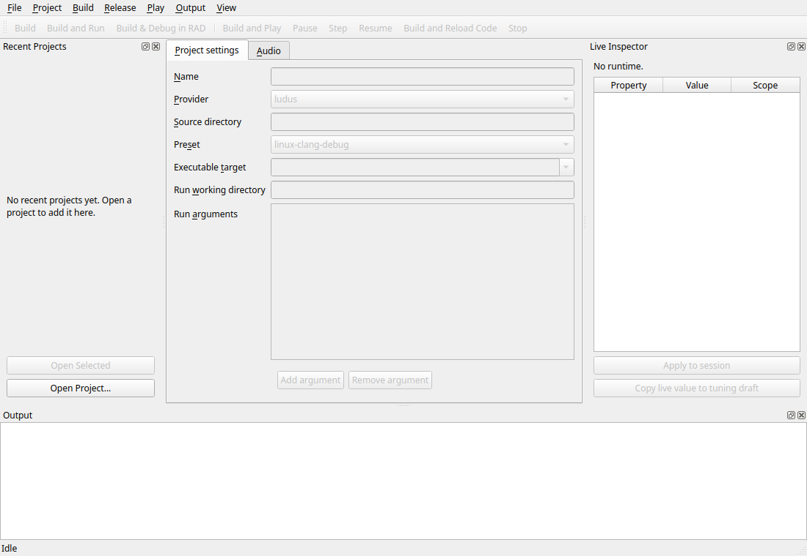

# Native editor workspace and troubleshooting

The editor is an **optional, OFF-by-default** native developer tool
(`apps/editor`, target `ludus_editor`). It opens a project descriptor, edits its
native build/launch settings, saves, reopens, configures/builds, runs the
selected executable in a separate process, stops it, and reports failures. It
also provides scene placement and project-defined component authoring in World,
including the world-demo game adapter. Trusted authoring
rendering and gameplay use separate windows; the status area describes the runtime.

See the specification package for the authoritative contract:
`.kiro/specs/editor-workspace/{requirements,design,tasks}.md` and
`docs/architecture/editor-workspace-research.md`. The
[editor architecture](../architecture/editor-architecture.md) and
[interaction design](../architecture/editor-interaction-design.md) define S1
and subsequent authoring stages.

The editor embeds the approved [Ludus Block artwork](../architecture/editor-art-direction.md)
for its application/window icon, Welcome view and recent-project fallback icons.
macOS bundles include the derived ICNS resource for Finder and Dock. The shared
PNG sources live in `docs/wiki/assets/` and also supply the wiki and browser
editor package; launching the native editor does not need those files on disk.

## Work areas and document ownership

| Surface | Purpose |
| --- | --- |
| Welcome | New/Open and recent projects while no project is open |
| Project | Setup/engine overview, lifecycle actions, name/profile and expandable build/launch details |
| World | 2D/3D placement, game-owned entities/components, typed fields, references, shared history/save/recovery and trusted preview |
| Scripts | Project-owned script and sequence drafts |
| Audio | Content selection, definitions, save and preview |
| Configuration | Independent offline configuration preview and preference editing |
| Live Inspector | Copied runtime state and supported live property operations |
| Output | Selectable build/tool/runtime diagnostics |

The Configuration workspace retains its explicitly loaded preview/draft across
project changes. Quitting prompts for unsaved preferences. Project settings,
audio definitions, offline preferences and live values have separate save owners.
Applying to a session does not save a file; copying a live value to a tuning draft
requires a separate save. See [configuration](../wiki/guides/configuration.md)
and [native live editing](project-live-reload.md).

## Project lifecycle: tasks and audiences

The **Project** tab shows the project folder, committed engine requirement and
components (v2 SDK projects), saved build profile, and the last read-only setup
check. A successful SDK check identifies the actual selected engine version,
revision, target, flavor, installation and selection source, including local
overrides. An unchecked or failed check is not a claim that the project is ready.
These results describe the saved project and computer inputs at check time;
recheck after changing installations outside the editor.

**Check setup**, **Repair setup**, **Save settings**, **Build and run**, and
**Stop** use the existing controller commands and their capability gates. Dirty
settings must be saved before checks/repair/build. Save settings saves only the
project descriptor; audio, World documents, scripts and configuration keep their own save
owners. Opening a project still does not configure, download, repair or build it.
Repair's browser checkbox and engine selection retain their explicit behavior.

Name and build profile are visible. Profile labels explain **Development** for
everyday work, **Debug** for investigating code, and **Release** for distribution,
with Linux/macOS named explicitly. Version-1 descriptors disable profiles outside
their original Linux Debug/Development contract. Labels preserve the exact
underlying preset IDs; profile selection edits a draft and never switches engines or builds
implicitly. The saved preset ID remains visible in the overview. **Build and
launch details** reveals provider, source directory, executable target, working
directory and the exact argument list. Expanding/collapsing only changes the
presentation and preserves settings and history.

The following are designed use cases, not claims of interviews or usability
studies. Experience and discipline are independent: a professional artist may
need simple setup while a beginning programmer wants detailed build controls.
No role choice gates access to capabilities.

| Consumer and real task | Workflow and observable acceptance |
| --- | --- |
| First-time developer creates a game | Welcome → New Project → Name/Location → Create. Existing automatic engine selection stages and verifies the project. Errors retain the current project; no successful publication is claimed before build/tests. Project shows where files live and how to run. |
| Unity/Unreal/Godot user opens a team clone | Open the descriptor, read setup status, then explicitly Repair if tools/presets are missing. Learn the engine requirement and profile from the overview; no need to understand CMake fields to repair. |
| Experienced developer switches from iteration to a release build | Select the named profile, Save settings, Check/Repair its setup, then Build or Package through existing menus. Profile intent stays distinct from SDK acquisition and release packaging. |
| Designer, artist, sound designer or localization contributor joins a project | Open and diagnose setup without changing team metadata. Use the relevant work area; the Project tab explains that content documents save separately. Setup remains explicit rather than blocking access to readable content. Localization authoring itself remains a separate editor gap. |
| QA reproduces a launch issue | Expand build/launch details to inspect target, working directory and exact arguments; select the intended profile, save, run and stop. Copy Job Details in Output supplies exact process evidence. Failed builds never launch an older artifact. |
| Engine/tool engineer uses a local SDK | Repair with a selected installed engine; verify revision, prefix and local override in the successful check. Existing repair preserves custom presets and unrelated IDE settings; committed engine requirements are not rewritten. |
| Rendering researcher runs an experimental executable | Reveal target/preset/arguments, configure to discover executables, select the target and launch separately. Check reports the actual selected SDK; shader prerequisites remain explicit. This does not create a renderer authoring panel. |

### Delivery boundary and next lifecycle work

This first UX slice improves orientation and access to existing verified tooling.
It does not deliver an installed Editor distribution, SDK archive/store browser,
release-version upgrade/migration UI, arbitrary custom-preset discovery, or
browser/native workflow parity. Existing CLI owners remain the source of those
operations. Future UI must reuse their preview/validation/locking semantics and
show expected/actual engine identities before committing a change; upgrade must
preserve project-owned source and custom settings, support failure recovery, and
never conflate a machine-local override with a committed team engine update.

SDK setup identity travels through a bounded, job-tagged `setup_details` control
event (at most 16 KiB of UTF-8), separately from the reserved terminal summary
and output credit. The controller publishes it only after a successful setup
result; failure and cancellation show their own outcome. This private protocol
requires the matching editor/tooling version.

Acceptance covers keyboard/mouse disclosure, profile identity and explicit save,
read-only checks with selected engine evidence, disabled commands, pending
argument text, history and project switching. Offscreen Qt tests validate behavior;
native screenshots validate layout separately. No automated result establishes
that representative users completed these journeys comfortably. Moderated task
sessions with programming and content disciplines remain a usability gate.

## Prerequisites (optional editor setup)

The editor needs Qt 6 (6.4-compatible) with the Core/Gui/Widgets modules and a
native platform plugin (Wayland on Linux, Cocoa on macOS), in addition to the normal reference toolchain
(`./init.sh` prepares pinned Clang 23 / LLD / managed CMake/Ninja/Conan and the
managed Python venv). Qt is not added to Conan or the SDK. Default initialization
skips editor setup; select **Build Ludus editor** in the setup window or use
`./init.sh --cli --with-editor` to install missing Ubuntu/Debian Qt packages or
Homebrew `qtbase` on macOS and
build the selected native Debug, Development or ASan/UBSan editor with 3D preview.
Editor setup also acquires the checksum-verified pinned shader tools: Slang on
macOS, plus SPIR-V Tools on Linux. In **Advanced setup**, clear **Include 3D
preview and pinned shader tools** for a lightweight document-only editor, or use
`--no-editor-preview` with `--with-editor` in the CLI. That path skips shader-tool
setup and explicitly disables rendering, including in an existing build cache.
The preview choice is saved for the selected editor preset and applies to later
script, direct CMake and IDE builds. `--no-system-install` skips system package
installation; it does not skip the managed shader tools when preview is enabled.
`--no-editor` explicitly
disables the editor for the prepared presets. Initialization also excludes test
targets by default; use `--with-tests` to include editor tests or `--run-tests` to
build and execute the enabled tests after setup.
Editor tests also require Qt Test, supplied by the same Qt base development
package on Ubuntu/Debian.

To manage Qt yourself, install it once (names vary by distribution) and use
`./init.sh --cli --with-editor --no-system-install`:

- Debian/Ubuntu: `sudo apt-get install -y qt6-base-dev qt6-wayland`
- Fedora/Amazon Linux: `sudo dnf install -y qt6-qtbase-devel qt6-qtwayland`
- macOS: `brew install qtbase` (Core/Gui/Widgets/Test and Cocoa). Setup discovers
  Homebrew Qt and records `Qt6_DIR` only in the local build cache. A manual Qt
  installation can be selected with CMake `-DQt6_DIR=/path/to/lib/cmake/Qt6`.

Only the editor configure/build uses Qt. A default configure
(`LUDUS_BUILD_EDITOR=OFF`) and default engine browser builds never search for Qt. The separate
[browser editor build](browser-editor.md) explicitly prepares WebAssembly Qt.

## Build the editor (Editor ON)

The editor is gated behind `LUDUS_BUILD_EDITOR` (OFF by default). Configure a
native preset with the option ON using the managed CMake, then build the target:

```bash
./init.sh --cli --with-editor                # Qt + pinned shader tools + rendered editor
# Or manage Qt and the editor build yourself:
./init.sh                                   # pinned tools + managed venv (once)
# Editor ON configure/build (managed cmake shown as `cmake` for brevity):
./scripts/shader-probe bootstrap
cmake --preset linux-clang-development -DLUDUS_USE_INIT_OPTIONS=OFF -DLUDUS_BUILD_EDITOR=ON \
  -DLUDUS_SLANG_COMPILER="$PWD/out/shader-tools/slang/bin/slangc" \
  -DLUDUS_SPIRV_VALIDATOR="$PWD/out/shader-tools/spirv-tools/usr/bin/spirv-val"
cmake --build --preset linux-clang-development --target ludus_editor
```

Native `LUDUS_BUILD_EDITOR=ON` supports Linux x64 and macOS arm64/x64.
Apple silicon is the validated macOS host; native Intel acceptance remains pending.
Browser editor builds use
the separate pinned Qt WebAssembly toolchain; ordinary browser engine setup does
not enable the editor. Browser scene import, in-process cook and the CPU
navigation viewport are documented in [browser-editor.md](browser-editor.md). Unsupported native hosts fail configuration explicitly.

On macOS, the launcher defaults to `macos-clang-development`:

```bash
./init.sh --cli macos-clang-development --preset-only --with-editor --with-tests --no-system-install
./scripts/editor --preset macos-clang-development
```

The macOS port includes New/Open/Save, SDK setup/check/repair, Configure/Build,
Build and Run, Stop, project profile selection, layout/history, audio authoring
and preview, and Configuration. Qt supplies native Cocoa windows, text input,
file pickers, and platform shortcuts. Games run separately using their own
platform/RHI backend, including Metal. Version-2 descriptors expose all three
macOS game profiles; the Editor itself uses Debug, Development or ASan/UBSan.
Version-1 descriptors retain their original Linux preset contract.

Live Play and native reload support macOS Debug/Development profiles with
validated Mach-O UUIDs and immutable detached DWARF symbols. Build and Play,
Build and Reload, Pause/Step, live edits and opt-in source watching share the
existing isolated host supervisor; see [native live editing](project-live-reload.md#macos-setup-and-symbols).
RAD debugging remains disabled on macOS, with a backend error if invoked directly.
Game release setup and packaging now share the
[macOS ad-hoc app backend](game-packaging-publishing.md#macos-app-packages).
Developer ID signing and notarization remain separate distribution work. The Editor is built from the tooling checkout; this port does not add
an installed/signable Editor application bundle to the runtime SDK. The local
macOS build produces `ludus_editor.app`, with the required Qt frameworks supplied
by the opted-in development installation; the File API launcher resolves its
executable inside the bundle.

## Launch

`scripts/editor` locates the already-built `ludus_editor` through the shared
CMake File API helper and starts it with the trusted managed Python interpreter,
the `editor_tool.py` adapter, and this tooling root. It never builds or installs
anything; if the editor is not built it prints the preparation commands above.

```bash
./scripts/editor --preset linux-clang-development \
                 --project examples/editor-workspace/ludus.project.json
```

Opening a descriptor reads metadata and queues a read-only setup check for v2
SDK projects. The check uses the selected CMake to list presets and reports
missing/stale setup in the status area and Output. It never configures, builds,
downloads, runs project hooks, or changes files. Configure, Build, Build and Run,
and Stop remain explicit actions.

## Recent projects

The **Welcome** work area shows recent projects only when no project is open.
The **File → Recent Projects** menu remains available while authoring. Double-click
an entry or choose **Open Selected**. The editor remembers ten successful opens
across restarts, including command-line and newly created projects. Missing paths
are labelled; a failed open preserves the current project. **Clear Recent Projects**
clears history without deleting projects. Recents no longer reserve a dock column.

History is local to the user, in `$XDG_CONFIG_HOME/Ludus/Editor/recent-projects.json`
(normally `~/.config/Ludus/Editor/recent-projects.json` on Linux). An absolute
`XDG_CONFIG_HOME` override works on both native hosts; otherwise macOS uses
Qt's native config location (`~/Library/Preferences/Ludus/Editor`). It is saved atomically,
separately from project files. If preferences cannot be written, project opening
still works and history remains available for the current session.

## Create, initialize, repair and update projects

The **Project** menu provides **New Project**, **Check Setup**, and
**Repair Project Setup**. Setup actions require a saved, clean v2
CMake project; save pending edits first.

For Ludus-Sandbox, open its `ludus.project.json`, choose **Repair Project Setup**,
leave **Use this project's selected engine (recommended)** selected, and click
**Repair Project**. This reuses the project's saved engine selection or installed
locked release; no installation paths need to be entered.

An SDK is the installed engine's headers and libraries. A desktop engine is built
for this computer; a browser engine is built for the web. The dialog asks for a
folder only after choosing **Choose a different installed engine** or enabling
**Also set up browser builds**. The latter needs an installed browser engine
matching the same engine release and enables the web Development and Release
profiles. Saved browser setup is shown and enabled initially. Turning it off
repairs only desktop builds and clears the saved browser selection and owned
web presets, so a missing old browser installation cannot block desktop repair.
Custom presets stay intact. The operation does not change the project engine
requirement or committed lock.

Repair verifies the managed CMake, Ninja, Clang 23, required SDK components,
dependency prefixes and shader tool paths. It generates marked
`ludus-local-<profile>` presets in ignored `CMakeUserPresets.json`, keeping custom
presets and their includes. Machine paths stay in ignored presets and
`.ludus/local.json`; the IDE uses preset mode and each preset selects its CMake
executable. Related stale IDE CMake-path overrides are removed; unrelated
settings are preserved. Real CMake configure/build/test preset discovery must
succeed, followed by a fresh configure, full build and native CTest. No-tests
is an error. Web profiles configure and build; browser runtime acceptance is
separate. The setup signature detects changed SDK contents and moved tools.

The **Build and install the engine used by this editor** option explicitly
initializes and builds the trusted tooling checkout, then installs the desktop
SDK before repairing the game project. This can download dependencies; it
does not install system packages or execute the game project’s bootstrap hooks.
Web SDK acquisition remains an explicit engine-tooling step; select an installed
browser engine in this dialog. New Project asks only for Name and Location, with a Browse button and a
resulting-folder preview. Choose **Create Project** to select the engine and verify
the project. **Advanced engine selection** allows a custom Development SDK;
normal creation requires no SDK path or preparation checkbox. All child commands use the existing streaming output,
Stop, process-group cleanup and single-operation ownership.

New Project creates the bundled minimal v3 native template in a sibling staging
directory, verifies setup/configure/build/tests, then publishes to an absent
destination and opens it. Failure/cancellation before publication discards the
stage and leaves the current workspace intact. Staging build artifacts are
discarded because their CMake paths belong to the staging directory. The next
Configure builds at the final location.

The CLI calls the same backend:

```bash
ludus project check /path/to/Ludus-Sandbox --tools /path/to/Ludus
ludus project repair /path/to/Ludus-Sandbox --tools /path/to/Ludus --sdk /path/to/sdk
ludus project repair /path/to/Ludus-Sandbox --tools /path/to/Ludus --no-web
ludus project update /path/to/Ludus-Sandbox --tools /path/to/Ludus --sdk /path/to/new-sdk
ludus project create /path/to/new-game --name MyGame --sdk /path/to/sdk --tools /path/to/Ludus
```

`create --engine` without `--tools` can still generate metadata without an SDK.
Use `--tools` for verified creation. Without `--engine` or `--sdk`, CLI and
editor share automatic selection: explicit Advanced/CLI SDK, then an absolute
`LUDUS_SDK_PREFIX`, then the editor tooling checkout's current native Development
install, then automatic preparation of that engine. Invalid explicit/environment
selections fail visibly; they never fall back silently. A missing or stale
editor-owned install is prepared only after Create. ABI/compiler validation and
real preset discovery/configure/build/tests still gate publication. Paths remain
in ignored machine-local settings. Reuse requires matching checkout revision;
source-checkout builds are the supported editor distribution today.

```bash
ludus project create /path/to/new-game --name MyGame --tools /path/to/Ludus
```

## Closing and shortcuts

**File → Close Project** returns to Welcome without quitting. Save/Discard/Cancel
protect project settings and audio changes; Cancel or failed Save preserves the
project. Stop active jobs/Play before closing. Close clears the project identity,
setup result, discovery cache, document undo history and audio binding, preserving recent-project history and monotonically
increasing job IDs/epochs so callbacks cannot target a later project.
Quit also checks unsaved project settings before closing; Cancel or a failed Save
keeps the window and its draft open.

| Shortcut (Linux) | Action |
| --- | --- |
| Ctrl+N / Ctrl+O | New / Open Project |
| Ctrl+S | Save the active Project Settings, Audio or Configuration document |
| Ctrl+Z / platform Redo | Undo / Redo in focused text, or Project Settings history |
| Ctrl+Shift+W | Close Project |
| Ctrl+Shift+B | Build |
| Ctrl+F5 / F5 | Build and Run / Build and Debug in RAD |
| F6 / Shift+F6 | Build and Play / Stop |
| F1 | Keyboard Shortcuts help |

The help dialog reads the same QAction bindings used by menus/toolbars. Qt's
standard New/Open/Save bindings follow the platform; actions remain window-scoped
and use controller capability gates. Configurable mappings remain future work.
See [art direction](../architecture/editor-art-direction.md) and
[browser strategy](../architecture/editor-browser-strategy.md).

## Initial S2 document interactions

Project Settings retains up to 64 before/after snapshots. Consecutive edits in
the same field coalesce until focus changes or Save establishes a boundary.
Undo and Redo change the draft; they never write the descriptor. Dirty state
compares the draft's content with the last successful save, so undoing to that
content becomes clean. Save keeps history and acknowledges the captured snapshot
rather than any later edit. A new edit after Undo clears the redo branch.
Validation failures, external-file conflicts and failed file replacement
preserve the draft and its history. Accepted Open, Reload and Close reset this
document history; rejected loads preserve it.

Unrelated controller updates leave unchanged fields and argument rows intact,
preserving cursor, selection and Qt text undo. A pending argument-row edit is
committed before Save or an unsaved-project decision. Field changes reach the
current project synchronously, preventing queued edits from targeting a newly
opened project. Focused editable text owns Undo/Redo first; move focus to another
Project Settings control to use document history. Other work areas and live
inspection do not consume project history.

The shared Save action follows the active work area. Audio retains its existing
save policy. Configuration saves committed preference edits to its selected
file, or asks for a path on the first save; **Apply** still commits the entry
buffer and **Save Sparse** selects an export path. Configuration and project
dirty states remain independent. Audio/configuration document history and live
tuning history are separate follow-up concerns. In the browser, Save downloads
an export and retains the existing volatile-workspace durability limits.

The bounded history primitive is independent of Qt. Project descriptor parsing,
validation and persistence still use the existing Qt adapter; the complete
[portable document core](../architecture/editor-gui-systems.md) remains pending.
This slice does not complete S2: typed portable transactions, richer validation
feedback, broader inspector/IME acceptance and configurable command mappings
still need implementation and qualification. Regression fixtures cover history
branching, save failures and conflicts, a later edit during Save, text focus,
pending argument buffers, command scope and cancelled Quit. The Linux and macOS optional
editor CI run the Qt fixtures offscreen and the sanitizer profile includes the
editor; offscreen checks do not establish native input or browser acceptance.

With the Qt prerequisites installed, include the editor in sanitizer validation:

```bash
./init.sh --cli linux-clang-asan-ubsan --preset-only --with-editor --with-tests --no-system-install
./scripts/build linux-clang-asan-ubsan
./scripts/test linux-clang-asan-ubsan
```

## Gameplay world authoring

The **World** tab owns scene placement and game-owned entity/component data in
one document, entity list, inspector and undo history. Imported geometry is an
entity: select it to edit its placement and attach gameplay components. The editor
never loads project code or guesses C++ component layouts. A project may supply
`authoring/world.schema.json` under its saved source directory; the inspector uses
that schema for gameplay fields. Without it, World supports scene import and
placement with an empty gameplay schema. The world-demo adapter uses this same
World workspace, document, hierarchy, inspector, Save, Undo and recovery path.
There are no separate Scene or 3D Levels authoring tabs.

### Start with an example

1. Use **File → Open Sample → live-edit-game** to obtain a writable sample copy.
   Opening world data does not require downloading tools or building the game.
2. Select **World → Open World…**, then `authoring/starter.world.json`.
3. Select **Starter Cube**. Edit its position or presentation fields. Units,
   project help, enum choices and logical asset names appear in the inspector.
4. Use **Apply Changes** to validate all fields as one edit. Invalid text stays
   visible and the applied document stays intact. **Reset Fields** restores the
   last applied values. Selection and structural commands wait for Apply/Reset.
5. Use **Add Entity**, **Duplicate**, or **Add Component**. Required components
   arrive with defaults; optional components have **Remove Component**. Tags
   with no properties are supported. Entity names can repeat; stable IDs differ.
6. **File → Save World** (the normal Save shortcut while World is selected)
   applies valid pending fields and writes only the world document. Undo/Redo
   operates on whole applied edits; a focused text field retains its own text
   history. New World creates its file on the first successful Save.

The starter includes designer placement, artist presentation, sound asset,
localization-key, behavior-target and rendering-experiment fields. These are
**authoring examples**, not a runtime integration for `live-edit-game`: its
shipped gameplay remains driven by its existing tuning adapter. World previews applied authoring data but does not send edits to Live Inspector.
A game adapter must explicitly
read world data and map it to its typed component pools before it can affect
play. Do not assume Build and Run consumes a World document automatically.

### Use cases and review criteria

Experience and discipline are independent: an experienced artist should not
need C++ knowledge to edit a component, and an engine engineer should not have
to implement a widget for each new numeric field.

| Consumer/task | Interaction and acceptance criterion |
| --- | --- |
| Introductory developer creates a pickup | Start from a named entity and project defaults; add Presentation, choose a mesh and sound, save and reopen without editing JSON. An incomplete number remains visible with an actionable message. |
| Developer moving from Unity, Unreal or Godot changes composition | Use entity list plus component inspector, add/remove optional components, duplicate and Undo. Required components explain why removal is unavailable. |
| Professional designer or artist makes a precise batch of inspector edits | Apply the name and component values atomically. A failed property prevents partial publication; Undo restores the entire edit. File conflicts preserve the draft and history. |
| Audio or localization contributor assigns content | Use labeled logical asset choices filtered by declared kind and a localization-key string. No machine asset paths are stored. This is key assignment, not translation management or audio preview. |
| Engine engineer defines custom component data | Own stable component/property IDs, explicit bounds/defaults/help and the runtime adapter. Unknown fields/schema mismatch fail closed, preserving the current document. No reflection plug-in or project binary is executed. |
| Rendering researcher adds an experiment parameter | Declare units, finite bounds, numeric/enum fields and optional components. The existing inspector renders them. This slice has float32 numeric text input; float64 precision, material graphs and experiment execution remain future work. |
| QA validates a broken or interrupted authoring session | Invalid/duplicate-key JSON, missing references, locks and stale schemas produce explicit failure. Restore Recovery is opt-in, bound to the saved world and schema, validated before use, and undoable. |

These are designed task scenarios exercised by automated regressions and visual
review, **not evidence of a user study**. Validate with representatives of each
experience level and discipline before calling the interaction broadly usable.

### Project-owned file contract

Both schema and world are strict UTF-8 JSON with `version: 1`. See the editable
sample's `authoring/world.schema.json` and `authoring/starter.world.json` for
complete examples. Stable identifiers use 1–64 ASCII letters, digits, `_`, `-`,
`.` or `:`; they are not runtime generational `EntityId` values. Unknown members outside the scene extension described below,
duplicate object keys, duplicate definition/asset/entity IDs and missing
properties are rejected. Different entities may have the same display name.

The schema root has `id`, `label`, `components` and `assets`, and may declare the
`scene_transform` binding described below. Each component has
`id`, `label`, `help`, `required` and a `properties` array. Every property has
`id`, `label`, `help`, `unit`, `type` and `default`:

| Type | Additional schema / authoring behavior |
| --- | --- |
| `boolean` | Checkbox and boolean default |
| `number` | Finite ordered `min`/`max` within ±1e30; complete numeric input parsed by Ludus's float32 converter; untouched loaded numeric values retain their JSON value |
| `integer` | Finite ordered `min`/`max` within ±2147483647; integral values only |
| `string` | UTF-8 text of at most 512 bytes |
| `enum` | `choices`: 1–64 unique strings, each at most 128 UTF-8 bytes; default is one of them |
| `entity` | Empty-string default. Picker uses a stable ID in the current world or empty for None |
| `asset` | Empty-string default and `asset_kind`. Picker uses a declared logical asset ID of that kind or empty for None |

Each declared asset has `id`, `label` and `kind`. The list is supplied by the
project schema; it is not automatically populated from Content Browser and does
not prove that an asset exists or is loadable at runtime. A game's importer/binder
must verify that separately. Asset kinds prevent choosing a sound for a mesh field.

The world root has `schema` (the schema's stable ID) and `entities`. An entity has
`id`, `name` and `components`, an object keyed by component ID; each value is an
object keyed by property ID. Every attached component supplies every declared
property. Required components are present on every entity. Deleting an entity
referenced by another entity is rejected with the referring property; clear or
reassign that reference first. Duplicate creates a new stable ID, remaps its
self-references, and preserves references to other entities. New entity IDs are
FoundationIdentity UUIDv4 text from the operating system's entropy source; if it
is unavailable, Add and Duplicate change nothing and report that in the status
line (see [the UUID architecture](../architecture/object-handles-uuid.md#implementation-sequence)).
The Editor opens and saves version-1 Worlds only. Version-2 records with committed
UUIDs are produced by `ludus-cook identity` and are not yet editable here; see
[UUID authoring records](../architecture/object-handles-uuid.md#stage-3-uuid-authoring-records).

Runtime integration stays game-owned: parse/validate into temporary owned data;
create registry entities; map persisted IDs to new runtime handles; populate
`ComponentPool<T>` with the game's chosen types; resolve references only after
all identities exist. Publish the new world only after all phases succeed. Save
persistent IDs, never pool indices or runtime handles. The editor document is a
private Qt presentation model, not an installed engine API or serialization ABI.

### Save, recovery and scope

Schema loading and opening are read-only. World files must be regular files in
the source folder; symlinks and symlinked ancestors are refused. The schema is
frozen while a world is open. Save refuses a missing/changed schema, a changed
world source or a cooperative editor lock, keeping edits and history available.
Writes use an atomic replacement with direct-write fallback disabled. The lock
and baseline comparison coordinate cooperating editors, not arbitrary writers
racing the final filesystem rename. New World refuses existing destinations.

Applied edits to an existing saved world produce a sibling `.ludus-recovery`
snapshot with schema/base and payload digests. Opening never applies it. Restore
Recovery is available on a clean document and validates the current disk source,
schema and entire recovery payload before creating one Undo item. Save removes
recovery. Undo back to the saved baseline removes matching recovery. Unapplied
text and never-saved new worlds do not have crash recovery; Save is required to
preserve them. Each world path has one recovery slot, so concurrent authoring of
the same document should use version control and separate working copies.

Limits: schema 64 KiB, world 512 KiB, 128 entities, 16 component definitions,
32 properties per component, 4096 declared assets and 32 applied history entries.
These bounds keep this first slice predictable; large production-world UX,
hierarchy/parenting, multi-selection, prefab/archetype workflows, schema migrations,
viewport gizmos, automatic runtime binding and browser import/export are still
unsupported. The browser World tab explains its native-editor requirement and
disables its file actions. Both 2D and 3D authoring use the native World workspace.

## World renderer and camera preview

World now has a native 3D authoring adapter using the engine's mesh, unlit material,
reverse-Z view and C0 camera APIs. It extracts **applied** World data; it never loads
project code or changes simulation state. Camera/orbit/reference controls are
preview settings and do not enter Save, Undo or recovery. The engine's current
lighting implementation supplies Lit materials, authored lights and shadows;
Solid and Albedo remain inspection modes. See the owning
[renderer contract](../architecture/renderer-systems.md) and
[camera contract](../architecture/camera-systems.md).

### Try a 3D authoring workflow

Build the native editor using [Enable the rendered authoring surface](#enable-the-rendered-authoring-surface); the same option cooks the trusted renderer stages.

1. Open a writable **live-edit-game** sample and select **World**.
2. Open `authoring/rendering.world.json`. Its persistent 3D viewport starts inside
   the World workspace. Asset validation runs in an owned worker; the editor
   remains responsive during bounded file reads/decoding. Hold right mouse to look
   and fly with WASD/QE; Alt/Option-left-drag orbits and middle-drag pans. Scroll
   to dolly, press **F** with the viewport focused to frame the hierarchy selection,
   or **Home** to frame all visible objects.
3. Select **Starter Cube** in World. Edit Position/rotation/scale or Renderable
   tint, visibility, mesh and color texture. Valid inspector buffers update the
   viewport after a short debounce, before **Apply Changes** commits the edit.
   Incomplete or invalid text retains the last valid image without changing the
   document or moving keyboard focus. **Reset Fields** restores the applied view.
   **Tint…** opens a display-sRGB picker and fills pending linear RGB values;
   Apply/Reset still own the transaction, while numeric fields remain available.
   **Save World** persists the applied data. Invalid fields stay in the inspector.
4. Expand **Camera and diagnostics**. Use editor camera controls or select
   **Preview Camera** to see its authored pose and lens. **Frame all visible
   objects** explicitly recenters/rescales editor navigation without moving saved
   objects or cameras. Applied object transforms preserve the existing editor
   viewpoint so their movement/scale changes stay visible.
   The settings area scrolls at small window sizes.
5. Select the camera entity in World to edit projection, vertical FOV in degrees,
   orthographic span, near/far distances or XY-follow target. Camera scale must
   be one. Apply validates the World schema; preview validation additionally
   checks cross-field lens and C0 recipe constraints.
6. Use **Reload preview assets** after editing mesh/PNG/binding files outside the
   editor. An accepted preview is a frozen snapshot, not a file-watching promise.
   Invalid replacement files retain the prior preview with persistent stale-data
   feedback. **Pause viewport** cancels pending publication and releases its device;
   the viewport stays embedded. **Resume viewport** restarts rendering.

The world-demo 2D preview and World 3D preview share one device admission
boundary. Opening either closes the other authoring surface; launching a game
also pauses World rendering and resumes it when the operation returns to Idle. Project/document replacement prevents late worker
results from reopening or publishing into another document. Failed GPU setup
stops the surface with feedback and preserves World edits; resuming retries.

Reopening a project restores its last World, selection, editor camera pose/lens
and focus distance, authored camera selection, splitter sizes, active tab and dock
layout.
These preferences live beside the editor's local `workspace.json`, in `projects/`
files keyed by the canonical project root. They do not alter World camera entities
or project documents. Missing Worlds and incompatible or invalid preferences
fall back to the normal workspace; reopening never cooks or downloads assets
just to restore preferences. Viewport asset validation uses the existing local
project assets. Unsaved inspector buffers are not part of this preference file.
Browser builds and native builds without `LUDUS_EDITOR_RENDER_PREVIEW` explain
why rendering is unavailable. The game adapter chooses the trusted preview for
the open World; it does not introduce another authoring workspace.

### World viewport navigation

The World hierarchy scrolls when the available dock height cannot fit its entity
list and commands. **Import report**, beside the World path, opens the full stored
report in the scrollable inspector; opening it does not reduce viewport height.
The import confirmation preview remains visible before an import is accepted.

The editor owns a separate camera controller and publishes a validated C0
pose/lens sample to the renderer. Navigation never changes an authored camera,
World Save/Undo history, or simulation state. Starting navigation from an
**authored camera** adopts its currently visible pose and lens, including roll;
it does not jump back to an old editor orbit. The first nonzero gesture detaches
that preview. Zero-motion input leaves the selected camera unchanged.

| Input, with the viewport focused | Action |
| --- | --- |
| Right-drag | Look around from the current eye |
| Hold right mouse + WASD | Fly forward/backward and sideways |
| Q / E while flying | Move down/up along world Y |
| Shift while flying | Four-times movement speed |
| Wheel while holding right mouse | Adjust fly speed without dollying |
| Alt/Option + left-drag | Orbit around the current focus pivot |
| Middle-drag or Shift + Alt/Option + left-drag | Pan in the camera plane |
| Wheel / high-resolution trackpad scroll | Proportional dolly; orthographic views change visible span |
| F | Frame the selected rendered World entity |
| Home / **Frame all visible objects** | Fit all extracted visible geometry |
| Escape, right-button release, focus loss or hiding the viewport | Stop fly movement and release mouse capture |

Plain left-drag is reserved for selection/tools. Double-click no longer resets
the entire scene. An absent, hidden or non-renderable selection makes **F** a
no-op. Framing uses transformed mesh bounds, fits both viewport axes, and
preserves orientation. Pan uses the current lens, focus distance and drawable
height, so resizing and display scaling do not change the intended displacement.
Fractional pointer/scroll input is retained rather than rounded to mouse notches.
The controls hint stays visible above the image. On a Mac trackpad, hold Option
while clicking and dragging to orbit, add Shift to pan, and use two-finger scroll
to dolly. These gestures do not require a secondary or middle button. **Frame all**
beside the shading selector fits the scene without a Home key. Fly/look still
uses a held secondary click (including macOS Control-click) and WASD/QE.
On Cocoa and X11, fly look recenters the captured pointer and restores its starting
position on release. Wayland forbids pointer warping through this Qt API, so it
uses the delivered drag motion; continuous look at the screen edge still needs a
compositor-supported relative-pointer integration.

Focus distance is independent of the scene radius. The numerical safety range
is `0.000001`–`10000000` world units, with origin-zero camera coordinates bounded
to `10000000` units per component; rejected updates preserve the accepted camera.
Framing/dollying adapts the perspective near plane for close inspection. The
**Camera and diagnostics** controls expose absolute focus distance, and project
preferences retain the owning camera pose/lens and pivot distance. Existing
orbit-only preferences are migrated on load.

This is editor navigation using C0 fixed publications, not an implementation of
the proposed C1 director, transitions, damping, or C2 collision. Mouse displacement
is applied once per event; fly movement integrates presentation elapsed time and
caps a single update at 100 ms rather than integrating the entire duration of a UI
stall. Navigation
continues to use the current project's extracted World and existing GPU frame
ownership; pending or failed scene preparation retains the last drawable view.

The control vocabulary is adapted from Epic Games' [Viewport Controls](https://dev.epicgames.com/documentation/en-us/unreal-engine/viewport-controls-in-unreal-engine).

### Audience tasks and acceptance cases

| Consumer/task | Supported path and observable acceptance |
| --- | --- |
| Beginner follows a starter | Open the shipped textured cube, preview, edit a named position field, Apply, Save and Undo. Navigation never dirties the document; required transforms already exist. |
| Unity/Unreal/Godot user blocks out a scene | Add Renderable to an entity, assign declared mesh/texture, adjust XYZ rotation and positive scale, then frame all or select a camera. Asset IDs and camera selection survive unrelated edits. |
| Artist/designer/audio/localization contributor reviews content | Mesh/color-texture choices use the existing typed inspector; non-rendering entities remain part of World. Edit visible/tint or camera framing without a compiler/toolchain command. Pending inspector text is never silently treated as applied geometry. |
| Professional integrates a bounded project scene | Bind existing project component/property IDs, use indexed XYZ/UV meshes and sRGB PNG color textures, and check lens/capacity errors before publication. No glTF/FBX importer or production-scale scene claim is implied. |
| Engine engineer owns a custom world | Supply the explicit semantic mapping below. No C++ component layout is guessed, no ECS storage is borrowed and no project library is loaded. Runtime extraction remains game-owned. |
| Rendering researcher compares visibility | Use the copied submitted/visible/culled/draw counts, authored-camera trace and reference mode. Reference disables CPU culling/sorting/instancing, while normal GPU clipping still applies. This is inspection, not a profiler or lighting/shadow workbench. |
| QA tests broken inputs and lifecycle | Corrupt JSON/PNG/indices, retarget a path, change lens ordering, close during a load, switch documents, resize and reopen. Failures preserve authoring data; stale workers cannot publish and stale preview feedback stays visible. |

These are designed acceptance scenarios and automated/native checks, not
representative-user interview evidence. Native frame acceptance and existing
renderer pixel tests serve different purposes; offscreen widget tests do not
prove displayed GPU pixels, pointer interactions, IME or screen-reader behavior.

### Project-owned preview bindings and assets

The source root supplies `authoring/render.preview.json`, a strict version-1
object containing `schema` equal to the World schema ID, `transform`, `renderable`,
`camera`, `meshes` and `textures`. Each semantic role is an object with a
`component` ID and `properties` map. Component and property IDs may be renamed:
the map keys below are semantic names; the map values are project property IDs.
The `camera` role may be `null` when the project uses editor orbit only.
An optional `light` role maps an authored photometric component; absent or null
keeps older descriptors valid.
Unknown fields, duplicate keys, missing/duplicate mappings and wrong property
types reject. The shipped descriptor is a complete example.

| Role | Required semantic map keys and property types |
| --- | --- |
| transform | `x`, `y`, `z`, `rx`, `ry`, `rz`, `sx`, `sy`, `sz`: number. Translation uses world units; rotations use degrees, applying X then Y then Z; scales are positive. |
| renderable | `mesh`, `texture`: asset; `visible`: boolean; `r`, `g`, `b`: number in [0,1], interpreted as linear tint. Empty texture selects flat color; visible renderables require a mapped mesh. |
| camera | `projection`: enum with supported values `perspective`, `orthographic`, `infinite`; `fov`, `span`, `near`, `far`: number; `follow`: entity. Empty follow is fixed; nonempty follow resolves a transformed target through C0's immediate orthographic XY recipe with zero offset. |
| light | `kind`: enum (`point`, `spot`, `directional`); `enabled`: boolean; `r`, `g`, `b`: number in [0,1] linear hue; `intensity`: number in [0,1000000], candela for point/spot or lux for directional; `range`: number in [0.01,1000000] metres; `innerAngle`, `outerAngle`: number in degrees, 0 ≤ inner < outer < 90. |

Renderable/camera/light entities must also have the mapped transform component.
Lights require unit scale and use -Z forward; position and rigid rotation update
authored lighting, with persistent World entity IDs identifying the source. Disabled
lights are omitted without removing their authored component. The shipped schema
includes an optional Light component, which users attach explicitly. Camera
rotation is rigid, +Y up and -Z forward; XY follow requires identity rotation.
Other entity components remain untouched. Camera selection uses the persistent
World ID and falls back visibly to editor orbit when the selected camera is removed.

`meshes` and `textures` are arrays of `{ "id": "...", "path": "..." }` entries.
IDs must already be declared in World schema assets with kind `mesh` or `texture`.
Paths are normalized project-relative regular files; traversal, absolute paths,
symlinks and unreadable files reject. Mesh files are strict JSON objects with
`version: 1`, `positions` (XYZ arrays), matching `uvs` (top-left XY arrays) and
triangle-list `indices`. Each index must be a nonnegative integer JSON token within the vertex array
(decimal/exponent indices are not accepted).
Meshes have at most 4096 vertices/12288 indices and a 1 MiB file limit. PNG color
textures have a 4 MiB file limit, at most 2048 pixels per axis, one initialized
mip and nearest/clamp sampling; bytes are interpreted as sRGB with opaque output.
PNG profiles do not select another render color space in this adapter.

The adapter validates at most six declared meshes/eight textures and eight
distinct texture/tint combinations (identical surfaces are shared), within the renderer's fixed material-version budget.
World retains its 128-entity bound. Positions, transformed vertices and numeric
extraction are bounded to ±1,000,000. Resource admission can fail earlier on a
particular device; file/schema validation does not promise GPU availability.
It validates every declared preview asset, including unused entries.

The sample cube mesh, texture and rendering World are editor authoring examples;
they do not drive live-edit-game's runtime. High-resolution bake authoring,
masked/painter surfaces, UV/sampler/mip editing, mesh importers, viewport picking,
transform gizmos, hierarchy/prefabs and browser rendering remain later slices.

## Project-owned 3D levels and reference import

Use **World** for scene placement and gameplay authoring. There is no separate
**3D Levels** tab. The cooked-scene importer and renderer are services beneath
World; they do not expose another object hierarchy or authoring document.

1. Create a project or open an existing project. Missing/stale SDK setup is
   reported by the normal project checks; explicit **Repair** owns setup changes.
2. In **World**, choose **New World…** or **Open World…**, using a
   project-contained `.world.json` path, for example `scenes/main.world.json`.
3. Choose **Import scene…** and select `scene-v4.pbrt` from the supplied
   staircase2 reference directory. Import cooks assets into the project. The
   admitted instances join the current World's entity list in one undoable edit.
4. Select an imported entity. Its **Scene instance** inspector edits local
   position in metres, rotation in degrees, and positive scale; gameplay fields
   and **Add Component** are in that same inspector. **Apply Changes** validates
   placement, name and component values together. Valid draft fields update the
   embedded viewport before Apply; invalid buffers retain its last valid image.
   Camera and material data retain the imported scene profile.
5. Duplicate/Delete and World Undo/Redo act on the complete entity, including its
   scene binding and gameplay components. Parent removal is refused while its
   children remain. Invalid fields preserve the previous applied document.
6. **Save World** verifies the cooked-scene assets before the atomic document
   write, independently of viewport availability. During imports and asset/save
   operations, editing and Save wait for completion; draft preview assembly keeps
   text fields available and coalesces continued typing.
   **Cancel scene operation** retains the previous document. Reopen reads the
   project's cooked assets without needing the original source directory.

**Open World…** also accepts an existing `.lulevel` file. Successful conversion
creates an unsaved sibling `<level-name>.world.json`; it preserves the original
level and refuses an existing conversion destination. Failed conversion preserves
the active World. Save publishes only the converted World document. Existing
`.world.json` documents without scene data remain readable.

The optional World root `scene` contains the level's `version`, persistent `id`,
`name`, `profile`, `camera` and `imports`, with no second object list. An imported
entity's optional `scene` stores `mesh`, `material`, `parent`, the nine-number
imported affine `basis`, and, without a schema binding, three-number `position`, `rotation` and `scale`.
The entity ID and name are the only authoritative object identity and label.
Rotation applies X, then Y, then Z relative to the imported basis; unit scale and
zero rotation preserve source shear and orientation. Position is local to the
parent. Placement values are finite and bounded to ±1,000,000; rotations are
bounded to ±360 degrees and scales must be positive. A schema can explicitly bind a required numeric component with
`scene_transform`, for example:

```json
"scene_transform": {
  "component": "transform",
  "position": ["x", "y", "z"],
  "rotation": ["rx", "ry", "rz"],
  "scale": ["sx", "sy", "sz"]
}
```

Each array names three distinct `number` properties; all nine must exist on the
required component. This binding makes component values the placement source for
imported instances. Their `scene` then stores only mesh, material, parent and
basis, and the inspector displays the component's transform fields once.
The live-edit-game sample declares this binding. The editor does not infer it
from component names. Without a binding, the built-in Scene instance placement
fields own the imported transform. Scene metadata and components are saved and
recovered together, with one history.

When `authoring/render.preview.json` is present, schema-bound visible meshes and
imported geometry compose into the same embedded viewport. Scene instances use
their cooked bindings; they are not rendered a second time through the schema
adapter. The combined resident profile permits six meshes, eight materials,
eight textures and 128 visible instances; overflow retains the previous viewport
and reports the capacity. Schema meshes receive generated shading normals and
matte materials in this combined lit profile; their linear tints are baked into
transient sRGB texture copies. Original assets are preserved. Worlds without
imported scene data retain their existing unlit preview adapter.


Build the native Editor with
[the rendered authoring option](#enable-the-rendered-authoring-surface).
This first host profile requires macOS or Linux. Its source importer supports
Modern Hall/staircase2's bounded PBRT/PLY/TGA
subset, with grouped static room surfaces and emissive geometry. It is not a
universal PBRT/glTF/OBJ importer. Unsupported features preserve the active scene.
The embedded native viewport renders the selected World's current snapshot and
camera through the GPU raster renderer, bounded to 1024 pixels on its longest
edge. Valid field drafts, orbit, pan, zoom and resize update the GPU view. Both
project binding previews and imported lit scenes share their original GPU display
textures with Qt; presentation performs no CPU pixel readback or image upload.
The renderer tone-maps and encodes its RGBA8 display image once. Unlit textured
bindings use a linear RGBA8 intermediate; imported scenes in Lit mode prefer HDR
when available.

The shading selector above each viewport defaults to **Solid — neutral preview
shading**. It gives surfaces a neutral material and imported geometry an editor-only
directional fill and ambient contribution, so imported rooms remain visible for
inspection and editing. **Albedo — unlit surface colors** displays base-color textures and material tints; emitting meshes
with black authored albedo remain black in this view.
**Lit — scene lighting** displays authored analytic lights, emitting surfaces,
shadowed area-light proxies and the completed static diffuse/indirect bake. During resource preparation, the viewport retains its last drawable GPU
image until Qt presents the replacement. A failed replacement reports its error
without clearing that image; a later scene or shading change can retry preparation.
When no image remains to retain, the viewport itself shows the failure reason,
including the preparation stage's specific error, instead of its empty-viewport hint.
Switching modes keeps the World, camera and layout; the shading choice
is restored with the project's viewport preferences. Older preferences without a
shading choice open in Solid mode. These visualization overrides do not change
authored materials or add lights to the World. Solid lighting is a navigation
aid, not the imported scene lighting. Wireframe and normal visualizations are
not yet available.

Lit first publishes shadowed direct lighting, then prepares static diffuse and
indirect lighting as cancellable CPU jobs on the preview's three-worker job system
(the UI thread only polls). The jobs compute illumination charts rather than
viewport pixels; navigation and Qt presentation continue on the GPU. Completed charts upload once on the device owner thread and replace the
per-instance materials and snapshot only after they are ready. Analytic direct
lighting and area specular remain raster; baked area diffuse replaces its proxy
contribution. HDR/constant authored environments supply the initial irradiance
and retain specular reflection after the bake. No editor fill is added to Lit.

The status shows planar proxy/shadow counts, bake progress, completion or failure.
A failed bake retains the direct-lit viewport and camera controls. While the bake
runs, **Cancel bake** below the shading selector stops it and keeps direct
lighting; **Bake again** restarts it. When the bake tolerates input flaws, such as
zero-area triangles in imported meshes, the bake controls show a warning with the
skipped count, and its tooltip names each affected object, as soon as preparation
completes. The status line repeats the count, so you can fix the meshes or cancel
the bake instead of waiting for a rejection. Camera, orbit,
exposure and layout changes do not restart this view-independent bake; geometry,
material, light and environment changes create a new exact revision. Saved World
assets preserve authored lighting through reopen and relocation. Legacy v1/v2
imports can use the bake without reimport, retaining historical two-sided emission.

This bounded quality profile uses one centroid quadrature proxy per connected
planar emitter patch and hard cube-map shadows. It supports up to 128 admitted
lights and 80 shadow regions: point/area lights consume six faces, while
spot/directional lights consume one. The 2048-pixel atlas packs guttered cells;
capacity, malformed or unsupported source topology rejects rather than dropping
illumination. Zero-area triangles, common in imported meshes, never reject a scene:
they carry no power and form no area proxy, an authored World mesh gives them an
inert placeholder normal, and the static bake skips and reports them (for example
the staircase2 reference scene). Curved or concave sources can exceed this proxy profile. The
static bake uses 64 cosine samples per triangle, depth four, and separate
4×4 guttered triangle tiles; it can show spatial discontinuities and sampling
noise. It includes diffuse bounces, with finite-depth bias, rather than glossy
indirect transport, soft area shadows or spectral PBRT parity. See the owning
[renderer contract](../architecture/renderer-systems.md) for transport semantics.
Optional GPU path tracing remains a separate renderer API.

Qt Quick's native surface is embedded in the World splitter and uses the basic
owner-thread render loop. The adapter admits the device and queue Qt Quick renders with, imports
its RGBA8 texture, and retires replaced reads only after Qt submits the consumer
frame. The scene graph samples only the active image, whose read stays open until
a synchronized replacement takes its place; the replaced read is released at
`afterFrameEnd` or on the next service tick, after Qt's submission either way.
`QQuickWindow::grabWindow` synchronizes and renders without the frame signals and
may itself promote the pending image; the same rule covers it. RHI and Qt submit
on one serialized queue, so a lease error would show a newer frame, never torn
pixels. Resize, scene replacement, Stop and source invalidation release texture
leases before renderer/device cleanup. Camera and splitter restoration keep the
existing project-local preferences. The native child surface follows Qt window
container stacking rules; widgets cannot overlay it arbitrarily.

Metal sharing requires Qt 6.4+ with Qt Quick and the Cocoa display plugin. On
Linux (X11 or Wayland) the editor creates the Vulkan device itself, on Qt's
`QVulkanInstance`, choosing a graphics queue that can present to the viewport
window and enabling `VK_KHR_swapchain`. Qt Quick adopts that device through
`QQuickGraphicsDevice::fromDeviceObjects`, available in every Qt 6 release, and
the RHI admits the same device and queue. Qt before 6.6 cannot report the queue of
a device it created itself; with this ownership it never has to, so Ubuntu 24.04's
Qt 6.4 shares GPU textures without CPU readback. Hardware adapters are preferred
over software rasterizers. The editor destroys the device only after Qt Quick and
the RHI have released it.

The viewport keeps presenting on Wayland after it is hidden and shown again, for
example by switching work tabs or hiding the editor window. QtWayland before 6.5.1
has two bugs on that path. It keeps the Vulkan surface of the unmapped
`wl_surface`, so the next present targets a recycled protocol object and the
compositor disconnects the editor. It also creates no subsurface for a viewport
shown before its parent window, so that viewport is never exposed again. On those
releases the editor destroys the viewport's native window when it is hidden, which
releases Qt Quick's swapchain and Vulkan surface. It recreates the window once the
parent window is visible, and Qt Quick builds a new swapchain. The shared device,
scene graph and frame leases persist, so presentation resumes from the same GPU
textures without readback. Releasing a swapchain makes Qt wait for the device to
go idle, as it already does on resize. Newer Qt releases and X11 keep Qt's own
hide/show handling.

Qt 6.4's `grabWindow` interprets every non-BGRA8 swapchain readback as 8-bit RGBA.
On GNOME Wayland, Mesa offers Intel GPUs an RGBA16F swapchain first, so grabs there
look striped although the screen is correct. On X11, grabs match `xwd` captures of
the window exactly; use X11 for pixel evidence.

If no adapter can present to the window with a shareable device, the viewport
falls back to an offscreen path. The engine creates its own headless Vulkan device,
renders the same raster viewport into its two display images, and copies the
latest completed image back to the CPU in bands that each fit one RHI transfer
slice. A plain widget paints that `QImage`. The renderer keeps drawing into the
other image while one is being copied, and the GUI thread only polls, so no call
waits for the GPU. [World navigation controls](#world-viewport-navigation) work as
in the shared path; resizing recreates the offscreen targets. The headless device
admits the same storage budgets and raster profile as the shared device, so Lit
shadow atlases fit on both paths. The copy costs some latency and bandwidth, and the
frame is capped at 1024 pixels on its long side, the same as the shared path. Set
`LUDUS_EDITOR_VIEWPORT=offscreen` to force this path for testing.

Offscreen Qt plugins without that variable, or machines with no Vulkan driver,
keep document editing and asset validation available, and the viewport explains
why it cannot show a frame. Lightweight builds can still disable native preview
explicitly. Browser scene import and a game's
automatic Play/load integration are outside this initial profile.

Keep `assets/` and `.world.json` documents with the project. Retain legacy
`.lulevel` files when using the scene CLI. They contain the catalog,
immutable cooked files, exact dependencies and retained licenses. Scene documents
contain stable logical UUIDs; artifact revisions and hashes live in the catalog.
Importing the same source again creates independent instances while reusing its
logical assets. An explicit import of changed source data updates those assets
only after complete validation and renderer admission. A failed/cancelled import
or save preserves the previous saved data; the last-good viewport remains visible
while a candidate is prepared.

The `ludus-cook` scene CLI (built with `modules/content/scene_cook`) retains the
`.lulevel` interchange workflow and uses the same native asset/import library as the
Editor. It does not consume World gameplay components:

```bash
ludus-cook scene new /path/to/project scenes/main.lulevel --name Main
ludus-cook scene import /path/to/project scenes/main.lulevel /path/to/staircase2
ludus-cook scene dump /path/to/project scenes/main.lulevel --json
ludus-cook scene open /path/to/moved-project scenes/main.lulevel
ludus-cook scene publish /path/to/project scenes/main.lulevel /path/to/new-release
```

`scene publish` writes only the selected required closure and its licenses,
`scenes/main.lulevel`, `scene-release.json` and a runtime `scene.luscn` packet.
It refuses an existing destination. `scene assemble PROJECT LEVEL OUTPUT` produces
an interchange packet without calling the source importer. The owning
[resource-manager architecture](../architecture/resource-management.md#initial-stage-5-storage-and-renderer-profile)
documents schemas, identities, capacities and ownership; the
[staircase2 prototype guide](../examples/reference-scene.md) retains its original
conversion/visual limitations and higher-quality offline capture evidence.

## S4 scene authoring

World owns the world-demo adapter as well as 3D scene placement. Its sample
[World files](../examples/world-demo.md#edit-levels-and-gameplay) declare
`ludus.world-demo.v1`; the shipped `apps/world_demo/authoring/world.schema.json`
defines Transform, Player, Enemy, Exit, Collision box and Level settings.
Actors, static boxes and settings all appear in the same World entity list and
component inspector. The runtime projects settings and boxes into level data;
they do not become gameplay registry entities merely because they are editable.

1. Open the engine project with `ludus_world_demo` selected, then **World → Open
   World… → apps/world_demo/levels/first-room.world.json** (inside its saved source root).
   A standalone copy can place the supplied schema at `authoring/world.schema.json`;
   when no project schema exists, the known sample schema is available in the editor.
2. Select `player-start` or `guard-a`. Edit Transform position in metres, rotation
   in radians, positive scale or the role's gameplay fields. **Apply Changes**,
   **Reset Fields**, **Save World** and Undo/Redo have the same behavior as other Worlds.
3. Select `floor` to edit collision center/extents, or **Level settings** to edit
   bounds, camera and seed. The seed is decimal text so all unsigned 64-bit values
   survive the JSON/inspector boundary exactly.
4. Duplicate an enemy/exit with **Duplicate**. Its new ID fits the game's 31-byte
   identity limit. Add Entity and Add Component can assemble new recipes; unfinished
   recipes remain editable, while Save/preview reject incompatible role combinations,
   broken player targets, invalid bounds, excess capacity or missing settings.

The player accepts at most 64 KiB, 32 actors and 16 collision boxes, one settings
entity and exactly one player. Runtime-only handles never enter the file.
Old v1 world-demo `.json` levels open through this same command: they become
unsaved sibling `.world.json` documents, and Save writes the sibling. The original
file remains intact; conversion refuses an existing destination. This is an import
compatibility path, not a second editor or save workflow.

### Enable the rendered authoring surface

Native editor builds enable `LUDUS_EDITOR_RENDER_PREVIEW` by default. Normal
`init.sh` editor setup prepares the pinned tools and builds preview automatically:

```bash
./init.sh --cli linux-clang-development --preset-only --with-editor
```

For a lightweight document-only build, use `--with-editor --no-editor-preview`
or clear the preview checkbox in **Advanced setup**. Manual CMake builds can use
`-DLUDUS_EDITOR_RENDER_PREVIEW=OFF`; browser editor builds keep preview off by
default. Existing manual CMake caches retain their explicit option value.

To prepare tools and select additional rendered sample targets manually on Linux:

```bash
./init.sh --cli linux-clang-development --preset-only --with-editor --with-tests
./scripts/shader-probe bootstrap
out/host-tools/venv/bin/cmake --preset linux-clang-development \
  -DLUDUS_EDITOR_RENDER_PREVIEW=ON -DLUDUS_BUILD_WORLD_DEMO=ON \
  -DLUDUS_SLANG_COMPILER="$PWD/out/shader-tools/slang/bin/slangc" \
  -DLUDUS_SPIRV_VALIDATOR="$PWD/out/shader-tools/spirv-tools/usr/bin/spirv-val"
out/host-tools/venv/bin/cmake --build --preset linux-clang-development \
  --target ludus_editor ludus_editor_tests ludus_editor_scene_tests ludus_world_demo
```

For macOS use `macos-clang-development` and omit `LUDUS_SPIRV_VALIDATOR`; its
pinned Slang path emits Metal. With tools prepared, World’s **Open rendered preview**
creates one main-thread Platform-owned window and connects it to RHI. No Qt
`winId()` borrowing, cross-process embedding, CPU-painted stand-in or project
module loading is involved. Shutdown releases RHI before the window. This
recovery path supports one authoring surface; multiwindow/multisurface ownership
and an embedded mouse gizmo remain follow-ups.

In the preview, WASD moves the white pick cursor, Enter picks an object, Tab
cycles IDs, and arrow keys preview a 0.1-metre transform. Releasing all arrows
accepts one edit. Escape cancels. The CPU pick uses the shader's rotated/scaled
rectangles and draw order, and compares document, revision, camera, surface and
transient-preview identities. Resize and cancelled previews invalidate older
frames. Native Cocoa events are normalized through either the host responder
or Ludus event pump, with duplicate suppression. Rendering failure leaves the
document editable/saveable; reopening the preview starts a fresh RHI session.

### Save, recovery and Play

**Save World** uses the same cooperative lock, baseline conflict checks, atomic
replacement and explicit recovery described in [Gameplay world authoring](#gameplay-world-authoring).
The sample player reads that exact World file. The 2D renderer owns only a
transient validated projection and pending gesture; it never saves a second
scene document. Releasing all arrows commits one edit to World's history.
Undo/Redo update the projection from World, and incomplete inspector buffers
stop the preview so native keyboard input cannot overwrite unapplied text.
Pending text and cancelled gestures never enter Save or recovery.

For this adapter's **Play saved World**, configure Project settings to build
`ludus_world_demo` with `LUDUS_BUILD_WORLD_DEMO=ON`, and set run arguments to
`--level` followed by the `.world.json` path (relative to the configured run working
directory, or absolute). Save Project settings. The action saves the World,
closes authoring rendering, then uses the existing supervised Build/Run workflow.
The child independently reads and validates that saved file before activation;
simulation never writes authored transforms back to the Editor. The action does
not rewrite project settings or execute a different target implicitly. On macOS
this sample Build/Run is distinct from the still-unavailable native Live Play /
hot-reload protocol. `--headless --level <file>` and `--frames 3 --level <file>`
provide bounded player acceptance paths.

Portable scene tests cover failed-load rollback, all-or-nothing multi-target
edits, cancelled gestures, saved-content history, eviction, save-during-edit
acknowledgement, and stale picking. World widget/persistence tests cover invalid
buffers, save/reopen, runtime projection, source conflicts, shared recovery,
actor duplication, collision/settings edits and legacy import preservation. The opt-in Cocoa journey exercises actual Metal
frames, native keys, resize, save/reopen, and a separately rendered player:

```bash
QT_QPA_PLATFORM=cocoa LUDUS_SCENE_TEST_PLAYER="$PWD/out/build/macos-clang-development/apps/world_demo/ludus_world_demo" \
  out/build/macos-clang-development/apps/editor/ludus_editor_tests '[.scene-native]'
```

Linux compilation and portable/offscreen checks do not qualify native Wayland
input or compositor behavior. Windows embedding, pointer gizmos, general project
schemas, large-scene measurements and browser authoring remain explicit gates.
See [rendering/platform obligations](../architecture/editor-gui-systems.md#rendering-and-platform-hosts).

## S3 content browser

The **Content** work area projects the saved `content/catalog.json` into a
searchable table of resource IDs, kinds and paths. Search is case-insensitive
and checks all three columns. Selection is an ID, so filtering, sorting and
refreshing cannot reinterpret a row number as another resource. Hidden selections
are restored when their ID becomes visible again. Unchanged refreshes preserve
the model and focused search buffer; changed paths update their roles. Structural
changes restore selection by ID. Activate a Sound or Music row to open the
existing Audio workspace, which retains its unsaved-change policy.

**Import WAV / FLAC** asks for a stable resource ID. **Reimport selected** retains
the selected audio-source ID and asks for its new export. Both entry points,
including the existing Audio import button (which opens Content), share the bounded decoder,
dependency checks and publication implementation. Import validates saved loops
and matching sample rates, captures catalog/dependency digests, and rechecks
consulted inputs before publication. It never rewrites authored Sound or Music
settings. Errors name the failing stage or dependency and retain the last valid
catalog/list. Refresh explicitly retries a failed catalog read.

The copied source is published to an immutable `sources/<key>.wav` or `.flac`
file. The SHA-256 key includes source bytes, format, importer version and native
copy profile. Only a successful compare-and-swap catalog replacement makes that
version active. Failed catalog publication retains the previous source and
reports the unreferenced candidate path. Old versions and candidates are retained;
this slice does not automatically delete them. There is no multi-file filesystem
transaction. Uncooperative writers can still race native save checks; the
[Content save contract](../architecture/content-resources.md#native-saves) owns
those limitations. Dependency checks are snapshot validation, not locks over an
entire authoring project.

Native catalog reads, decoding, validation and writes run on a worker with owned
input/result data. The GUI applies completed snapshots. One request is admitted
per browser; a completion must match its operation ID, project epoch and root.
Changing identity invalidates old results and requests cancellation. While an
import is active, finish or cancel it before using the shell's project-switch,
Reload or Close Project actions or saving a changed source root. Other project
field editing and the search buffer remain available. Read-only catalog refreshes
do not block project changes; their cancelled/stale results are discarded.

**Cancel operation** reports cancellation requested until a terminal outcome is
acknowledged. Cancellation wins before publication begins; a late request cannot
undo a catalog commit. The UI then waits for the actual success or failure.
Quit cancels and asynchronously drains owned work without blocking the GUI.
Polling exists only during an active job. Workers never call model/widget APIs
or capture a window pointer. Browser controls explain their desktop requirement.
Native support follows the [host prerequisites](#prerequisites-optional-editor-setup).
Browser import and persistence still need acceptance.

The table uses a Qt model/view projection with no widget per asset row. Actual
audio catalog admission remains **4096 resources / 1 MiB JSON**. The separate
scene asset catalog admits **4096 resources / 64 MiB JSON**; see
[limit ownership](../architecture/content-resources.md#limit-ownership).
The `[content][scale]` fixture separately measures a synthetic **100,000-row**
view: population, 20 searches (p50/p95), and stable-ID lookup. The optional-editor
CI records host/OS/architecture, Qt version and the Development profile in its
`editor-content-scale` artifact. This is a reproducible model baseline, not a
claim that larger catalogs are admitted or that native scrolling/accessibility
has been qualified. Native input/scroll measurements, thumbnail budgets and
non-audio importers remain follow-up work.

Regressions exercise immutable reimport, malformed source rejection, saved-loop
constraints, dependency/catalog conflicts, cancellation before publication,
late-cancel semantics, ID selection across filtering, unchanged-role updates,
stale operation/project results, GUI-owned completion and shutdown. CI runs
those fixtures under Clang 18 analysis and ASan/UBSan.

## The project descriptor (version 1)

One UTF-8 JSON file, conventionally `ludus.project.json`
(`examples/editor-workspace/ludus.project.json`):

```json
{
  "version": 1,
  "name": "Ludus smoke workspace",
  "provider": "ludus",
  "source_dir": "../..",
  "preset": "linux-clang-debug",
  "target": "ludus_smoke",
  "run": { "cwd": ".", "args": [] }
}
```

- `version` must be the number 1. `provider` is exactly `ludus` or `cmake`.
- `source_dir` and `run.cwd` are **relative** paths (intentional `..` allowed);
  they resolve against the descriptor directory / resolved source, never the
  editor launch directory. `source_dir` must contain `CMakeLists.txt` and
  `CMakePresets.json`.
- `preset` is `linux-clang-debug` or `linux-clang-development` in E0.
- `target` matches `[A-Za-z0-9_][A-Za-z0-9_.+-]*` and must resolve to a unique
  executable after Configure.
- `run.args` is an exact argument list (one string per entry). Empty, quoted,
  Unicode, whitespace and shell-looking entries are preserved verbatim; there is
  **no** shell, globbing, variable expansion, or RAD-style argument restriction.

Size limits: file ≤ 64 KiB, name ≤ 128 bytes, paths ≤ 4096 bytes, target ≤ 256
bytes, ≤ 64 args each ≤ 4096 bytes and ≤ 32 KiB total.

## Save, conflict and recovery

Save validates the whole draft, takes a short cooperative lock in an ignored
`.ludus/` directory beside the descriptor, checks the on-disk bytes still match
the digest recorded at Open/last Save, then writes atomically with `QSaveFile`
(direct-write fallback disabled). A short/failed write, commit failure, or disk
conflict **retains the old saved file and your dirty draft** and reports the
error; it never silently overwrites. If the file changed on disk you get a
Conflict and an explicit Reload (with discard confirmation).

Open/Reload/Close on a dirty document offer Save / Discard / Cancel; a failed
Save aborts that action.

## Build / run semantics

Build and Build-and-Run require a clean saved document, snapshot it, verify its
digest, Configure, resolve the executable through the CMake File API codemodel
(never a guessed path), build only that target, re-resolve the artifact after
build (CMake may regenerate), and validate it. **A failed or cancelled build
never launches any artifact, including a previously successful one.** Run uses
the resolved absolute artifact, the explicit `run.cwd`, the inherited session
environment, and the exact argument list — no shell, no detached launch.

### External installed-SDK projects (provider `cmake`)

An external project (`examples/editor-sdk-project/`) uses `provider: "cmake"`,
`source_dir: "."`, and its own `CMakePresets.json`. Its two supported native
presets must produce single-config Ninja trees at `<source>/out/build/<preset>`.
The sample's preset supplies `CMAKE_PREFIX_PATH` from `$env{LUDUS_SDK_PREFIX}`;
the matching SDK must already be installed:

```bash
./scripts/install-sdk linux-clang-development   # produces out/install/<preset>
export LUDUS_SDK_PREFIX="$PWD/out/install/linux-clang-development"
./scripts/editor --project examples/editor-sdk-project/ludus.project.json
```

The adapter does not choose, build, or install an SDK, and never injects engine
Conan profiles into the external project. The external project compiles no engine
sources. Unsupported generators/tree layouts fail explicitly.

## Operations, cancellation and close

Exactly one operation is owned at a time. Configure/Build/Run never block the
GUI. Stop is idempotent, uses deadlines, terminates ordinary descendants (owned
process group), drains output, and confirms cleanup. A Stop accepted before the
runtime spawns prevents the launch. Normal Close while busy offers "Stop and
Close" (asynchronous; closes only after cleanup is confirmed) or "Keep Open"; a
close request is cancellable. If the supervisor is lost or cleanup cannot be
confirmed, the editor enters **CleanupUnknown**: no new operation and no
automatic close until explicit operator recovery (restart), with the known
job/PID details available through Copy Job Details.

An operation holds a cooperative, nonblocking lock on its build tree for the
whole configure/build/run (including runtime ownership). A second editor
instance targeting the same build tree gets a `Busy` result rather than racing
it. The installed Ludus CLI shares this cooperative lock. Direct CMake or unrelated
build tools bypass it; avoid modifying the same build tree concurrently.

## Copy Job Details

Produces a bounded, telemetry-free text record: descriptor digest,
provider/preset/target, absolute argv/cwd per executed stage, job id, stage
transitions, last exit/signal/result, cleanup status and dropped-output counts.
It contains **no** environment dump, credentials, or automatic upload, and makes
no deterministic-replay claim. Its argv/cwd can reproduce a tool invocation
manually.

## Known limitations (first acceptance baseline)

This first milestone does **not** promise:

- containment of a project that deliberately daemonizes or escapes its process
  group (no cgroup/service-manager/containment framework);
- recovery from a `SIGKILL` of the supervisor itself or machine loss;
- power-loss durability on every filesystem (atomic replacement is not a
  durability guarantee);
- coordination with direct CMake or unrelated build tools that bypass the shared
  Editor/Ludus CLI cooperative lock;
- that "Running" proves the game rendered a frame; it means the process started.

The [browser editor](../wiki/guides/browser-editor.md) imports complete project
folders and plays shipped web sample builds through separate browser adapters.


## Debug a native game

The Game toolbar and Build menu offer **Build & Debug in RAD** (F5 in the Editor)
for a clean, saved Debug or Development project. It builds the selected target
and verifies native symbols before opening RAD. RAD stays optional for all other
project operations. If it is missing, choose **Set Up RAD**, **Choose Existing
Installation**, or **Cancel**. Setup downloads/builds the pinned local revision;
missing system prerequisites are reported in Output.

The status says **RAD session open**. Run, breakpoints and stepping happen in RAD;
Stop closes the owned session and game. Local debugger preferences and existing
breakpoints survive repeated launches. The pinned Linux argument limitations apply
only to this debugging action. See [Native debugging](debugging.md#from-the-ludus-editor)
for setup, session files and compatibility acceptance.


## Workspace layout (S1)



This historical S1 offscreen capture predates the Welcome/recent-project changes.
It records presentation at that stage; use the work-area table above for current
layout roles. It does not establish native interaction or game-frame acceptance.

Project settings, Content, Audio and Configuration occupy central work areas. Recents
appear on Welcome and in the File menu; Live Inspector and Output are movable panels; the status bar reports current workspace state.
The Game toolbar exposes the existing build/debug and Play controls. Toolbar
and menu actions share controller capability gating. Project settings and Audio
scroll when available space is small. Ctrl+S routes to the active Project Settings,
Audio or Configuration document; live tuning retains its explicit save action.

Use **View** to recover a hidden panel or Game toolbar. **View → Reset Layout**
restores the default panel arrangement without changing project drafts or Play.
A normally accepted close writes local layout preferences to
`$XDG_CONFIG_HOME/Ludus/Editor/workspace.json` (Qt platform config location when
that environment variable is absent). Preferences are independent of projects
and recent-project history. Missing, invalid, oversized, or incompatible app/Qt
versions fall back to defaults. Only this editor's locally generated layout is
supported; do not distribute layout blobs with projects.

See [architecture](../architecture/editor-architecture.md),
[interaction design](../architecture/editor-interaction-design.md), and
[post-design reference review](../architecture/editor-design-review.md).

## macOS validation

The macOS CI job builds the Editor with pinned Clang 23 and warnings as errors,
runs offscreen widget/document tests and real process-adapter regressions, and
runs those widgets under ASan/UBSan. A separate explicit Cocoa test exercises a
real native window, creation against an installed SDK, build/run, Stop of a
long-lived runtime, read-only diagnosis of missing local presets, and repeated
repair. Run it only after preparing the SDK and Editor tests:

```bash
QT_QPA_PLATFORM=cocoa LUDUS_SETUP_TEST_SDK="$PWD/out/install/macos-clang-development" \
  out/build/macos-clang-development/apps/editor/ludus_editor_tests '[.macos-journey]'
```

The adapter binds Darwin `waitid(WNOWAIT)` through libc because Python does not
expose it on macOS. Bounded libproc group snapshots replace `/proc`. The leader
stays unreaped until descendant cleanup is confirmed, preserving the existing
ownership/Stop contract; missing or truncated process information yields
**CleanupUnknown**, never successful cleanup. Settings in tests are isolated
using the same absolute `XDG_CONFIG_HOME` override as local development.

## Script assets and behavior debugging

The Scripts tab reads project-owned text and bounded structured-sequence assets
from `ludus.scripts.json`. Save, Cook and Build/Reload are explicit operations.
Inspect, source/node breakpoints and step controls use the existing out-of-process
GameHost channel; partial script ticks block native reload. See the
[S5 workflow and acceptance](../architecture/behavior-s5.md) for the SDK-only sample,
draft conflict handling, source-map identity checks and supported limits.

## Opening complete projects and samples

**File → Open Project** selects the folder containing `ludus.project.json`.
Native editing uses that folder directly; browser editing copies its sources and
assets into session storage. **File → Open Sample** creates a separate writable
copy of a bundled example. Copies live under the editor's application data
folder on desktop and in session storage in the browser. The existing sample
never changes when you edit a copy. The [browser guide](../wiki/guides/browser-editor.md)
describes export and session limits.

In the browser, **Play → Play Web Sample** runs the precompiled Cornell Box,
Live Edit Game or Scripted Game player without engine selection or setup.
The player uses the shipped build; source/data changes in the workspace require
a desktop rebuild. The console-only SDK example has no web game player.

**Project → Repair Project Setup → Automatic** reuses the selected engine.
For an unresolved version-2 CMake project without a local selection, it discovers
or prepares the editor's engine automatically, then validates and builds the
project and runs tests. This happens only after explicit repair; opening a
project remains read-only. A missing, corrupt or incompatible explicit selection
still reports its error so you can choose a replacement. Advanced engine
selection remains available for deliberate overrides.
