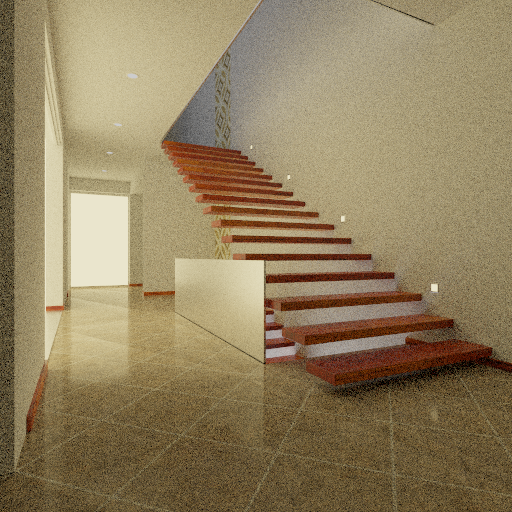

# Cook and capture staircase2

Convert the locally supplied **Modern Hall / staircase2** scene and render it
through Ludus's L6 reference renderer. This native installed-SDK sample selects
**CPU-oracle traversal explicitly**. It produces a complete linear HDR capture;
its PNG preview is a separate, documented display conversion.



Ludus CPU-oracle capture: 512 × 512, 256 samples/pixel, depth four, seed 871.
Preview exposure one; no denoising. Modern Hall by NewSee2l035, CC BY 3.0;
conversion and display changes are described below.

This is a scene-specific offline vertical slice. The private sample bundle
does not itself implement the project workflow. Stage 5 now reuses its converter
inside the installed backend and integrates project-owned assets, saved levels and
the native Editor viewport; see the
[World scene import and saved-document workflow](../architecture/resource-management.md#project-scene-import-and-saved-level-workflow).
The standalone commands below are prototype evidence; they do not provide the
project → scene → import → viewport → save/reopen product workflow.

## Prepare the SDK and tools

Use the [supported native toolchain and SDK workflow](../development/building.md)
and [shader tool bootstrap](../development/tools/shader-probe.md). Install a
Development SDK with the L6 renderer, then set these host inputs:

```bash
export LUDUS_SDK_PREFIX="$PWD/out/install/linux-clang-development"
export LUDUS_SLANG_COMPILER="$PWD/out/shader-tools/slang/bin/slangc"
export LUDUS_SPIRV_VALIDATOR="$PWD/out/shader-tools/spirv-tools/usr/bin/spirv-val"
export LUDUS_SPIRV_CROSS="$PWD/out/shader-tools/spirv-cross/bin/spirv-cross"
```

The sample's selectable configure/build/test profiles are
`linux-clang-{debug,development,release}` and
`macos-clang-{debug,development,release}`. Select the profile matching your SDK.
On macOS, provide `LUDUS_OSX_SYSROOT` and `LUDUS_LIBCXX_INCLUDE` from the prepared
host tools and put its Clang 23, CMake and Ninja on `PATH`. For unbundled local
SDK installs, supply the matching Conan generator directory through an ignored
`CMakeUserPresets.json` extending the selected profile's `CMAKE_PREFIX_PATH`.
Machine paths belong in that local file, never in shared presets. Configuring
reports missing dependencies/tools and does not download or repair them.

From `examples/reference-scene`:

```bash
cmake --list-presets=configure
cmake --list-presets=build
cmake --list-presets=test
cmake --preset linux-clang-development
cmake --build --preset linux-clang-development
ctest --preset linux-clang-development
```

The tests use synthetic geometry; the third-party scene is not required for CI.
They check bounded source encodings, geometry/UV preservation, a complete
reference capture and malformed-bundle rejection. Complete-scene acceptance also
submits 128 independently encoded objects using every admitted mesh/material,
including 127 offscreen objects and a visible tail emitter. It compares optimized
raster pixels with source-order submission, checks all source identities and
triangle counts, checks an unlit object-ID pass, and finishes the capture after
public resource owners detach.
The acceptance driver's negative tests reject missing geometry, bad identities,
changed pixels, incomplete samples and stale/mismatched provenance. Enable
`LUDUS_SCENE_SANITIZERS=ON` to instrument the consumer with ASan/UBSan; its SDK
libraries must separately be built with sanitizers for full engine coverage.

## Convert and render

From the repository root, with the licensed local reference scene present:

```bash
out/build/linux-clang-development/modules/content/scene_cook/ludus-cook cook \
  references/resources/scenes/staircase2 out/staircase2
examples/reference-scene/out/build/linux-clang-development/reference_scene \
  out/staircase2 out/staircase2 256 64
python3 scripts/reference-hdr out/staircase2/capture.luhdr \
  --pfm out/staircase2/capture.pfm --manifest out/staircase2/capture.json
```

The PFM can be viewed with any HDR viewer; the retired `tools/scene_cooker/preview.py`
PNG tone-mapper has been removed with the Python scene tooling.

The final two capture arguments are square pixel extent (1–1024) and samples per
pixel (1–4096). Rendering uses four path vertices, roulette from depth three,
seed 871, the authored 70-degree camera and the authored area emitters with a
black environment. A capture has a 30-minute deadline and requires zero invalid
contributions before publication. It can take minutes on the CPU. Use `64 8`
for a quick framing check before increasing quality.

The output directory must already exist. The cooker creates it; a different
capture destination needs explicit creation. Failed captures preserve the
previous `capture.luhdr`. Exit steps distinguish usage (1), numeric arguments
(2), bundle acquisition (3), device creation (4), renderer setup (5), reference
setup (6), program readiness (7), bundle admission (8), capture creation (9),
completion/deadline (10), contribution validation (11), output allocation (12),
HDR encoding (13), and publication (14).
Acceptance raster setup, accounting, draw, completion or readback failure is step
15. An optional fifth argument, `acceptance`, adds raster/submission evidence to
the CPU capture; `native` requires native ray queries and never falls back.

`manifest.json` records every consulted source file's SHA-256, the bundle hash,
source and cooked geometry counts, camera, attribution and approximations.
`LICENSE.txt` accompanies the converted assets. `scene.luscn` is an explicit
little-endian versioned sample format with bounded counts and finite binary32
fields; it is not a stable shipping asset format. The capture consumer admits
six meshes, eight materials, three textures and up to 128 scene items within a
64 MiB bundle. It rejects unsupported versions, truncation, trailing data,
nonfinite fields and invalid geometry references.

The PFM and LUHDR retain linear radiance. The PNG uses exposure multiplied into
radiance, `x / (1 + x)` compression, then sRGB encoding. It applies no denoising;
finite-sample noise is expected. Never compare that preview against a different
renderer without matching transport, materials, exposure and display transform.

## Conversion profile and limitations

The referenced PBRT scene has 19 room PLY meshes, four planar mesh lights, four
inline rectangle lights and five disk lights. Only referenced files are cooked.
The room surfaces are grouped into four meshes: diffuse, wood, floor tiles and
conductors. Shared quad and disk meshes make six renderer meshes and 17 scene
items. Three retained RGBA8 textures and four emitter colors fit eight materials.
Wallpaper triangles are clipped at repeated UV boundaries before atlas mapping,
so repetition survives interpolation. Wood and tile textures retain repeat UVs.

The local source contains 32,967 triangles after quad triangulation, including
2,432 zero-area room triangles. These contribute no surface area and are counted
and discarded. The resulting profile stores 28,561 triangles and renders 28,831
triangles after instancing the lights. Geometry is not decimated. Planar light
grids become equivalent rectangles; disks use 64 segments.

The converter rejects source directives, parameters and material/texture
profiles it cannot represent. It is deliberately restricted to this source's
PBRT subset, bounded binary little-endian PLY triangle/convex-quad meshes,
uncompressed opaque true-color TGA textures, rigid perspective camera and
identity room transforms. It is not a general PBRT importer.

Material approximations are explicit:

- PBRT coated diffuse becomes L6's RGB GGX/Lambert model, without coating layer
  multiple scattering. Direct GGX alpha is converted to perceptual roughness.
- Conductor eta/k becomes normal-incidence RGB F0 with Schlick angular behavior.
- Diffuse surfaces use the renderer's fixed dielectric F0 of 0.04.
- Textures use one retained mip with bilinear sampling, rather than PBRT's
  trilinear footprint filtering.
- The supplied PBRT material named `Glass` is a **conductor**, so this conversion
  does not introduce glass transmission. The included Tungsten preview can
  therefore differ substantially from the declared PBRT scene.
- L6 surface emission is two-sided; PBRT diffuse area lights default to one-sided.
- Source integrator, sampling and film choices are replaced by the explicit L6
  capture profile above.

## Full prepared-scene renderer acceptance

Use the same cooked bundle and installed sample; this check adds no importer or
new scene format. From the repository root:

```bash
python3 examples/reference-scene/tests/acceptance.py \
  --binary examples/reference-scene/out/build/linux-clang-development/reference_scene \
  --bundle out/staircase2 --output out/staircase2-acceptance \
  --extent 32 --samples 8
```

Add `--native` only on a device exposing the optional native query profile. It
requires a second full capture and compares its raw RGB radiance with the CPU
oracle under identical camera, seed, sample, depth and scene-fingerprint settings.
Unsupported native traversal fails visibly. Configure
`LUDUS_SCENE_NATIVE_ACCEPTANCE=ON` to require the synthetic native parity test in
CTest; the default CPU-oracle tests run on native CI without assuming ray-capable
hardware.

Acceptance verifies all decoded textures, materials, meshes, vertices, stored
triangles and instanced triangles against an independent serialized-bundle walk.
The source-order raster path disables visibility/LOD/batching and must report
every object identity in order. The optimized path must account for each object
as visible or culled, emit unique valid identities, and match its raster bytes
within one RGBA8 code value. Both paths use the same camera, depth and material
profile. These linear, clamped RGBA8 raster images are structural comparisons;
they are not compared against indirect path-traced radiance. An additional unlit
snapshot encodes a distinct RGB identity for every source object, using the same
geometry, transforms and depth. Its source-order and optimized images must also
agree, every nonbackground pixel must name a submitted visible object, and the
visible-object accounting must match the lit views. This checks dark surfaces
without relying on lighting to reveal a missing wall. Both raster and
reference captures must observe nonblack surface radiance, so an empty or wrongly
framed scene cannot pass solely through matching black images.

Every reference pixel must have exactly the requested sample count and zero
invalid contributions before publication. CPU/native parity permits RGB-vector
error at most `0.002 + 0.0001 * max(length(cpu), length(native))` per pixel; the
report preserves maximum and RMS errors. This is a declared correctness tolerance
for the admitted profile, not convergence to the source renderer or an FPS claim.

`acceptance.json` records the selected backend and exposed adapter name, host,
binary and bundle SHA-256, complete
resource/triangle/submission counts, sample settings, artifact hashes and native
parity disposition. If a cooker `manifest.json` exists, its bundle hash and cooked
counts must agree; its source-file hashes, attribution and approximations are
retained in the acceptance report. Each attempt runs in a fresh directory, and
validation failure preserves the previous accepted report and retains the
isolated `attempt-*/` artifacts with a `failure.txt` diagnostic. `acceptance.json` is
published last; consumers must verify its artifact hashes rather than assume the
output files form an atomic filesystem transaction. The retained files are
`cpu/` (and optional `native/`) `capture.luhdr`, `raster-reference.rgba`,
`raster-optimized.rgba`, `adapter-name.txt` and versioned `scene-acceptance.bin`.
The object-ID pass adds `identity-reference.rgba`, `identity-optimized.rgba` and
`identity-acceptance.bin`. `run.json` retains each path's verified observations;
a failed native comparison additionally retains `native-parity.json` with failing
pixel count, maximum/RMS error and the largest error locations.
An empty adapter name is recorded as unavailable, not inferred from the backend.

This stage accepts **all prepared geometry under the explicitly approximated RGB
reflection profile**. It does not establish source-PBRT material fidelity,
general scene-format support, browser traversal, animated geometry, real-time
transport or physical-GPU performance qualification. Unsupported source features
remain converter errors; unsupported prepared material/geometry remains renderer
admission failure. No fixture is simplified merely to turn an acceptance failure
into a pass.

### Recorded acceptance and remaining gap

The [Apple M5 prepared-scene evidence](../assets/renderer/scene-acceptance-metal.json)
records the exact bundle/binary/capture hashes, source attribution and declared
approximations. Staircase2 CPU-oracle acceptance at 64 × 64 and 32 samples/pixel
accounts for all 17 objects, 85,554 vertices, 28,561 stored triangles and 28,831
instanced triangles. Six meshes, eight materials and three textures are admitted.
Both lit and object-ID optimized raster images match their source-order images
with zero byte error. Sixteen objects are camera-visible and one is culled;
occluded objects need not appear in the object-ID image.

The 32 × 32, eight-sample native comparison passes with maximum RGB-vector error
0.000239291 and RMS 0.0000106928. The denser 64 × 64, 32-sample comparison is
**not qualified**: four pixels exceed the unchanged tolerance, maximum error is
0.184945 and RMS is 0.00348437. Diagnostic ray comparisons include near-coincident
primitive choices and near-origin disagreements; their full root cause remains
open. Neither that run nor all resolutions/seeds/native adapters are marked
accepted by the smaller passing fixture. The failing command exits nonzero and
retains its evidence without replacing `acceptance.json`.

Acceptance exposed a separate coordinate-zero self-intersection defect, corrected
by the shared triangle-extent origin allowance described in the
[reference rendering profile](../architecture/renderer-systems.md#reference-workflow-and-frozen-profile).
The shifted-plane transport regression fails with the original calculation and
passes with the correction under the existing radiance tolerance. It does not
close the denser native qualification gap above.

## Attribution

Modern Hall is by **NewSee2l035**, distributed under
[CC BY 3.0](https://creativecommons.org/licenses/by/3.0/), originally shared on
[BlendSwap](http://www.blendswap.com/blends/view/51997) and obtained from
[Benedikt Bitterli's rendering resources](https://benedikt-bitterli.me/resources/).
Preserve the supplied license and attribution when sharing cooked assets or
renders; disclose conversion and display changes.

Thanks to Matt Pharr, Wenzel Jakob and Greg Humphreys for the
[pbrt-v4 input format documentation](https://pbrt.org/fileformat-v4), especially
camera transforms, graphics-state scopes, materials and shapes. The converter
is original code, with no PBRT implementation copied.

For interactive placement and gameplay fields use the single
[World authoring workflow](../development/editor-workspace.md#project-owned-3d-levels-and-reference-import).
The command-line level conversion/capture remains a runtime asset pipeline,
not a separate editor workspace. Existing `.lulevel` files open in World through
the documented conversion path.

## Interactive raster viewport acceptance

The installed consumer accepts `reference_scene INPUT OUTPUT SIZE 2 viewport`.
It loads the supplied cooked scene and its camera, renders two ordinary raster
frames through `RasterViewport`, and exports `viewport.rgba` for offline evidence.
It never enables reference capture or requires compute/ray queries. That file
contains top-left RGBA8Unorm **sRGB-encoded tone-mapped RGB**; the consumer must
preserve display values without encoding again. The independent emitter fixture checks authored .5 emission
maps to 156/255 after Reinhard/sRGB. This mode supplies no indirect transport, invented
lights or CPU image presentation fallback.

The native renderer viewport regression changes the extracted World snapshot's
material and camera while keeping an earlier image leased, checking changed
pixels, culling, retained-image immutability, backpressure and stale rejection.
A real editor must feed the selected project's current World extraction into
`Update`, respond to scene/camera/resize changes, and import the completed image
through the RHI/Qt native-sharing bridge. The offline consumer proves the
installed renderer API; it does not prove editor integration. See the
[interactive viewport contract](../architecture/renderer-systems.md#interactive-world-viewport).

## GPU preview acceptance

This is the explicit optional progressive path-tracing reference mode, distinct
from the primary interactive raster viewport above.

The installed sample also accepts `gpu` as its optional mode. This selects the
renderer GPU-compute BVH path, requires compute capability and preserves authored
emissive lighting with a black environment. It performs GPU tracing, shading,
accumulation and display conversion and returns a leased RHI texture. CPU setup
builds, packs and uploads the static scene; it does not trace or shade pixels.

```bash
examples/reference-scene/out/build/linux-clang-development/reference_scene \
  out/staircase2 out/staircase2 64 32 gpu
```

Offline acceptance writes `gpu-preview.rgba` (top-left opaque RGBA8, exposure one,
Reinhard then sRGB) and `gpu-preview.bin`: little-endian width, height, completed
samples and reserved zero as four uint32 values, then two uint64 scene fingerprint
words. This sample deliberately reads back its final leased texture to export
acceptance evidence. A live viewport must share that texture through RHI/Qt with
producer and consumer completion, without running this export. GPU preview failure
is exit step 16. Failed execution never selects the CPU reference renderer.

The source profile and approximation limits above still apply. Numerical failure
is a magenta error pixel; the completed-dispatch count does not assert radiance
validity. `scene_gpu_preview` tests the installed shaders/API using an independently
encoded emitter fixture with no added lights and verifies the expected display
pixels. Dense-scene accuracy and additional GPU backends require separate
qualification. See the [GPU preview contract](../architecture/renderer-systems.md#gpu-resident-progressive-preview)
for budgets, capability rejection, ownership and external-consumer requirements.

## Surface fidelity profile

The [material and lighting fidelity contract](../architecture/renderer-systems.md#material-and-lighting-fidelity)
extends renderer-authored materials with a packed linear normal/roughness/metallic
map, and admits authored analytic lights in GPU reference rendering. The current
LUSCN scene fixture still supplies its declared constant metallic/roughness and
base-color textures; this renderer change does not reinterpret source PBRT materials
or add map fields to the interchange format. Captures produced now use reference
profile version 2. Historical evidence above retains its recorded version;
acceptance compares captures from the same profile and current binary.

## Full static Sponza and SunTemple acceptance

The authored/HDR renderer acceptance uses the supplied main Sponza glTF and
SunTemple FBX under `references/resources`. Its optional fixture adapter is
**test tooling**, independent of the installed scene importer. It never downloads
assets or executes supplied `.pyscene` files. Fixtures, manifests and images stay
in ignored `out/`; the original supplied resources are read-only.

Prepare fixtures with NumPy, Pillow and Assimp 6 installed on the acceptance host:

```bash
python modules/graphics/renderer/tests/prepare_resource_scenes.py \
  --resources /absolute/path/to/references/resources \
  --output out/resource-acceptance \
  --assimp /absolute/path/to/assimp \
  --assimp-library /absolute/path/to/libassimp
```

Assimp exports SunTemple's geometry/material bindings to a private glTF fixture;
its C API supplies the authored FBX camera and 13 lights omitted by that export.
The adapter preserves their transforms and RGB intensities, interpreted under
Ludus's lux/candela and bounded attenuation profile. Point/spot range is explicitly
one million meters for this FBX acceptance profile. It applies the source
`SunTemple.pyscene`'s documented 1000× emissive factor adjustment without running
the script. DDS DirectX normal Y is converted; roughness and metallic come from
the source ORM G/B channels. The supplied FBX contains no tangent/bitangent layers,
so it uses the declared UV-derived fallback. Static base transforms are captured;
its animation is outside this acceptance.

Sponza retains its authored tangents, colors and UV sets. One degenerate tangent
vertex is recorded in the manifest and explicitly marked unavailable; no vertex
or triangle is dropped. Its 24 glTF punctual lights have authored zero intensity;
acceptance retains those zeros. Its supplied HDR environment supplies illumination.
The camera is an explicit interior acceptance rig because this glTF supplies no
camera. Both scenes retain every primitive, material and mesh instance, with
texture dimensions explicitly capped at 512 for this bounded acceptance profile.
Source AO is not applied to reference transport; this test does not establish
physical transmission, layered-material fidelity or shadow/GI agreement with the
original authoring renderer.

Build `ludus_renderer_render_tests` with the normal prepared native toolchain.
Run the hidden, private-resource test once per fixture:

```bash
LUDUS_RESOURCE_SCENE_FIXTURE=out/resource-acceptance/sponza.rscn \
LUDUS_RESOURCE_SCENE_OUTPUT=out/resource-acceptance/sponza.ppm \
  /absolute/path/to/ludus_renderer_render_tests '[.resources]'
LUDUS_RESOURCE_SCENE_FIXTURE=out/resource-acceptance/suntemple.rscn \
LUDUS_RESOURCE_SCENE_OUTPUT=out/resource-acceptance/suntemple.ppm \
  /absolute/path/to/ludus_renderer_render_tests '[.resources]'
```

The fixture is a private little-endian test format, not an engine interchange
format. At 256×256, acceptance compares ordinary culling/batching/clustered-light
execution with source-order, unculled, direct-light-list execution. It requires
all submitted items to be accounted for, no dropped admitted lights, nonblack
output, no magenta error pixels, and no pixel differences greater than one byte.
The output manifest reports actual geometry counts, source/fixture hashes,
attribute coverage, HDR dimensions/range and conversion limits. Image metrics
include renderer/RHI requested or known peak bytes and setup/frame-plus-readback
wall time; these timings are diagnostics, not steady-state frame-rate claims.

| Full static input | Primitives / instances | Materials | Stored vertices | Instanced triangles |
| --- | ---: | ---: | ---: | ---: |
| Main Sponza | 405 / 405 | 28 | 2,049,137 | 3,747,018 |
| SunTemple | 1,056 / 1,056 | 48 | 550,165 | 606,376 |

SunTemple's triangle count also agrees with independent Assimp FBX inspection.
Both supplied environments are 4096×2048; Sponza's maximum source radiance is
125,952 and SunTemple's is 2,880. The renderer's scaled binary16 storage preserves
these source ranges for lighting; reference transport retains the original HDR.
Regular CI exercises small authored-input/HDR fixtures and CPU/GPU reference
convergence without depending on these separately supplied assets. Full-scene
acceptance here is **raster acceptance**; it does not qualify large-scene native
ray-query parity or GPU path-tracer capacity.
